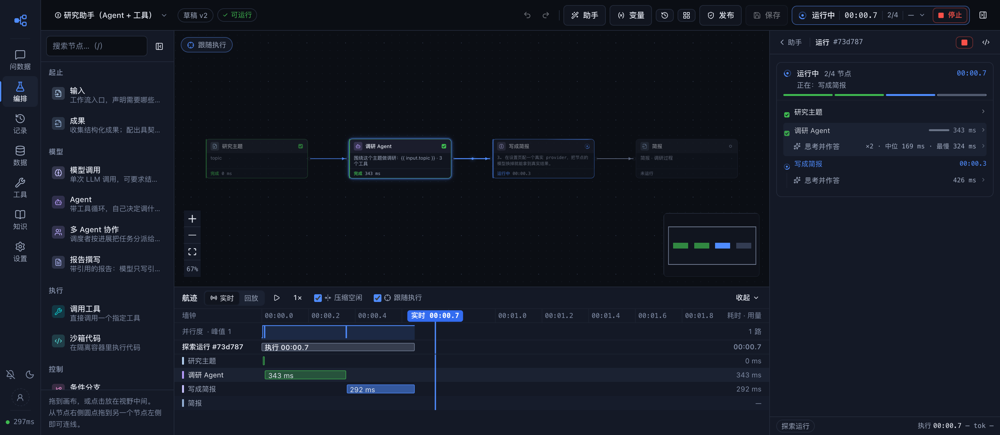
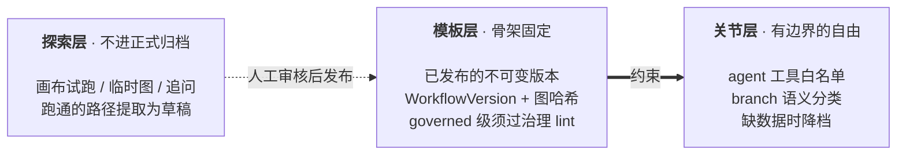
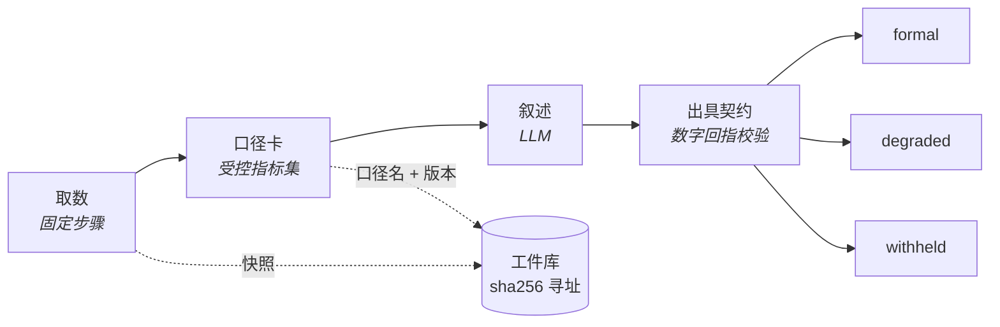
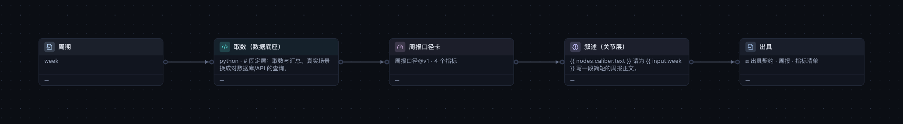
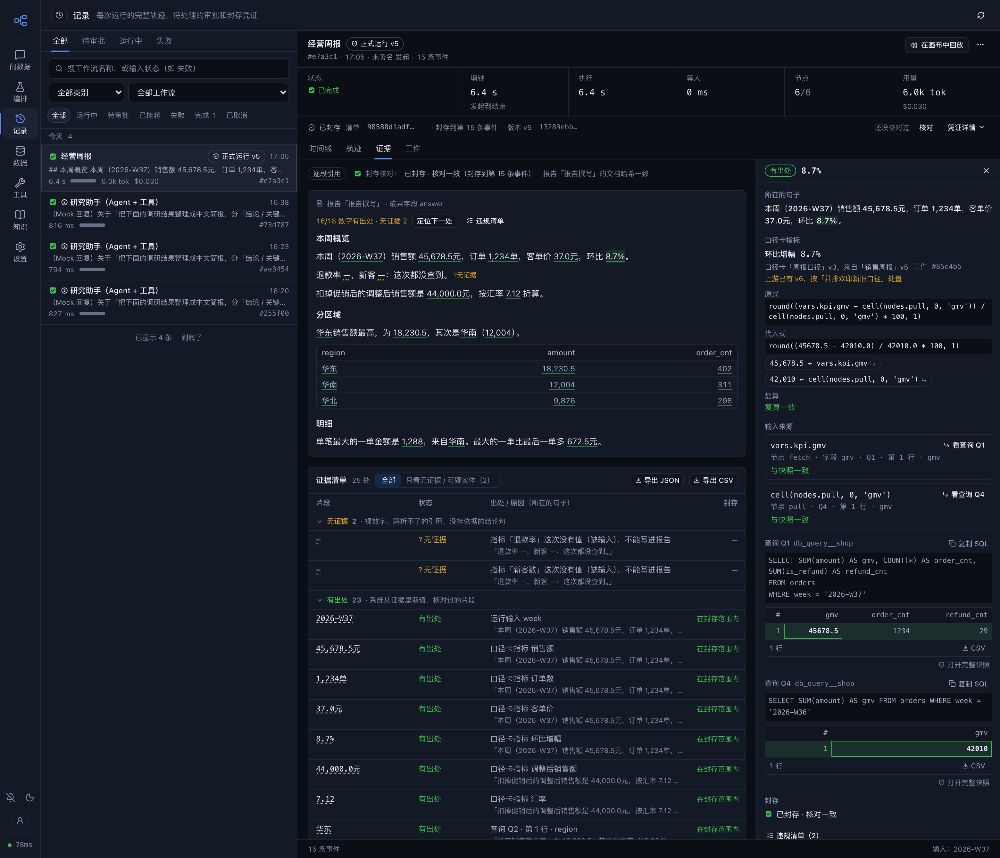
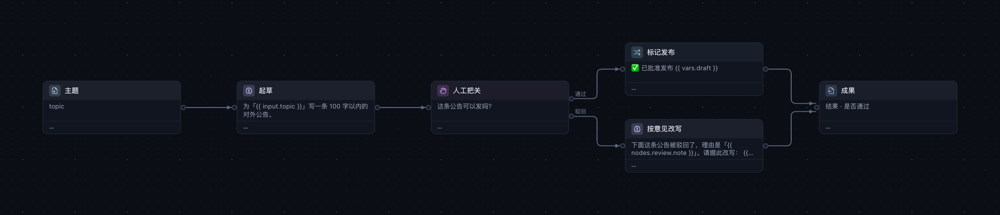
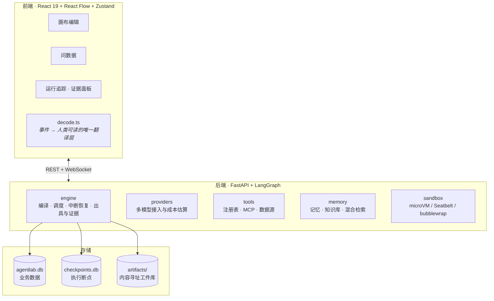

# AgentLab

**可视化 Agent 编排实验台**——在画布上定义工作流，运行时逐节点观察执行过程，
并对产出施加可验证的约束。

面向通用场景的**受限动态编排**：模板定义骨架，agent 只在被授权的关节处自由。
所有算术下沉到受控指标集，叙述层无权创造数字——报告里的数字由系统照快照填值，
每一个都点得开出处；正式运行钉死在不可变版本上，每一次执行的完整证据落进内容寻址的工件库。



<sub>研究助手模板用 Mock 执行中：跑完的节点打勾，执行中的节点显示耗时和流式输出；
底部航迹是实时时间轴，右栏是同一份事件流驱动的运行步骤。</sub>

---

## 目录

- [快速开始](#快速开始) · [生产部署](#生产部署) · [核心能力](#核心能力) · [受限动态编排](#受限动态编排模板定骨架agent-填关节)
- [可点击证据](#可点击证据报告里的每个数都点得开出处) · [应用](#应用已发布版本的使用面) · [身份与权限](#身份与权限) · [能力登记与端点](#能力登记与端点)
- [数据目录](#数据目录让助手和-agent-看懂业务数据) · [工作流形态](#工作流形态) · [节点类型](#节点类型) · [架构](#架构)
- [关键设计决策](#关键设计决策) · [运行环境](#运行环境) · [常见问题](#常见问题) · [开发与验证](#开发与验证)

---

## 快速开始

环境要求：conda（[miniforge](https://conda-forge.org/miniforge/) 即可）、Node 20+、pnpm。
**无需 Docker**——代码沙箱基于操作系统自带的隔离原语，可选升级至 microVM。

```bash
conda env create -f environment.yml   # 首次：创建 agentlab 环境并安装依赖
./scripts/dev.sh                      # 之后：一条命令启动前后端
```

`dev.sh` 自动定位 `agentlab` conda 环境；环境不存在时依 `environment.yml` 创建。
如需使用其他环境名，设置 `AGENTLAB_CONDA_ENV`。
后端依赖的版本以 `backend/requirements.lock` 为准，装到的是测试跑过的那一套，
不是当天的最新版（见[依赖与锁文件](#依赖与锁文件)）。

服务启动于 http://localhost:5273 。

要让同一网络里的手机、别的电脑打开，用 `./scripts/dev.sh --host`：前端监听所有网卡，启动时打印局域网地址；
后端仍只听 127.0.0.1，页面里的 `/api` 由前端开发服务器在本机转发。**默认不开登录**：同一网络里打得开页面的人
都能用全部功能——跑工作流、花你配的模型额度、读数据源、执行沙箱代码，审批和发起记的是各自填的署名、未经核实。
只在信得过的网络里这样用；多人使用请开登录，见[身份与权限](#身份与权限)。
认不出的参数直接报错，`./scripts/dev.sh --help` 看用法。

**无需配置 API Key 即可完整体验。** 内置 Mock provider 产出流式回复、工具调用与
符合 schema 的结构化数据，编排链路（画布高亮、审批中断、沙箱执行）会完整走一遍。
接入真实模型请在「设置 → 模型接入」配置。启动时若环境变量中存在
`ANTHROPIC_API_KEY` / `ANTHROPIC_AUTH_TOKEN` / `OPENAI_API_KEY`，将自动导入为 provider。
Mock 不会写引用标记：探索运行里报告撰写节点照样跑完，但里面的数字全标成「无证据」，
要看到逐段可点的出处得接真实模型。

内置 9 个模板，从「最小问答」到「可追溯周报」，既可直接运行，
也是各类节点用法的可执行文档。

---

## 生产部署

**不用 Docker：** `./scripts/prod.sh` 构建前端并由后端一并托管页面，单进程、不热重载，启动于
http://127.0.0.1:8000 。前端产物不存在或比源码旧时才重新构建，`--build` / `--no-build` 强制构建或跳过。
`--port`（或 `AGENTLAB_PORT`）改端口；`--host` 监听所有网卡，默认同样**不开登录**，多人使用请开登录
（[身份与权限](#身份与权限)）。
数据目录默认为仓库下的 `data/`，`AGENTLAB_DATA_DIR` 可改。只能单进程运行：运行管理器在进程内、数据库是 SQLite。
上传表格的版本存储同样只支持单进程运行（不要给 uvicorn 加 `--workers`）：启动时会锁住数据目录，同一个数据目录
起了第二个进程时，后起的那个不做任何清理，上传、启用版本等写操作一律返回 503。
按期累积的数据源每个历史版本是一份完整副本，磁盘占用随期数和被引用的版本数增长。除当前版本和被运行引用的
版本外，每个数据源再保留最近启用过的 3 个版本，其余的会被回收、无法再启用。

**Docker 离线包：** `./scripts/package-docker.sh` 构建 Linux 镜像（默认取本机架构，目标机不同时用
`--platform linux/arm64` 或 `linux/amd64`），连同一键部署脚本、配置模板和部署说明打成
`release/agentlab-<版本>-linux-<arch>.tar`。拷到只装了 Docker Engine 的离线机器上，解包、按需修改
`agentlab.env`、运行 `./deploy.sh` 即可，不需要 docker compose。安装、升级、备份、沙箱权限与常见问题见
[deploy/README.md](deploy/README.md)。

镜像里默认带 microVM 的运行时和沙箱镜像（约 150 MB，`--no-microvm` 可不带）。目标机有 KVM 时，deploy.sh
先用临时容器试启动一台 microVM，起得来就把 `/dev/kvm` 交给容器，代码在 microVM 里执行，部署时不用联网。
没有 KVM（Mac、Windows 上的 Docker Desktop，多数云主机）时，默认权限下代码沙箱退回本地子进程，隔离边界只有容器本身。


**从旧版本升级（应用平台）**：升级后第一次启动会自动做几件事，都幂等：

- 存量的待审批补建成待办；自定义工具的请求头、MCP 的环境变量里的明文加密一遍；能力登记同步一遍。
- 记级别之前发布过、有正式运行凭据的老版本补记为「已发布」。子工作流、口径卡固定的版本须已发布且未退役，没有凭据
  的老版本被固定着时，正式运行会被拒绝，按提示改为固定一个已发布的版本。
- 指向本机或内网的 http MCP 服务，自动登记一个开了内网访问的端点（`mcp-<服务名>`）并绑定，写审计。之后新建的内网
  MCP 要管理员先在「工具 → 端点」登记。
- `/api/copilot/generate` 改图时只出改动操作，不再是整张新图；每次运行多一条 `run.origin` 事件（在封存范围内）。

**从旧版本升级（2026-10 下一轮第 1 波）**：有几处行为变化会影响现有部署：

- 人工驳回（审批、动作确认、填写、代码和工具审批、双盲复算）的运行记为「已取消 · 被驳回」，不再算失败：通知走「实例
  结束」，定时任务推「未出具（被驳回）」，不能继续运行。配了失败重试或「出错时继续」的关卡，驳回不再重问、也不接着往下走。
  已封存的老运行不改写。
- 开了登录时，应用入口和待办表单里的选人控件按候选池核对（缺省是能用这个应用的人），池外的名字回 422（`principal`）。
- 页面默认只能被本站嵌入（`frame-ancestors 'self'`，另加 `X-Frame-Options`）。已经用 iframe 嵌 AgentLab 的门户，
  在 `AGENTLAB_FRAME_ANCESTORS` 里写上门户的地址。
- 「对外访问地址」只剩一个设置（「设置 → 通用」；`AGENTLAB_PUBLIC_URL` 优先，写错了启动就报错）。设置里填了地址的部署，
  OIDC 回调改按这个地址拼，和身份提供方登记的不一致时要去改登记。开了登录时 `/docs`、`/openapi.json` 要搭建者登录。
- 探查结构时列类型改存各数据库的完整写法（`VARCHAR2(20 CHAR)`、`ENUM('a','b')`）：升级后每个数据源点一次「探查结构」。
  新运行的表结构快照哈希会变，旧运行不受影响。MySQL / MariaDB 上文字列的剖析说明多一句排序规则，ENUM 列补上数据里没出现的
  取值，日期列写明排除了几个无效日期，所以升级后第一次重新剖析，这些表的目录各升一次版本。剖析设置的「抽样键值数」改叫
  「核对键值数」（`DISTINCT … LIMIT` 取的不是随机样本）。

**从旧版本升级（2026-10 下一轮第 2 波）**：

- 探查结构改成后台任务（和同一个数据源的起草、剖析排队）。升级后每个数据源点一次「探查结构」，建立对象索引；老的表结构
  在探查读完之前原样保留。超过 500 张表、又没设探查范围的库，第一次探查会被拒绝并说出命中了多少张，要先在「探查范围」里
  设规则或调高上限（最多 2,000）。正式探查不再接受 `?schema=` 临时换 schema（一个数据源一个 schema），预览照旧可以。
- 运行时的 `db_schema__` 不传表名时只列前 50 张，并说清另有多少张；可以用 `keyword` 检索，点名探查范围外的表会当场读结构、
  加进范围（每次运行最多 8 张，留痕）。
- 探索运行封存后会在后台比对已发布的口径，追加一条封存后事件 `ledger.matched`：时间线、可验证报告的「封存后追加」里
  多出这一条，不在封存范围内。启动时补比最近 7 天的运行，跟着 `AGENTLAB_SCHEDULER` 开关。
- 报告导出和可验证报告下载各记一条审计 `report.exported`。问数据发起的运行带上所在对话和轮次（`origin_ref`），
  「在画布里打开」建的工作流记下来自哪一轮。

**从旧版本升级（2026-10 下一轮第 3 波）**：

- 探查结构时每张表记一个结构版本，和上一次读到的结构比：加删列、改类型、改可空、改注释、主键 / 唯一约束 / 外键的增删
  记进数据源的变化记录（疑似改名只说「可能是改名」，不下结论）。升级后第一次探查每张表只建基线、不出变化。从发布版本发起
  的正式运行，这一版引用的表结构在发布之后变了时，运行里多一条「表结构变化」提醒（`schema.drift`，在封存范围内）。
- 剖析多了取值观察：行数、码值分布（包括人工确认过的码值列）、最新业务日期、最近 35 天每天的行数，和同一口径的历史比出
  新码值、比例剧变、断档、缺天、量跌、行数大起大落。只在剖析范围是「取值观察」或定时维护时做。标了「已列全」的码值表出现目录
  里没有的取值时，系统撤销「已列全」（目录升一版），这是机器唯一会写进目录的事；新取值的含义仍要人填。遮罩列不观察。
- 数据源可以设定时维护（探查 → 剖析需要的表 → 取值观察，可多选），就是一条目标为数据源的定时任务，缺省没有。定时任务的
  目标也可以是评测题集。这两种目标不收 Webhook（回 422），通知走「设置 → 通知」的渠道订阅。
- 变化记录、评测、口径出具与对账这一波只有接口（`/api/datasources/{id}/changes`、`/api/evals/…`、
  `/api/ledger/answers/{run_id}/…`），界面随下一波上线。
- 问数据的答案整题等价于一份已发布的受管口径时（SQL 被证明等价、版本受管、图里没有人工节点和写入），系统按口径自动发起
  一次正式运行，来源记为「按口径正式出具」。「设置」的 `ledger` 一组可以关掉自动出具（`auto_issue`），自动和一键合计每天最多
  20 次。画布试跑、个人应用刷新这类不是问数据的答案不自动出具。
- 应用视图、趋势、分享链接、视图数据接口取「最近一次封存」时，只认定时任务、应用入口、按需视图、画布或版本页上的「正式运行」、
  入站钩子和访问密钥发起的正式运行；按口径出具、补算出来的运行不会顶替看板上的数。
- 开了登录时，使用者能读原始运行记录、事件和实时流的，只剩自己的问数据运行；别的运行（包括替他发起的口径对账）经应用页
  和证据接口读，展示的 SQL 里写着的遮罩值换成「已遮罩」。
- 通知多了邮件：管理员在「设置 → 通知 → 邮件服务」配 SMTP（口令加密存），之后可以建邮件格式的渠道。邮件只确认交给了邮件
  服务器，退信不追踪。每天的待办汇总按 `notify.digest_at`（缺省 09:00，服务端时区）发给订阅了它的个人渠道；访问密钥到期前
  7 天、1 天各提醒一次。关登录时这两项都不发。
- 分享链接（只读、不用登录的视图页）缺省关，见[分享链接](#分享链接)。

---

## 核心能力

| 领域 | 能力 |
|---|---|
| **可视化编排** | 18 种节点拖拽连线；运行时节点实时高亮、边上光点流动画、卡片内直接呈现流式 token；底部航迹把各节点的起止和并行度排在一条时间轴上，实时和回放共用；多 agent 节点在卡片里展开协作矩阵（谁在跑、几个人并行、省下多少） |
| **对话式取数** | 「问数据」页：自然语言提问，系统自行接入数据源、生成工作流、执行并给出结论；答案里有数字时经报告撰写节点输出、逐段点得开；对话持久化、可分享链接 |
| **多模型接入** | Anthropic / OpenAI / 任意 OpenAI 兼容服务（DeepSeek、Kimi、通义、智谱、硅基流动、Ollama 等）+ Mock |
| **工具链** | 15 个内置工具 + 自定义工具（HTTP 模板 / 沙箱 Python）+ MCP server 接入；MCP 与自定义工具默认每次等审批，可逐个改成门控模型把关或始终允许 |
| **能力登记与端点** | 所有可调用的工具登记在一处，逐项治理读写效果、审批、字段语义、遮罩；外部系统按测试 / 生产两个环境登记成端点，只有登记的端点能连内网，认证头加密；端点读回的表格和查询快照一样能作证（[详见](#能力登记与端点)） |
| **Agent 护栏** | 同样的调用不重复执行、连续拿不到新信息就收尾、令牌与金额预算、上下文接近窗口先压缩再收尾；步数只留兜底（默认 100） |
| **代码沙箱** | 双档隔离：系统沙箱（Seatbelt / bubblewrap，冷启动约 25ms）或 microVM（独立 Linux 内核，内存限额真实生效） |
| **人工介入** | 执行暂停并落盘，人工批准 / 驳回 / 改稿后从断点继续；进程重启不丢状态；可派给岗位、发起人或按表达式算出的人，会签（任一人 / 全体同意，一票否决 / 至少 m 人），设时限，超时提醒、升级或驳回，永远不会自动批准；驳回是人的决定，运行记为「被驳回」，不算失败、不重试 |
| **断点续跑** | 失败的运行可从失败节点继续，已完成的节点不重复执行；探索运行允许修改节点配置（拓扑必须一致），正式运行固定在发布的版本上、不能改配置后继续；继续运行不改发起人 |
| **知识库** | 向量 + BM25 混合检索、倒排索引、可选模型重排；PDF / Word / PowerPoint / HTML / Markdown 解析；向量模型可接本地端点 |
| **表格入库** | Excel / CSV 上传后转为可用 SQL 查询的表，自动生成 `db_query__<name>` 工具——数字由 SQL 计算得出，而非模型读取；复杂报表按取数配方导入（CSV 同样可以），每月一份的明细能按期累积成一张表，夹在明细中间的小计核对后不进数据 |
| **数据目录** | 给数据源的每张表记下粒度、业务主键、业务日期、有效记录条件，每个字段的含义、单位、度量类型和码值，以及表与表的关联；由外键、命名推断、数据剖析和模型起草，逐项确认后生效；表详情里可以和助手对话完善一张表，审阅队列按影响排好先审哪些，目录能导出、导入到别的实例；助手建图、agent 查结构、SQL 检查都读它 |
| **SQL 检查** | 按数据目录检查一对多关联后重复计算、存量跨时间相加、比率被相加等七类问题；助手自查时交回修正，受管模板发布时挡住，运行时标在查询结果上、契约指标降档 |
| **跨库合并** | 合并查询节点：各库先聚合到同一个键，再在库外按键合并；截断的输入拒收，证据一路追到两边的原始查询 |
| **长期记忆** | 跨运行的记忆读写与自动去重；Copilot 建图时主动记录应当记住的事实 |
| **Skill 管理** | 将方法论抽象为可复用单元，挂载到节点上注入 system prompt |
| **自然语言编排** | 助手：一句话生成或改写整张图，自动排版；system 里每个数据源只给一行概览，要看表结构、能力参数、工作流版本时由助手自己「查看」，一次给齐字段、目录和连接条件；交付前按运行时同一套规则自查，查出会运行失败的问题先交回去改，改不好就不自动运行（[详见](#助手按需查看)） |
| **结构化成果** | JSON Schema 校验，不合格时将错误回传模型自动返工 |
| **产出复核** | 运行结束后规则扫描事件流，发现异常才调用模型复核；复核可重组答案但**不得引入原答案中不存在的数字** |
| **追踪与成本** | 全量事件落库可回放；逐节点耗时、token 用量、按目录价折算的成本；问数据每一轮的花费含助手建图、挑表和复核 |
| **三档出具** | 口径卡（受控指标集）+ 出具契约：叙述中每个数字回指指标集，或由报告撰写节点按引用逐段核对，formal / degraded / withheld 三档判定 |
| **可点击证据** | 报告撰写节点只写引用标记，数字和表格由系统照快照填值；数字、表名字段名、知识库原话都点得开，一路指到查询结果里的那一格；结论句可要求挂依据或交给另一个模型裁判；证据清单可导出，报告导出为自包含 HTML（数字点得开口径与出处），另有封存哈希核对件「可验证报告」 |
| **发布前检查** | 受管级别加证据门禁 G1–G5；问题给出一键修复 / 选项 / 交给 Copilot 三类修法，一律先预览、不许降低要求；老工作流一键升级为可追溯结构 |
| **正式 / 探索分级** | 正式运行只从已发布、未退役的不可变版本发起（按图哈希固定），子工作流、口径卡固定的版本同样须已发布且未退役；画布试跑自动标记为探索性；每次运行记下来源（问数据、画布、定时任务、应用入口、外部系统……），进封存范围 |
| **应用** | 已发布工作流的使用面：从版本确定性派生出入口表单、视图、待办和动作，助手只润色布局和文案；视图只读封存的运行，每个数点得开出处，印章写明截至何时、哪版口径、出具档位；待办箱、实例进度、写外部系统的确认与对账（[详见](#应用已发布版本的使用面)） |
| **身份与权限** | 默认不开登录；可开本地账号或通用 OIDC 单点登录，管理员 / 搭建者 / 使用者三种角色加应用级授权，管理操作留审计；开登录后使用者看到的数据一律遮罩（[详见](#身份与权限)） |

---

## 受限动态编排：模板定骨架，agent 填关节

大多数实际任务的步骤是已知的（写周报、核对数据、审批后发布）。让模型每次现场重新规划，
既是在重复发明已知答案，也使结果不可复现——而不可复现即不可验收。

AgentLab 的引擎是**编译式**的：运行时模型无法修改图结构，其自由被结构性地限制在
agent 节点内部与 branch 决策之中。在此基础上划分三层：



- **模板层**　正式运行只认已发布的不可变版本。发布后修改画布不影响已发布版本。
  governed 级发布须通过治理 lint：禁用 supervisor（全动态归属探索层）、方法卡必须钉版本、
  agent 不得关闭全部审批、output 必须配置出具契约，另有证据门禁 G1–G5
  （见[受管门禁与发布前修复](#受管门禁与发布前修复)）。
- **关节层**　授权范围内的自由。工具白名单衰减报表（`/api/governance/tool-usage`）
  将「已授权但从未使用」的工具显性化，为收缩权限提供依据。
- **探索层**　结果自动标记为探索性，不进正式归档。跑通的路径经「提取模板」沉淀为草稿
  （仅保留实际执行的节点，剪除未走的分支），人工审核后发布。探索问题聚类提示哪些追问
  应当固化为模板中的一节。

### 出具链路

模板⑧是最小示范：叙述由模型调用节点写，出口按数值回指。模板⑨把叙述换成报告撰写节点，
数字按引用填值（见[可点击证据](#可点击证据报告里的每个数都点得开出处)）。两者的设计前提都是
**派生边界收死**：所有算术发生在口径卡节点内，叙述层只能引用。





校验器从叙述中抽取全部数字逐个回指指标集，支持千分位、百分数与比率互转、千/万/亿后缀、
按书写精度的舍入容差；日期、枚举序号、引用标记不参与回指。三档判定与缺数据声明随成果印出。

中文数字同样回指——否则换一种写法就绕过去了（"增长三成、客户两千五百家"以前能盖 formal 章）。
成、倍、百分之、分之、一半按比例回指，"两千余"按区间 [2000, 3000] 回指；"一个问题""十分重要"
"从三个方面看""三季度""几十家"这类虚指、序数、季度名、结构性列举不算结论数字。

实测记录：Opus 5 撰写的正文数字全部回指成功，但结尾「（约 100 字）」中的 `100` 被判定为
集合外数字并触发降档。处置方式是修改 prompt 而非扩大白名单——这正是校验器应有的行为。

**口径升版是被迫处置事件。** 钉住的方法卡出现新版本时，正式运行将被拒绝启动，
直至模板显式声明升版策略：`recompute`（回算历史）/ `dual`（双印）/ `incomparable`
（标注不可比）。此处无默认值——口径变更最容易静默翻车的形态是「数字看起来都对，
只是与上周不可比」。

每次运行的完整证据存于内容寻址的工件库（`data/artifacts/`，sha256 即地址，取回时复验哈希）；
运行终态的事件清单哈希记录在 Run 上（封存到 `run.finished` 为止），事后修改流水将无法对齐。
运行详情页一键核对，接口是 `GET /api/runs/{id}/verify`；封存之后追加的事件不在核对范围内。

---

## 可点击证据：报告里的每个数都点得开出处

按数值回指只能在出口回头猜出处，同值的指标一多就猜错。可点击证据把核对挪到写的那一刻，
出处直接写进报告的数据结构里。



<sub>记录页的「证据」页签：点开「环比 8.7%」，右栏从口径卡的原式、代入式一路指到两次查询里被引用的那一格，
末尾是封存核对；左下是证据清单。Mock 写不出带引用的报告，这次运行用前端测试夹具
（`frontend/src/run/__tests__/evidence-query.json`，示例数据）伪造，列表里其余几条是 Mock 真跑的。</sub>

**引用即渲染。** 报告撰写节点（`report`）里模型只写引用标记，数值由系统照快照填进去：

```
[[m:gmv]]  [[m:gmv|万]]                    口径卡指标；换算显示也由系统完成
[[i:week]]                                 运行输入
[[v:Q1.r0.gmv]]                            查询快照里的一格，取回时复验哈希
[[table:Q1 cols=region,amount rows=0-4]]   系统照快照生成整张表，每一格都点得开
[[t:orders]]  [[c:orders.week]]            表名、字段名；写在反引号里的名字同样核对
[[q:K1|原话]]                              知识库原话，须在那次检索命中的片段里逐字出现
[[see:m:gmv,Q1]]                           结论句的依据，挂在句末，不渲染
```

流式输出里看到的就是最终数字。裸数字、解析不了的引用当场判违规、交回去重写（`max_repairs`，默认 1 次），
仍不过关时按 `on_violation` 让节点失败（正式运行默认）或把违规标在报告里（探索运行默认）。
出具契约写了 `report_from` 就按引用核对：取回报告文档时复验哈希、独立重算一遍，全部带引用才判完整出具。
纯指标看板（契约只写 `metrics_from`，上游没有报告撰写节点、成果里也没有模型写的话）按**指标出具**：没有叙述可核，核的是指标本身——必需指标齐不齐、每个指标的输入是否追到原始数据（查询快照的格、运行输入）、成果字段里的数是否都回指到指标；受管级要求每个指标都静态地追到原始数据。

**取数链路。** agent、工具节点、代码节点、知识检索取数时都记进证据台账，报告目录按台账编出 Q1… / K1…。
口径卡表达式可以写 `cell(nodes.pull, 0, 'gmv')`，出处精确到单元格。agent 开 `cite_fields`（配合 `output_schema`）
后，每个字段标出取自哪次查询的哪一格，再到快照里核对：对不上以快照为准并告警，查不到的记为空值，不兜底成 0。
代码节点分 `evidence_role`：`source` 是取数，`compute`（默认）是计算——沙箱算出来的数不能被报告直接引用，
要进口径卡。数据源可设 `mask_columns` 遮罩列（只减少暴露，不是安全边界）。

**点开看到什么。** 数字：指标的原式、代入式和复算结果，输入与快照是否一致，查询的 SQL、被引用的行加前后
各 2 行、高亮到格，最后是封存状态；只认封存范围内的事件交回过的工件。上传表格的单元格可以追到原表格子
（推断的来源）。表名、字段名：出现在哪次查询、类型、
所属的表。表结构快照、SQL、结果列里都没有的名字标成可疑实体（「可能是编造的名字」，附最接近的 3 个）；
快照被截断、核对不了的只说核对不了，不冤枉成编造。

**结论句。** 报告节点的 `claims`：`off`（默认）不管；`require_citation` 要求结论句挂依据，没挂的计入缺口；
`judge` 再请另一个模型按证据逐句判为支持 / 部分支持 / 不支持 / 不是结论，只标注、不改写正文，裁判模型和
写作模型相同时给警告。正式运行在节点内判，判定随报告一起封存，不支持的按 `on_unsupported` 降档或不予出具；
探索运行点开哪句判哪句，判定作为封存之后追加的事件记下，封存核对照样一致。每份报告的句数、金额、时长，
每次点击的金额，每天的总金额都有上限（默认 40 句、$0.05、30 秒，每次点击 $0.01，每天 $2），每一项都能设成不限。

**审计与旧运行。** `GET /api/runs/{id}/evidence/audit` 按无证据 / 可疑实体 / 有出处 / 旧运行猜测分组，
可导出 JSON 和 CSV。没有契约的旧答案按数值和已封存的查询单元格、口径卡值比对，每个数最多 3 个候选，
默认折叠，写明「猜测的来源，不能当证据」。老工作流可以一键升级为可追溯结构：模型调用写的报告换成报告撰写节点，
问数据的 input → agent → output 中间插一个报告撰写，配了 `output_schema` 的 agent 打开 `cite_fields`；
沙箱代码喂口径卡的只建议标成 `source`，不替人改。升级只给预览，人确认后才保存。

**导出两份。** 问数据答案和运行详情成果上的「导出」把报告导出成一个自包含的 HTML 文件
（`GET /api/runs/{id}/report.html`）：正文由服务端渲染，不执行脚本也读得到（邮件附件预览常常不执行脚本）；
执行脚本后每个数字、无证据的数字、可疑的表名字段名都点得开——面板是网页上证据面板同一个拼法的
出处链（口径、来源、计算方式、SQL、被引用的行），封存状态逐项标明；遮罩列照网页上的规矩写「已遮罩」。
没封存的运行照常导出（和网页上读报告一个道理）。记录页「凭证详情」里的「导出可验证报告」
（`GET /api/runs/{id}/bundle.html`）是另一份：封存核对件，收件人不连服务、在浏览器里重算哈希，核对每个
数字、文档和运行记录没被改过；数字的出处面板同样带口径、原式、代入式、输入和复算，口径卡输入指向的
查询快照也随文件附带、引用链认得这条引用。要证明没被改过用可验证报告，要让人读报告、查数字的来历用报告导出。

### 受管门禁与发布前修复

受管级别在治理 lint 之外加了证据门禁，只看图和配置，让「每个数都点得开」在结构上成立：

- **G1** 带契约的出口，成果字段的文字只能来自报告撰写节点
- **G2** 模型写的文字不绕过报告撰写节点直接流进出口
- **G3** 报告撰写节点写明 `numbers: strict`、`on_violation: fail`、`claims: require_citation`（或 `judge` 并写预算）
- **G4** 口径卡的输入不来自计算角色的沙箱代码
- **G5** 给口径卡供数的 agent 配 `output_schema` 并开 `cite_fields`

受管级别下是错误、挡住发布；已发布级别只给警告；已经发布的版本照常运行，下次发布时按新规则检查。

发布弹窗打开就先跑一遍发布前检查（`POST /api/workflows/{id}/publish-check`，和真正发布同一套口径），
问题面板里平时也看得到。修复（`/autofix`）分三类：答案唯一的一键修复；要人拿主意的给选项、不替人选；
结构性的交给 Copilot。一律先预览，不自动保存、不自动发布。删节点、删契约、放宽审批、关掉 strict、改级别
这类降低要求的改动一律拒绝，Copilot 的方案也要过这一关；应用后重跑检查，错误必须变少、不能冒出新的。
一键升级（`POST /api/copilot/upgrade-evidence`）过的也是这道检查。

---

## 应用：已发布版本的使用面

工作流发布出去之后，看数的人、办事的人在「应用」里用它。应用不是新引擎，也不是嵌进来的低代码平台：每个数都来自
固定版本封存的正式运行，每次发起都是固定版本的正式运行。界面层不放逻辑——绑定只取已有的值，可见条件只能比较、
做布尔运算、取值和 `in`，没有算术，求值都在服务端，不可见的组件和遮罩值不出服务端。

**怎么生成一个应用**

1. 在画布上发布工作流，在发布成功的提示里点「做成应用」；或者在问数据的回答上点「做成应用」：先把这次运行提取成
   工作流（只保留实际执行的步骤），在画布上发布，再从发布成功的提示进来。
2. 系统按这一版确定性地派生出应用草稿，不调模型：入口字段生成表单，口径卡生成指标块，报告生成报告块，取数节点生成
   表格，人工节点生成待办（岗位留空等人绑定），写外部系统的调用工具节点生成动作确认和动作状态。视图优先绑定已有的
   定时任务。
3. 在应用编辑里调整：页面树和属性面板、按草稿预览（不发起运行）、检查。右侧助手只能润色布局、文案和控件，改不了
   固定的版本、入口映射和表单的数据约束。
4. 绑定岗位到人或组（流程类应用必须）、授权、入站钩子、通知订阅，然后发布。固定的工作流版本比上一版应用新时，
   发布时要为它选一种处置：按新口径重算、两版并列、前后不可比。

**能做哪几类应用**

| 类型 | 用到的能力 |
|---|---|
| 数据看板 | 视图读定时任务最近一次封存的正式运行：印章、指标块、多期趋势（按升版处置画）、表格、折线 / 柱状图、报告 |
| 参数化报表 | 入口表单发起一次正式运行，在实例页看结果；或者页面上的参数表单按需运行并缓存 |
| 审批流程 | 待办派给岗位 / 发起人 / 表达式算出的人，任一人 / 全体 / 至少 m 人，时限与升级，待办箱、「我发起的」 |
| 写回外部系统 | 调用工具节点写登记的端点，确认卡是遮罩后的预览和内容哈希，结果未知转人工核实 |
| 外部系统触发 / 回调 | 签名的入站钩子：发起实例，或者回调「等外部系统」的那一步 |
| 混合 | 看板上发起处置流程，最后写回系统 |

**视图与印章**　每个视图带印章：截至何时（含统计期、数据版本）、哪一版口径（工作流名 vN · 哈希前 8 位，加口径卡的
口径名和版本）、哪一档出具、数据从哪来（定时任务「…」第 n 次 / 按需运行 / 本实例）。定时任务已改跑新版本、应用还
固定在旧版本时照实写明。按需视图默认点「刷新」才运行，同一组参数在进程里只运行一份，查活库的必须设时效，每个应用
每天有上限（设置项 `apps.on_demand_daily_limit`，默认 200）。

**流程与待办**　一次中断对应一条审批（给引擎）和一条待办（给人），所有人的决定经待办服务汇总、凑齐才恢复一次运行。
图里只写岗位名，岗位绑定到人或组在应用里做。没有应用的运行（画布、定时任务）派给任何人，行为和以前一样；老接口
`/api/approvals/{id}/decide`、`/api/runs/{id}/resume` 照旧可用。时限由调度循环每 15 秒检查一次——调度关着
（`AGENTLAB_SCHEDULER=0`）时不提醒、不升级、不自动核实。

**写外部系统**　写入能力只能放在「调用工具」节点里。先写生效记录再发送，同一次执行发第 n 次的幂等键是
`{action_key}:{n}`；确认卡显示遮罩后的预览和内容哈希，确认之后上游变了就拒发。结果未知时运行挂起、不封存：登记了
查询能力的自动按幂等键核实，没有的开核实待办（已生效并填外部单号 / 未生效重新发送 / 未生效放弃），结果未知永远
不会自动重发。正式运行写生产环境；探索运行写测试环境，没有测试环境时演练、不发请求。有生效记录的运行不能删除。

**入站钩子**　在 spec 里按名字声明（发起实例 / 回调待办），在应用编辑里生成密钥（只显示一次）。外部系统向
`/api/hooks/{钩子 id}` 发签名请求：`X-AgentLab-Timestamp`、`X-AgentLab-Signature: sha256=HMAC-SHA256(密钥, "时间戳." + 请求体)`，
时间窗 5 分钟，`Idempotency-Key` 必填。钩子做什么以应用当前发布版的声明为准，没发布或停用的拒收。

**按新口径补算**　固定版本升版、处置选了「按新口径重算」时，管理者可以点「按新口径补算历史」：取旧版本在同一来源上
最近几期的输入，用新版本逐个发起正式运行（来源记为按新口径补算），同一输入算过的跳过。有外部副作用的工作流（流程、
人工节点、写外部系统）不补算。

**升级安全**　流程实例可能一等几天，中间升级是常态。停在人工节点、停在写入节点开头等确认的实例，升级后都能继续；
写入结果未知的核实后继续、不会重发；停在 Agent 半路审批的实例升级后无法继续，所以发布时 `process.wait_mid_agent`
会提醒，应用按流程引用时直接拦下。

**填报登记与附件**　填报登记的每次提交是平台托管的记录表里的一行（`data/records/`，一个表版本一个 SQLite 文件，
只许追加）：写入只经「调用工具」节点的平台能力 `records_append`，同一次提交只落一行；更正是追加一行并指向原行，原行
不改，更正的那一行仍记原提交人（他照样看得见），动手更正的人记进动作记录和审计。看板用 `db_query__<记录表>` 查，
一次运行只看得到开始时已有的记录；使用者逐行只看得到自己提交的（「记录列表」组件），正式运行的汇总是全量的。
表单只加可选字段时同一版本加列，改类型、删字段、加必填字段出新版本，旧记录照原样保留：看板查新一版时，
旧版本只读并进同一张 `records`（旧版本没有的字段、类型改得对不上的字段为空），各版本都按运行
开始时的记录固定；新一版发布之前已经发起、还在半路的实例照常写完旧版本，之后发起的只写新一版。记录表按单进程锁写入，
面向人工填报的频率，不适合每秒多次的高频写入。表单里的附件先上传（`data/files/`，按内容哈希存、只读）、提交时绑到
这次运行，读得到那次运行或那一行记录的人才能下载；上传后 24 小时没提交的自动清理。

**验收用的假外部系统**：`python scripts/fake-erp.py --port 8765`，可以切换「正常 / 写成功后超时 / 500 / 4xx」，接口见
脚本开头。

### 分享链接

要给没有账号的人看一个看板时，用分享链接：管理员先在「设置 → 偏好设置」的「应用」一节打开「允许建分享链接」（缺省关），
再由能管理这个应用的人在应用编辑的「岗位与授权」里建。

- **看什么**：只看定时出数的视图（最近一次封存的正式运行）。可选「始终最新」或「固定这一期」（建分享时的那一期）；按需视图、实例、
  入口表单不显示，也不会因为有人打开而发起运行。流程组件、报告正文换成说明块，正文和出处在「下载报告」里。
- **链接**：`/s#<key>`，key 在 `#` 后面，不进服务器日志、不随 Referer 带出去；库里只存哈希。到期必填，最长 90 天，可撤销；
  撤销、到期、应用不再发布时打开回 410 并写明原因。管理员关掉开关后，已有的分享链接也一并打不开。
- **嵌入**：分享页允许被哪些站点嵌由 `AGENTLAB_EMBED_ORIGINS` 定；建分享时没勾「允许嵌入到别的站点」的那一条，在 iframe 里不显示内容。
  同站的门户（同一个可注册域名下）要嵌整站时用 `AGENTLAB_FRAME_ANCESTORS`，登录照常；跨站的门户嵌整站不支持（浏览器不把会话
  cookie 带进跨站的 iframe），请用分享链接。
- **留痕**：建、撤销写审计，打开只计次数；访问密钥调不了分享接口。

## 身份与权限

三种登录方式，环境变量 `AGENTLAB_AUTH_MODE`（`off` / `local` / `oidc`）优先于「设置 → 身份」：

- **off**（默认）：即以前的行为。`X-Actor` 自报署名，所有人等同管理员，应用首页上写明这一点。
- **local**：用户名 + 密码（`hashlib.scrypt`）。从未开启切过来时，必须在同一次保存里建出第一个管理员；环境变量
  直接指定 `local` 的新部署，在登录页建第一个管理员（只在还没有管理员时可用）。
- **oidc**：通用 OIDC，授权码 + PKCE；飞书、企业微信这类非标准协议暂不支持。要配身份提供方地址、客户端标识和密钥，
  至少配一个管理员映射（管理员用户名或管理员组）。每次登录按映射重算角色，`groups` 声明同步成只读的组。回调地址是
  `<对外地址>/api/auth/oidc/callback`，在反向代理后面时设 `AGENTLAB_PUBLIC_URL`。

会话放在 HttpOnly、SameSite=Lax 的 cookie 里，库里只存 token 的哈希；闲置 12 小时、最长 7 天过期
（`AGENTLAB_AUTH_SESSION_IDLE_HOURS`、`AGENTLAB_AUTH_SESSION_MAX_DAYS`），是否带 Secure 按请求是不是 https 决定
（`AGENTLAB_AUTH_COOKIE_SECURE` 可强制）。开了登录后，非 GET 请求必须带 `X-AgentLab-Request` 头；带了 `Origin`
的，必须是本站或 `AGENTLAB_CORS_ORIGINS` 里的地址。登录连续失败后等待时间逐次增加。

忘了密码、单点登录配错时，在服务器上执行：

```bash
cd backend && python -m app.auth reset-admin --username admin   # 不给 --password 时随机生成并打印一次
```

**角色**：管理员 ⊇ 搭建者 ⊇ 使用者。应用另有三档授权：使用、查看全部实例、管理（授给使用者的「管理」按「查看全部
实例」算）。搭建者绑定岗位、授权时从只读的人员名录（`GET /api/directory`：用户名、显示名、是否停用、组名）里选，
名录里没有的、停用了的名字不让添加；单点登录的人和组第一次登录后才进名录，没进名录的要确认后才添加。开了登录后，
发布、发起、数据导入的确认一律记登录的人，界面上不再有署名框。

| 能做的事 | 管理员 | 搭建者 | 使用者 |
|---|---|---|---|
| 问数据、助手 | ✓ | ✓ | 默认不能，管理员可在「设置 → 身份」开启 |
| 编排、探索运行、以已发布级发布、数据源、数据目录、定时任务、知识库、自定义工具 | ✓ | ✓ | ✗ |
| 以受管级发布、把受管工作流降为已发布、版本退役 | ✓ | ✗ | ✗ |
| 记录页、运行的实时推送 | ✓（别人的个人应用除外） | ✓（别人的个人应用除外） | 只限自己的问数据运行 |
| MCP 的 stdio、端点和凭据、能力治理、模型接入 | ✓ | 只读 | ✗ |
| 应用：使用 / 查看全部实例 / 搭建发布 | ✓ | 能用能看；管理要创建者或有管理授权 | 按授权使用、查看 |
| 共享蓝图：读、改、试运行、出发布单 | ✓ | 自己建的、自己管理的应用出自的 | ✗ |
| 建个人应用、刷新、提交审核 | ✓ | ✓ | 默认不能，管理员可在「设置 → 应用」开启 |
| 别人的个人应用：名称、拥有者、创建和更新时间，归档 | ✓ | ✗ | ✗ |
| 别人的个人应用：页面、刷新和试运行的运行、证据、附件、蓝图 | ✗ | ✗ | ✗ |
| 处理派给自己的待办、核实动作 | ✓ | ✓ | ✓ |
| 用户、组、登录方式、审计 | ✓ | ✗ | ✗ |

**使用者的问数据**（管理员开启后）只能发起探索运行：图里只许输入、模型调用、Agent、报告撰写、成果、知识检索、
数据整形、条件分支、口径卡、合并查询、调用工具；Agent 和调用工具节点都只能用数据源查询和只读的内置工具；查询结果在
工具边界先遮、数据源一律只读（调用工具节点和 Agent 走同一道），能力治理里改成写入的工具也不执行；记忆范围固定为
自己的。对话按建立人隔离。

**个人应用**：在蓝图上「存成我的应用」，只给拥有者自己看；使用者要管理员在「设置 → 应用」里开启。图和使用者的问数据
同一份白名单，周期看板、异常处置（只看清单）这些模板的取数节点就是查数据源的调用工具节点；每次刷新是一次探索运行，
查询结果在工具边界先遮、数据源一律只读，和按需视图共用每人每天的次数上限。刷新和个人蓝图的试运行只有拥有者读得到：
管理员、搭建者也看不到这些运行、证据、工件和附件，运行列表里不列。管理员在应用列表里只看得到名称、拥有者、创建和
更新时间，可以归档，看不到页面和蓝图。个人应用没有入口表单，刷新不带附件；要随表单交附件的，请提交审核，由搭建者
做成正式应用。

**哪些角色看得到原值**：数据源设置的遮罩列，对开了登录的使用者是边界——查询快照按派生遮罩处理后才给，工具快照的
原文、运行事件里的结果预览一律不给，工件按白名单给。对搭建者、管理员，以及未开启登录时的所有人，遮罩只减少暴露，
完整快照仍能按工件 id 取到。管理类操作（登录方式、用户和角色、组、端点、能力治理、应用发布、版本退役）写进审计。

### 访问密钥

外部系统（门户、OA、BI）用访问密钥调接口，只在开了登录时生效：

- **谁能持有**：服务账号（管理员在「设置 → 访问密钥」建，`svc-` 开头，没有口令、不能登录、不能被派待办）；个人访问密钥
  要管理员打开开关（缺省关），本人在同一页建。密钥只在建、轮换时显示一次，库里只存哈希；到期必填（最长 365 天，缺省 90 天），
  轮换时旧钥 24 小时后到期，撤销立刻失效，拥有者停用后一并失效。
- **能做什么**：一律按使用者的权限算——只看得到授权给拥有者（或所在组、所有人）的应用，看到的数据一律遮罩，管理员的密钥也
  一样。权限按接口白名单给（读应用和视图、发起入口、刷新视图、读待办、回复待办、读报告；新建时缺省只勾读的），白名单外的
  接口一律 403。发起入口、刷新视图必须带 `Idempotency-Key`，外部系统超时重发不会多发起一个。回复待办只给个人密钥，只限审批、
  补充输入、编辑稿件。每把密钥每分钟 120 次。
- **留痕**：建、撤销、轮换、开关都写审计；每次请求记一条（保留 90 天）；用密钥发起的运行在 `run.origin` 里记是哪把密钥。
- **视图数据**：`GET /api/apps/{app_id}/views/{view_id}/data` 给印章、清单哈希和口径卡指标的原值（遮罩的为 `null`），可以拿
  清单哈希去对照可验证报告。完整的接口清单和错误码在「设置 → 访问密钥 → 接口说明」。

```bash
curl -H "Authorization: Bearer agl_…" https://agentlab.example/api/auth/me
curl -H "Authorization: Bearer agl_…" -H "Idempotency-Key: order-20261016-001" \
     -H "Content-Type: application/json" -d '{"input": {…}}' \
     https://agentlab.example/api/apps/<app_id>/entries/<entry_id>
```

## 能力登记与端点

「工具 → 能力」把内置工具、数据源、自定义工具、MCP 工具登记在一处，名字就是图里的工具名。启动时和各对象增删改时
自动同步，来源删掉的标为「缺失」，不删除。管理员可以逐项治理：效果（只读 / 写入 / 视参数而定）、审批（跟随信任
设置 / 总要确认 / 免审批）、是否允许无人值守写入、返回的表格位置、字段语义（形状和数据目录的「项」相同，推断的项
进「待审阅」）、遮罩字段、凭据模式、查询能力。每改一次版本号加一，正式运行在发起时固定下来，发布时记下版本，
之后有变化只提醒。

- **正式运行免审批**：声明为只读、审批设为免审批的能力，在正式运行里直接执行，带 MCP、自定义工具的 Agent 不再停在
  半路等审批。可写数据源上的写语句不会因为一句声明而免审批。
- **写入能力只能放在「调用工具」节点里**：Agent、多 Agent 协作的工具清单里有写入能力时，发布检查各级都报错，运行时
  也拒绝。工具页的试运行、工具库执行碰到写入能力一律演练：不发送，交回将要发送的方法、地址、请求头名和请求体。
  试运行没保存的草稿时，请求按草稿的配置拼，读写按已保存的治理和草稿的方法里更严的一个认。试运行和端点的测试连接按 HTTP 状态说成败：2xx 才算成功，能连上但回 404、401 的照实写状态码。查询能力只能选同一
  端点上、绑定这个端点的只读能力。
- **登记的端点**：管理员按测试、生产两个环境登记外部系统的地址和认证头。只有登记过、开了「允许访问内网」的端点能连
  内网。绑定端点的 HTTP 工具只填方法、路径模板、查询参数和请求体，路径参数逐段编码代入，模型拿不到任意地址，不跟随
  跳转。正式运行走生产环境；探索运行里写入走测试环境（没有就演练），读取走生产环境。凭据模式选「服务凭据 + 身份
  断言」时，请求另带 `X-AgentLab-Assertion`（EdDSA JWT，5 分钟有效，`aud` 是端点名，`sub` 是运行发起人，确认动作
  的人在 `act` 里），公钥在 `/api/auth/jwks`。
- **端点读取可以作证**：给只读的绑定端点工具声明了表格（行的位置、各列的位置）后，结果落成和查询快照形状相同的
  端点快照：报告里照样编号 Q1…、单元格点得开出处，运行对比照样比（比的是请求），遮罩按列名。Python 工具和 MCP
  不在此列。

## 数据目录：让助手和 agent 看懂业务数据

表名和字段名说不清业务：一行代表一张门票还是一次检票，`visitor_count` 能不能按天相加，两张表按哪一列连、
连上之后会不会一对多。助手（Copilot）建图、agent 写 SQL 时只能猜，猜错了查询照样能跑，数却是错的。
数据目录把这些事实记下来，交给三处读：

- **助手建图**：system 里每个库一行概览（表数、几张有目录、有没有遮罩），不列表名、不列字段。助手要看表时自己
  「查看」，服务端一次给齐（见[助手按需查看](#助手按需查看)）。
- **运行时查结构**：`db_schema` 返回表结构时附上目录。**遮罩列只给列名和类型**：它的注释、目录里这一列的中文名、
  码值和说明都不交给模型。助手查看、`db_schema`、`/api/datasources/{id}/schema?table=` 是同一份说法
  （`data/schema_view.py`）；代价是运行时 agent 看到的目录少了遮罩列那部分。
- **SQL 检查**：按目录检查七类问题——一对多关联后重复计算、存量跨时间相加、比率被相加或平均、漏了有效记录条件、
  码值不存在、没用约定的业务日期、关联条件对不上已知关系。助手自查时交回修正，受管模板发布时挡住，运行时标在
  查询快照上，契约指标的来源查询有错误时出具降档。解析不了的写法一律跳过：宁可漏报，不误报。

目录里每一项都带来源和状态。来源是数据库注释、外键、命名推断、数据剖析、模型起草或人工；状态是推断、已验证、
已确认或已驳回。推断的项只作提示，已验证、已确认的才进入错误级检查；驳回的项保留编号，不会被下一次起草或
推断带回来。

| 环节 | 做法 |
|---|---|
| 起草 | 探查时读外键和唯一约束；按 `xxx_id`、`xxxId` 推断关联，表名带业务前缀的也认；可选让模型起草中文名、粒度、表类型、业务主键、业务日期和每列的含义、单位、度量类型。导入表格的源已有系统按核对结果生成的说明，目录不重复、不改写它 |
| 模型起草 | 作为后台任务逐表进行，每张表记下状态和原因，写完一张就并入目录，宽表每写完一段就并入；关掉对话框不停，可以停止、只重试失败的表，清单上标出上次起草失败或只完成一部分的表。停止、服务重启时已经写进目录的段保留；服务重启时没跑完的任务标成中断，不会自己续跑，点重试重新起草这些表（已写进的不会丢）。不设总时长上限，靠止损和手动停止：最近 10 次调用有 7 次没写出来时后面的段不再拆小，同一张表接连 3 段都没写出来就跳过它剩下的段。保留模型的思考，输出额度 32768（服务方不收时退回 8192）；每次调用最多 40 列，宽表先起草表级的项、再把列均分成几段起草，按表的先后排队，不插到窄表前面；额度用完或超时就拆小再问（超时的两半同时问，拆到每段 10 列仍接连超时就不再拆），累计两次后新开始的段减半（最低 10 列），每段连同它分开、拆小的各块最多调用 8 次，进度上看得到段被分成了几块，缺的表和列只补问缺的，被截断的回复先留下已经写完整的部分；最近 6 次调用有 4 次没写出来时提醒换模型。没写出来的原因写清是第几段、哪几列，「已拆小重试」只跟在真拆过的段后面。同步起草和后台任务互斥。重新起草时模型这次留空或没通过校验的项不删以前起草的；模型拿不准、留空的列（目录里还没有中文名和含义的）逐表记下，可以补充起草要求后重起草。库注释就是表名、列名本身或者是标识符写法的，不记进目录（不当中文名，也不当说明、含义）。数据源上存的「起草要求」和这次的补充说明一起交给模型，帮它理解业务、统一用词，不能推翻「只记数据事实」的规矩，交回的内容照样逐项校验。用哪个模型在「设置 → 偏好设置」的「起草模型」里选，空着跟随助手的模型；按配方导入表格的 AI 起草也用它 |
| 防错事实的提议 | 模型起草时另提议「有效记录条件」（一段 SQL 条件）和「去重规则」，各带依据；开了剖析的源把目录里的码值一起交给模型（遮罩列不给）。条件按数据源方言用 sqlglot 解析，只能引用这张表的列，不能有子查询、聚合、窗口函数，只允许几个常用函数，不过就不收（逐表说明里写原因）；开了剖析的源上经只读守卫数出排除比例，排除 0% 或 100% 的不收，收下的在说明里写「剖析核对：排除 x% 的行」。这些都记为推断，SQL 检查的错误级规则只认人确认过的，提议在审阅队列里排在前面 |
| 审阅队列 | 只列推断的项，按「表被运行用到的次数 × 这一项多影响数字 × 来源」排序：有效记录条件、去重规则、业务日期、关联关系最前，业务主键、度量类型次之，中文名、含义、单位靠后，每项写明排在这里的理由；按类别和表筛选，多选批量确认、驳回或撤销审阅（逐表乐观锁，冲突逐条标出）；看得到一张表被哪些运行用过，以及常用表、全部和影响数字的项各确认了多少 |
| 表助手 | 表详情页里和助手对话完善这一张表：它看得到表结构、目录现状（每项的来源和状态）、关联关系、剖析结果、起草要求和上次起草留空的列（遮罩列只给列名），按你的指示成批提出修改，每项带改前、改后和依据（照目录的校验：公式不收、列名要在表结构里），拿不准的会反过来问你；只在开了剖析的源上经只读守卫跑查询核实（每次请求最多 5 条，结果先遮）。提案攒在「待保存的修改」里，确认后一次保存（一次最多 200 项），记为人工确认，每项的依据另存为这一项「确认时的依据」（和备注分开，表详情里看得到；撤销审阅回到推断时去掉）。对话不存服务端，只改目录、不碰业务库 |
| 导出与导入 | 导出成一个 JSON 文件（全部表的目录、各项状态和起草要求），在另一个实例或数据源上导入：先预览哪些表、列对得上，每一项会新增、更新还是保留，冲突和跳过的逐条列出；人确认、驳回过的项照带，目标里已经确认过而值不同的保留目标、记成冲突，文件里推断的项只填空缺，表结构里没有的列跳过并写原因；有起草或剖析在进行时不能导入。起草要求只在目标没有时写入 |
| 数据剖析 | 默认关闭，按数据源开启。作为后台任务逐表进行：每张表看得到检查项进度、查询数、用时和正在核对哪一项，关掉对话框不停，可以停止、只重试没做完的表；服务重启时没跑完的任务标成中断，不会自己续跑。预算按表算（缺省每张表最多 40 条查询、60 秒），一张表用完只停它自己，下一张照样满额；整次不设上限，靠止损和手动停止：连续 3 条查询失败，或最近 10 条有 7 条超时就停，不给业务库加压。查询一条一条发、只读、经过守卫，大表用统计信息估算行数，遮罩的列不取样；发过的每条查询都留痕（取值换成「?」，抽到的键值不进 AgentLab 的库）。抽样核实推断出的关联，补上覆盖率和基数，站得住的升为已验证；状态列给出码值候选，含义等人填写。缺省剖析「需要剖析的表」：从没剖析过、上次没做完，或之后又出现了待核实关联、新的码值或日期列的；同一个数据源上起草和剖析排队串行，范围在开始剖析时按当时的目录定，所以起草完接着点剖析就行。表清单有「剖析」一列，表详情有上次剖析的结果 |
| 对话里纠正 | 用户说「status=9 表示作废」，助手给出一条目录修改提案，列出改前、改后和理由，人确认后才保存，理由记为这一项的「确认时的依据」；公式不收，留给口径卡 |
| 版本与提醒 | 目录随表结构快照冻结进证据，每次运行用的是哪一版查得到。发布时记下模板引用的表的目录版本，正式运行时目录有变化就提醒；agent 运行时才写 SQL 的，按「可能涉及」单独提醒。只提醒，不拦运行 |

目录只记数据事实，不记计算公式：「在园人数是存量，不能跨天相加」进目录，「环比 =（本月 − 上月）÷ 上月」进口径卡。
这也是不另做一层指标编译式语义层的原因——口径已经由口径卡和版本固定在管，再造一层就会出现两份口径。

跨库的问题不做联邦查询：各库先聚合到同一个键，再用**合并查询**节点在库外按键合并（内存 SQLite，同一套只读守卫）。
被截断的输入拒收，键类型不一致、合并后行数变多都会提醒，报告里的数能一路追到两边的原始查询。

---

### 大库：探查范围与按需加入

几千张表的库不必全部读进来。探查先建一份全库的对象索引（每种数据库一条字典查询：名字、类型、注释、估算行数），再按
「探查范围」的规则（通配、排除优先，缺省最多 500 张、上限 2,000）读范围内的表；有数据目录的表、已发布模板写死 SQL 用到的
表一律在范围内。助手查看和运行时的 `db_schema__` 先按需求检索（BM25，遮罩列只用列名），点名范围外的表会当场只读地读结构、
加进范围并留痕。「表已不在」只在真删除时说，范围外、读不到结构、索引里从来没有，各自分开说。剖析得到的行数和日期范围也
交给助手和 agent，附一句「只供写查询参考，不能作为回答里的数」，遮罩按当时的设置重滤。

### 助手按需查看

以前每一轮开始前，服务端按库的大小把表结构塞进助手的 system：说一句「你好」也要先挑表，再带着上万字的表结构去
生成。现在要不要看由助手自己定：

- **默认只给概览**：每个数据源一行；画布和问数据另列能力登记里的能力，问数据只列只读的。闲聊、改提示词只调一次模型。
- **查看**：助手输出一行 `{"op":"look","need":…,"targets":[{"kind":"table","source":…,"name":…}]}`，服务端读到就停止
  这次输出，查看完把结果作为下一条消息交回，助手接着写，已经落地的操作不重复。能看三类对象：表；能力（名字、参数、
  返回字段、读写、要不要确认，不给地址和凭据）；工作流版本（只列已发布且未退役的）。点名的直接取；只给需求时候选
  不超过 12 张就全给，否则按需求挑（关思考、20 秒时限），沿关联补上两跳以内的中间表，一次最多 16 张、12,000 字。
  挑不出、挑出来是空的照实说，把目录交回去让助手点名。每轮最多查看 3 次，自查修正另给 1 次。
- **系统代为查看**：发布前修复、升级证据按要修的 SQL 点名查看用到的表；应用润色先查看应用固定的工作流版本。
- **留痕**：每次查看发一条 look 事件（看了哪些、怎么来的、没找到的、目录版本、用时），存进这一轮的 `meta.looks`，
  下一轮写「上一轮查看过：…」，追问时直接点名看。
- **先问再做**：必须先问清才能动手时，助手输出 `{"op":"ask","question":…}`，这一轮就此结束，已经落地的改动照常交付、
  不自动运行。
- **一个生成过程**：起草 → 查看 → 接着写 → 自查修正只有一份（`api/copilot_gen.py`），画布、问数据、`/generate`、
  发布前修复、升级证据、应用润色共用。

## 工作流形态

**人工介入与分支**——执行在 `human` 节点暂停并落盘，人工决策后沿对应出口继续：



**多 Agent 协作**——调度者按进展将任务分派给多个专家，属探索层能力，governed 级发布禁用：


节点间通过模板语法传递数据：

```
{{ input.question }}        入口输入
{{ vars.answer }}           某节点 assign_to 写入的变量
{{ nodes.n1.text }}         指定节点的输出
{{ vars.items | json }}     过滤器：json / compact / upper / length / first …
```

**条件和表达式不是模板。** 分支条件、while 循环条件、整形表达式、口径卡指标、跳过条件
这几处是直接求值的表达式，变量直接写：`vars.gate != 'ok'`、`len(vars.items) > 0`。
多套了 `{{ }}` 意思没有歧义，照 `vars.gate` 理解、只给一条提示；真写错的在校验阶段就拦下，
不会等跑到那一步才炸——`| length` 这类过滤器（改写 `len(x)`）、`{'a', 'b'}` 集合（改用列表）、
不认识的函数、把 `==` 写成 `=`、引号里的 `{{ }}`（它不会被渲染，条件永远不成立）。
校验、Copilot 自查和运行时用的是同一个解析器，不会出现"校验说能跑、跑起来报错"。

**代码节点的结果要 print 出来。** `assign_to` 拿到的是 stdout：脚本最后一行写个裸表达式
不会输出（那是 notebook 的行为），变量会是空的。要交给下游一个对象就
`print(json.dumps(结果))`，stdout 是 JSON 时会自动解析成对象。设了 `assign_to` 却找不到
任何输出的 Python 代码，校验会直接拦下。

连线即并行：单个节点连出多条边构成 fan-out，多条边汇入同一节点时自动等待汇聚——
汇合节点等图里其余待执行的任务都跑完再执行一次，支路一长一短也不会被触发两遍；
分支之后的二选一汇合不会去等没走的那条。代价是它也会等图里与它无关、恰好还在跑的支路。

自动排版按拓扑分层：并行的支路落在同一列，层内按中位数启发式排序以减少交叉，
分支节点的出口按 yes/no 的声明顺序自上而下，循环的回边不参与分层（否则循环体会
被压到循环节点左边）。层与层之间按"穿过这条走廊的连线在竖直方向最多重叠几条"
预留走廊宽度，前端 `canvas/routing.ts` 据此给每条线分配独立的竖直车道——扇出、
汇聚的线因此不会叠在同一段上，跨层的长边则从没有节点的空档绕过去。

---

## 节点类型

| 分类 | 节点 | 说明 |
|---|---|---|
| 起止 | `input` `output` | 声明输入字段 / 收集结构化成果 |
| 模型 | `llm` `agent` `supervisor` `report` | 单次调用 / 带工具循环 / 多 agent 协作 / 报告撰写（只写引用标记，数字由系统填） |
| 执行 | `tool` `code` `merge` | 直接调用工具 / 沙箱内执行代码 / 合并几次查询的结果（跨库按键对齐） |
| 控制 | `branch` `loop` `subgraph` | 条件或语义分支 / 遍历与条件循环 / 嵌套工作流 |
| 上下文 | `memory` `retrieve` `transform` | 长期记忆读写 / 知识检索 / 数据整形 |
| 把关 | `human` `validate` `metrics` | 人工介入（可派给岗位、会签、设时限与超时处理、表单可由上游 Agent 拟定）/ Schema 校验与自动返工 / 口径卡 |

---

## 架构



```
backend/                  FastAPI + LangGraph
  app/engine/             画布 JSON → StateGraph 的编译与执行
    schema.py             图定义与静态校验
    compiler.py           编译：节点包装、事件、重试、条件路由
    runner.py             执行调度、事件总线、中断与恢复
    issuance.py           出具契约：数字回指与三档判定
    evidence.py           可点击证据：证据台账、引用标记、报告文档的切块与核对（纯函数）
    judge.py              结论句裁判：预筛、成本上限、判定写回
    governance.py         发布门禁：受管 lint 与证据门禁 G1–G5
    autofix.py            发布前自动修复；upgrade.py 一键升级为可追溯结构
    guards.py             agent 护栏：重复调用、预算、上下文压缩
    review.py             产出复核：事件流规则扫描 + 模型复核
    expressions.py        模板插值 + AST 白名单表达式求值
    nodes/                各类节点的执行器（report.py 是报告撰写）
  app/data/               数据源接入：连接、SQL 守卫、结构探查、表格导入
  app/providers/          多模型接入与成本估算
  app/sandbox/            microVM / Seatbelt / bubblewrap / 裸子进程四后端
  app/tools/              工具注册表、内置工具、MCP、自定义工具
  app/memory/             记忆、知识库、倒排索引、混合检索、文档解析
  app/api/                REST + WebSocket（证据接口在 evidence.py）
frontend/                 React 19 + React Flow + Zustand
  src/canvas/nodeDefs.ts  节点元数据——属性面板、节点库、连接桩均由其驱动
  src/canvas/routing.ts   连线走线：端口错开、走廊车道、长边绕行
  src/run/decode.ts       事件流 → 人类可读步骤的唯一翻译层
  src/run/EvidenceDoc.tsx 报告逐段渲染：数字、名字、原话都是可点的片段；EvidencePanel.tsx 是出处链
  src/store/studio.ts     画布状态 + 事件流到高亮的映射
environment.yml           conda 环境定义
scripts/dev.sh            一键启动
scripts/check-all.mjs     前端检查的总入口：分道并行跑全部 check-*.mjs，汇总成一张表
```

---

## 关键设计决策

### 选用 LangGraph

可视化编排的难点不在绘制节点与连线，而在暂停、恢复与回放。LangGraph 的 checkpointer 与
`interrupt()` 将这几件事做在了底层：人工介入是一次中断加一次 `Command(resume=...)`，
进程重启后仍可从断点继续；`aget_state_history()` 直接给出每一步的状态快照。

由此派生的第二项收益：**agent 内部的工具审批不重复计费**。`interrupt()` 会使整个节点重放，
朴素实现将重复执行此前的模型调用。agent 节点内的模型调用与工具执行均包裹在 LangGraph 的
`@task` 中，结果进入 checkpoint，重放时直接读取缓存。

### 事件流是唯一的可视化数据源

节点通过 `get_stream_writer()` 发出事件，runner 转换为 `RunEvent` 落库并广播。
画布高亮、token 流、工具卡片、时间线全部由同一份事件驱动——刷新页面或中途接入
均可获得完整过程（WebSocket 先补历史再接实时）。

前端侧对应地只有一个翻译层 `run/decode.ts`：画布右栏、问数据页、运行详情页共用它。
分设多套的后果是同一次运行在三个页面讲出三个版本，而使用者无从判断哪个为真。

### 画布上的动效是"正在发生的事"，不是装饰

画布上每一个会动的东西都对应一件真实事件：边框上转一圈光弧 = 这个节点正在跑，
扫描线扫过 = 正在产出，绿色扫一遍 = 刚跑完，抖动 = 刚失败，琥珀呼吸 = 在等人，
边上的光点 = 数据正从这边流向那边。跑一张十几个节点的图，一眼要能看出"谁在动"——
纯装饰的动效做不到这件事，只会让画布变吵。

多 agent 节点会**在卡片里展开协作矩阵**：花名册固定不重排，被派出去的人亮起来并
显示当前任务，条形长度按"这一轮里最慢的那个人"归一化——三个人并排三条长短不一的
条，墙钟为什么等于最长那条而不是三条之和，不用解释就看懂了；页脚给出并行一共省下
多少。分支节点跑完会点亮命中的那个出口、压暗其余，实际走过的边留在画布上，就是
这一次的执行路径。

矩阵和右栏泳道读的是**同一份** `reduceTeam`（`run/decode.ts`），两处不会给出不同的
并行度。系统里关掉动效时（`prefers-reduced-motion`）光效整体不绘制而不是停住——
停在最后一帧的光弧和堆在起点的光点看着像渲染坏了；静态下"谁在跑"由实心圆点和
"进行中"三个字承担。

### agent 的护栏取代固定步数

以前 agent 节点一律「最多 12 步」。固定步数想挡的是四件事，每件都有更贴切的挡法（`engine/guards.py`）：

- **循环不收敛**：同一个工具、同样的参数第二次不再执行，把上次的结果交还给它；连续 3 步拿不到新信息就收尾
- **花费越滚越大**：每个节点记令牌预算（默认 200 万）和金额预算（默认不限），都可以在设置里改成不限
- **上下文会满**：用到窗口的 60% 先压缩早期的工具结果，到 85% 就收尾
- **真正失控**：步数只留兜底，默认 100，设置里可改，`AGENTLAB_MAX_AGENT_STEPS` 封顶

临近任何一个上限先提醒模型一次。上限在运行发起时快照，恢复和接着跑沿用同一份——审批恢复时节点整个重放，
上限一变，循环停的位置就和 checkpoint 对不上。下游结构化校验失败时，报错写明是上游哪个 agent 提前收了尾。

### 沙箱：双档隔离，以及必须声明的缺口

轻量档使用操作系统自带的访问控制：macOS 的 Seatbelt（`sandbox-exec`）、Linux 的 bubblewrap，
冷启动约 25ms，无需额外安装。重量档为 microVM（libkrun + Hypervisor.framework），
启动带独立内核的虚拟机。

两档共同保证三项约束：**默认断网**、**家目录不可读**、**仅工作区可写**。Seatbelt 侧策略
由内核强制且对子进程继承——沙箱内 `subprocess` 启动的 `cat` 读取家目录同样返回
`Operation not permitted`；解释器刻意使用 `sys.base_prefix` 下的干净 Python 而非项目环境，
因此沙箱代码无法 import FastAPI、SQLAlchemy 及任何凭据处理相关模块。

**Seatbelt 的局限**：它提供访问控制而非虚拟化。进程表共享（可见宿主机进程列表）；
代码以当前用户身份运行（不似容器会降权至 nobody）；**macOS 不强制 `RLIMIT_AS`，
内存用量无法限制**（实测设定 256MB 仍可分配 900MB）。CPU 时间、单文件大小、
墙钟超时三项有效。

**microVM 补齐的正是内存这一项。** 本机实测：宿主为 Darwin 27.0.0，VM 内为 Linux 6.12.99
（libkrunfw 编译），PID 1 为 `init.krun`，`/Users` 在 VM 内不存在，`free` 仅显示 512MB。
申请 900MB 将被内核 OOM killer 终止而 VM 存活——`RLIMIT_AS` 在 macOS 上形同虚设的问题
在此不是被修复，而是结构上不存在。两台 VM 之间亦互不可见。

代价：运行时约 50MB，OCI 镜像**首次拉取实测 54.5 秒**；缓存后热启动 0.19 秒、
VM 内执行 7–30ms。成本集中在首次而非每次——因此 auto 模式在镜像未缓存时优先使用 Seatbelt，
避免一分钟的等待（显式指定 strict 不受此限）。

> **网络隔离不完整，此项须置于前列。**
> `network=false` 时 HTTP/HTTPS 与域名解析均被切断，但 **UDP/53 无法拦截**——实测手写
> DNS 包仍可获得真实响应。`default_egress=DENY`、`Rule.deny_dns()`、显式 deny UDP、
> `max_connections=0` 均已尝试，UDP 通道始终无法封堵（`deny_dns` 生成的规则仅作用于宿主，
> DNS 出口在 microsandbox 的网络栈中硬编码放行）。
> 即 **DNS 隧道外泄通道始终开放**。该隔离足以防范「代码意外联网安装依赖」，
> 不足以防范「恶意代码窃取数据」。设置页据此将网络一项标注为「部分生效」的黄色而非绿色——
> 拦截了一半却显示为全绿，比显示为全红更危险。真正的外泄防护须在网络层实施。

### 检索为何是混合的

默认 embedding 为本地特征哈希：不联网、不下载模型、零配置可用，但语义泛化能力弱。
BM25 补齐精确关键词匹配。两者各自归一化后加权，权重在界面上可调，命中结果分别显示
语义分与关键词分。

实测（24 文档 / 16 问题评测集，hit@1）：

| 配置 | hit@1 | 字面类 | 语义类 |
|---|---|---|---|
| 纯关键词（alpha=0） | 88% | 100% | 75% |
| 纯向量（本地哈希，alpha=1） | 81% | 88% | 75% |
| 混合 + Qwen3-Embedding-4B | 94% | 100% | 88% |
| 上述配置叠加模型重排 | 100% | — | — |

值得注意的一项：纯向量（81%）低于纯关键词（88%），混合才达到 94%。专有名词依靠 BM25、
同义改写依靠向量，两者各担一半——混合检索在该语料上是必要的，而非装饰。
样本量为 16 题，单题即 6 个百分点，结论的方向可信而精度不可过度解读。

向量模型可接任意 OpenAI 兼容端点（LM Studio、Ollama、vLLM、TEI）。维度通过实际探测获得
而非按模型名推断——本地部署的模型维度各异（bge-m3 为 1024、Qwen3-Embedding-4B 为 2560），
推断错误的后果不是偏差，而是全部存量向量被判定为与当前 embedder 不匹配，检索整体退回关键词。

### 表格数据必须成为表

Excel / CSV 若传入知识库，只能被切块检索，数字即成为模型从片段中「读取」的结果。
而本项目的基础约定是「所有算术下沉到 SQL 或口径卡」——产出复核层能拦截凭空出现的数字，
无法拦截「从一堆片段中读错了一格」。

因此表格上传后落为 SQLite 文件并注册为 `kind=sqlite` 的数据源，自动生成
`db_query__<name>` 工具。列类型逐列推断（INTEGER / REAL / TEXT），空单元格存为 NULL——
整数列若落为 TEXT，`ORDER BY` 将退化为字典序（`'10' < '9'`），且不产生任何报错。

### 安全边界

- 分支条件使用 AST 白名单求值器而非 `eval`
- HTTP 工具解析域名后逐 IP 检查，拦截内网、回环与云元数据地址，且不跟随重定向（逐跳重新校验）
  本机代理开 fake-ip 时，解析结果是 198.18 段的假地址：配置 fake-ip 网段后，这类结果改向公共 DNS（DoH）
  核实真实地址再判断，核实不了按拦截处理
- 文件工具路径 `resolve()` 后必须仍位于工作区内
- SQL 守卫采用白名单动词判定 + 正文扫描 + 多语句拦截 + 结果集上限；`DROP` / `TRUNCATE` / `GRANT` 等
  在可写数据源上亦一律拒绝。以查询开头却会写的语句（`WITH … DELETE`、`SELECT … INTO`、
  `EXPLAIN ANALYZE`、`PRAGMA … =`、`set_config()` 等）按写操作处理
- 只读数据源在**连接层**也只读，不只靠守卫猜：SQLite 以 `mode=ro` 打开，PostgreSQL / MySQL
  会话事务只读。**Oracle 没有会话级只读开关**，只剩守卫一道——只读数据源请配只读账号
- 人工审批只认明确的批准（`true` / 同意 / approve），看不懂的回复一律按拒绝处理。
  危不危险逐次判定：同一个 `db_query__<源>`，查询直接执行，可写源上的写操作要先确认，
  确认后才提交。协作团队的成员停不下来等人，需要确认的调用不执行，会告诉成员换一种做法
- MCP 与自定义工具平台看不出它做什么，默认每次调用都等审批（三档：`ask` / `gated` / `always`）。工具页可逐个改成「始终允许 · 门控把关」
  （每次调用先由门控模型审一遍参数，拿不准、出错、超时都交还给人）或「始终允许」；审批卡上的
  「始终允许」等于前者。档位在发起运行时快照，恢复和接着跑沿用同一份；正式运行不看档位，一律等审批
- API Key 经 Fernet 加密落库，仅向前端返回掩码；端点的认证头、自定义工具的请求头、MCP 的环境变量与请求头同样加密、只回掩码
- 内网只对登记的端点开放（管理员开「允许访问内网」），元数据地址和高危端口照样拦；模型给出的地址照旧做完整的 SSRF 检查
- 开了登录：会话 cookie 在库里只存 token 的哈希；非 GET 请求核对来源标记头和 Origin；使用者只能读有授权的运行，看到的查询结果一律遮罩
- 写外部系统必须经「调用工具」节点：先留生效记录再发送，确认卡上的内容哈希在发送前重算比对；结果未知永不自动重发
- 安全响应头：`nosniff`、`Referrer-Policy`，以及 `frame-ancestors`（缺省 `'self'`，`AGENTLAB_FRAME_ANCESTORS` 列出允许
  嵌整站的同站门户；只有 `'self'` 时另加 `X-Frame-Options: SAMEORIGIN`）。严格的 `script-src` 目前只发
  `Content-Security-Policy-Report-Only`，观察一个版本没有误报再强制。HSTS 交给反向代理
- 集成方要用的接口（应用、待办、工件、角色拒绝）的错误一律带机读码（`code`），`detail` 是给人看的原话，可以改
- 评测、口径对账、口径召回是系统代为发起的运行：证据照常可查，但不进使用统计（探索问题聚类、工具白名单、目录使用
  次数），记录页默认不列并写明有几次没列出

---

## 运行环境

### 沙箱后端选择

设置页「运行环境」列出全部候选及其可用性，并标注当前选中项。安装 microVM 依赖、镜像已缓存，
Linux 上还要拿得到 `/dev/kvm` 时，auto 选择 `microvm`；否则 macOS 使用 `seatbelt`、Linux 上安装 `bwrap`
（`apt install bubblewrap`）后使用 `bubblewrap`。装了 `bwrap` 还要能真正创建命名空间才算可用：
启动后首次选择时实际起一次 `bwrap` 探测，Docker 默认权限、Ubuntu 24.04 的 AppArmor 限制下会失败并跳过，
「选择原因」写明。均不可用时降级至 `local`——**该路径不含任何访问控制**，界面明确标红。可通过 `AGENTLAB_SANDBOX_BACKEND` 强制指定，
亦可在代码节点上单独选择隔离档位（strict = microVM，fast = 系统沙箱）。

### 启用 microVM

三项准备，**均为一次性**——日常启动仍只需 `./scripts/dev.sh`：

1. Python 包：使用 `environment.yml` 创建环境时已包含（含 `[microvm]` extra）
2. 运行时（约 50MB，落于 `~/.microsandbox`）：每台机器一次
3. OCI 镜像（实测约 55 秒）：每个镜像一次

第 2、3 项手动执行，装完用 `doctor` 检查本机的虚拟化条件，再重启 `dev.sh`：

```bash
conda run -n agentlab python -c "exec('import asyncio, microsandbox as m\nasync def main():\n    await m.install()\nasyncio.run(main())')"
conda run -n agentlab microsandbox pull python:3.12-slim   # 默认镜像，换了 AGENTLAB_MICROVM_IMAGE 就拉那个
conda run -n agentlab microsandbox doctor
```

镜像要先拉：auto 只选镜像已经缓存的 microVM（免得第一次跑代码卡一分钟），没缓存就跳过它，而镜像又只在
microVM 里跑代码时才会拉——不手动拉，auto 永远选不到它。后端选定沙箱后整个进程都沿用，装好之后要重启 `dev.sh`
才会重新选。不想等也可以显式指定 `AGENTLAB_SANDBOX_BACKEND=microvm`，第一次跑代码时再拉镜像。

拉镜像报 `registry error: error sending request for url (https://index.docker.io/...)` 是连不上 Docker Hub。
msb 认 `HTTPS_PROXY` / `ALL_PROXY`，给它指一个代理：`HTTPS_PROXY=http://<代理地址>:<端口> microsandbox pull python:3.12-slim`；
或者从能连上的镜像源拉（写完整名字，如 `<镜像源>/library/python:3.12-slim`），再把 `AGENTLAB_MICROVM_IMAGE`
设成同一个名字，让 AgentLab 用的正是拉下来的那一份。

`install` 要在正在跑的事件循环里调用：写成 `asyncio.run(m.install())` 会先在循环外调用它，报
`RuntimeError: no running event loop`，所以包了一层 `async def`。Linux 要有 `/dev/kvm`，当前用户还得有权限——
doctor 报「/dev/kvm is not accessible by your user」时：

```bash
sudo usermod -aG kvm $USER               # 永久生效，重新登录后才算数
sudo setfacl -m u:$USER:rw /dev/kvm      # 当前会话立即可用
```

也可以直接 `microsandbox doctor --fix`。改完再跑一次 doctor，应当全是 ✓。doctor 全绿不等于第 2 项装好了：
它只查 wheel 里自带的 msb 和 libkrunfw，AgentLab 用 `microsandbox.is_installed()` 判断，看的是 `~/.microsandbox`，
所以上面那条安装命令照样要跑。

三项均落于磁盘，重启机器或重开终端无需重来。设置页「运行环境」中 `microvm` 条目的
`warm` 为 true 即表示三项齐备，auto 将自动升级至 `microvm`。镜像可通过
`AGENTLAB_MICROVM_IMAGE` 更换，闲置 VM 回收时间由 `AGENTLAB_MICROVM_IDLE_SECONDS` 控制。

### 可选依赖

`environment.yml` 默认已经全部装上。单独补装时带上锁文件，版本才和测过的一致：

```bash
pip install -e 'backend[docs]' -c backend/requirements.lock     # PDF / Word / PowerPoint / Excel 解析
pip install -e 'backend[db]' -c backend/requirements.lock       # MySQL / PostgreSQL / Oracle 驱动
pip install -e 'backend[microvm]' -c backend/requirements.lock  # microVM 沙箱
pip install -e 'backend[dev]' -c backend/requirements.lock      # pytest
```

### 依赖与锁文件

`backend/pyproject.toml` 写版本范围，`backend/requirements.lock` 写精确版本：后端全部
依赖（含间接依赖、全部 extras）锁在测试跑过的那一套上，跨平台通用。`environment.yml`
装包时以它为约束，所以换一台机器装到的也是同一套。

LangGraph / LangChain 一族在 `pyproject.toml` 里只放行到下一个小版本：引擎直接依赖
它们的断点格式、interrupt / resume 和流式事件，这些在小版本里也改过行为。aiosqlite
与 SQLAlchemy 同理——`db/base.py` 给 aiosqlite 打了补丁，连接池断开连接时会走到它。

升级依赖要主动做，改完跑一遍测试再提交：

```bash
./scripts/lock-deps.sh --upgrade-package langgraph   # 升一个包（连带它必须跟着动的）
./scripts/lock-deps.sh --upgrade                     # 全部升到 pyproject 允许的最新
./scripts/lock-deps.sh                               # 只加了新依赖：补上它，已锁的不动
pip install -e 'backend[microvm,dev,db,docs]' -c backend/requirements.lock   # 装到当前环境
```

重新生成锁文件需要 [uv](https://docs.astral.sh/uv/)；装依赖本身只用 pip。

### 数据位置

全部位于 `data/`：`agentlab.db` 业务数据、`checkpoints.db` 执行断点、
`artifacts/` 工件库、`workspace/` 沙箱文件、`uploads/` 上传文件、`records/` 填报登记的记录表、`files/` 表单附件、
`.secret_key` 加密密钥。
删除 `data/` 即恢复出厂设置。

---

## 常见问题

**模型返回空内容。** Claude 4.6 之后的模型默认启用 thinking，`max_tokens` 过小会出现
「思考耗尽额度，正文为空」。将节点的 max_tokens 调大，或将思考模式设为关闭。
时间线中会给出相应提示。

**中转网关返回 401。** 部分网关仅接受 `Authorization: Bearer`，且额外携带 `x-api-key`
即会拒绝。在 provider 设置中勾选「用 Authorization: Bearer 认证」。

**数据源结构探查失败。** 探查失败与「尚未探查」是两种状态：前者点击按钮无法解决，
需先处理超时或更换 schema。数据源卡片会显示失败原因与该服务器上的可选库列表。
agent 侧同样会收到实情，并被告知可直接查询 `information_schema` 自行确认表结构。

**网页工具报「解析到内网地址 198.18.x.x，已拦截」。** 本机代理（Clash / mihomo 等）开了 TUN + fake-ip，
查任何域名都先拿到 198.18 段的假地址，被当成内网拦掉了。在 `.env` 里加一行
`AGENTLAB_HTTP_TOOL_FAKE_IP_RANGES=198.18.0.0/15`，重启后端即可：落在这个段里的解析结果会改向公共 DNS
核实真实地址，公网放行、内网照拦。核实用的 DoH 地址由 `AGENTLAB_HTTP_TOOL_DOH_URLS` 指定（逗号分隔）。
不想改配置的话，把代理 DNS 改成 redir-host，或把要访问的域名加进 `fake-ip-filter`。

**端口冲突。** 前端默认 5273、后端 8000，通过 `AGENTLAB_WEB_PORT` / `AGENTLAB_PORT` 修改。

**改了后端代码，正在跑的运行显示中断。** `dev.sh` 开着热重载，改一个后端文件就是一次
服务重启。运行会被挂起（不是取消），断点完好：在运行详情页点「接着跑」，跑完的节点不会重跑，
后面的人工审批照常停下来等人。

**运行被中止，提示超过时限。** 单次执行（两次人工介入之间的那一段）默认最多 600 秒，
单次模型调用默认 300 秒没有输出即超时。多半是模型或工具没有响应；确实需要更久，调大
`AGENTLAB_MAX_RUN_SECONDS` / `AGENTLAB_MODEL_TIMEOUT_SECONDS`。设置页「运行环境」里能看到当前值。

**运行报「走满了 N 步还没跑完」。** 循环按自己 `max_iterations` 声明的轮数另算步数预算，
配多少轮就能跑多少轮，不受全局上限约束。走到这条报错的，多半是分支连回上游、却没有
loop 节点给它定轮数上限的环：用 loop 节点包住它。确实需要更多步，调大
`AGENTLAB_MAX_GRAPH_STEPS`（默认 200）。

**agent 没查完就收了尾。** 时间线里有一条提示写明原因：步数用满、连续几步拿不到新信息、令牌或金额预算用完、
上下文接近窗口。按提示调节点上或设置里的步数、预算（预算可以设成不限），见
[agent 的护栏](#agent-的护栏取代固定步数)。

---

## 开发与验证

```bash
# 后端：约 12800 个测试，-n auto 并行约 1 分钟
cd backend && env -u ANTHROPIC_API_KEY -u ANTHROPIC_BASE_URL -u ANTHROPIC_AUTH_TOKEN -u OPENAI_API_KEY \
  python -m pytest -n auto

# 前端类型检查
cd frontend && npx tsc -b

# 前端检查：33 项，默认 8 道并行。连 5273 / 8000，先起 ./scripts/dev.sh
node scripts/check-all.mjs
# 另起 2 套只给检查用的「后端 + vite」，各用一份数据拷贝，约 6.5 分钟；边改代码边跑也不被打断
CHECK_DATA_SRC=<数据目录> node scripts/check-all.mjs --stacks 2 --lanes 12
# 只跑某几项（名字去掉 check- 前缀）
node scripts/check-all.mjs evidence publish
```

pytest 前面的 `env -u` 不能省：没配 Key 的 provider 会退回环境变量里的密钥，启动时的 seed 也会拿它种一个
provider——环境里留着真密钥，测试就可能真的去调接口。

`check-all` 的 38 项按 `scripts/check-all.mjs` 里 `ORDER` 的顺序排：

| 类别 | 检查 |
|---|---|
| 不开浏览器 | `tokens`（令牌静态扫描）`copy`（界面文案）`trace`（运行态内核的纯函数）`decode`（事件翻译层） |
| 走线、组件与护栏 | `canvas-layout` `ui-kit` `guards` |
| 外壳、回答流与运行态 | `shell` `stream` `evidence`（可点击证据）`run-states`（节点卡）`canvas-fx`（画布表层） |
| 各页面 | `studio` `publish`（发布前检查与自动修复）`chat` `runs` `manage` `versions`（上传表格的版本）`catalog`（数据目录）`catalog-loop`（表助手、审阅队列、导出导入）`catalog-profile`（数据剖析的逐表任务）`ui`（端到端，连真数据） |
| 复核套件与导出 | `schedules`（定时任务）`compare`（运行对比）`verify`（双盲复算、反方审稿）`inquiry`（审批质询）`challenge`（反方审稿）`bundle`（可验证报告）`whatif`（数字推演）`report-export`（报告导出） |
| 应用平台 | `apps`（应用页、印章、点数字看出处、入口校验、实例页）`inbox`（会签进度、超时、动作确认的哈希卡、核实）`app-editor`（应用编辑、派生、检查、发布时选处置、助手）`capabilities`（能力、端点、身份、通知、审计）`blueprint`（新建应用、蓝图卡片、试运行、发布摘要）`personal`（个人应用）`records`（记录列表）`files`（文件控件） |

完整输出写进 `/tmp/agentlab-checks/<时间>/`，终端只给汇总；并行时没过的最后单独重跑一遍，重跑才过的单列成「偶发」。
`--stacks` 每套拷一份数据、端口自动挑空闲的，后端不热重载、vite 不监听文件，跑完、出错或被中断都收干净。
`scripts/e2e-check.mjs` 真发起一次运行（Mock，不花钱），会在库里留下记录，所以不在 check-all 里。
`scripts/check-auth.mjs`（登录、按角色收起的导航、401 跳登录）要另起一套开着本地账号登录的服务单独跑，也不在 check-all 里。

三层前端验证的分工：`check-decode` 守「翻译对不对」，`check-stream` 守「画出来对不对」，
`check-ui` 守「整条路走得通不通」。三者可各自通过而合起来是坏的——例如 Step 字段全部正确，
组件却将其渲染为一屏转义 JSON。

`check-canvas-fx` 守的是「事件对了但界面没跟上」：把脚本化的事件灌进 store（走的是
页面上那一份 applyEvent / NodeCard / FlowEdge，只有事件来源是脚本），断言协作矩阵
真的长出来了、并行度算对了、条形长度和耗时成正比、分支命中的出口被点亮、系统关了
动效时光效确实不绘制。真跑一张多 agent 的图要连模型、要等十几秒，而且撞不上
"三个人同时还在跑"那一瞬间——那样的检查会变成偶发失败。

`check-canvas-layout` 单独守「图好不好看」里唯一能算的那部分：它把夹具图交给后端
`/api/copilot/layout` 排版，再直接 `import('/src/canvas/routing.ts')` 用页面上正在跑的那份
走线代码算路径，然后按几何断言——没有两条线压在同一段上、没有线从别人的卡片中间穿过去、
每条线的两端都接在节点边缘。连线叠成一团时 `check-ui` 和 `e2e-check` 一个字都不会说。

## License

This project is **source-available** and is licensed under the [PolyForm Noncommercial License 1.0.0](https://polyformproject.org/licenses/noncommercial/1.0.0).

### Noncommercial Use

You may use, study, modify, experiment with, and develop upon this software for purposes permitted under the PolyForm Noncommercial License 1.0.0.

Typical permitted noncommercial uses include:

* personal research;
* learning and education;
* experimentation;
* evaluation and testing;
* hobby projects;
* noncommercial software development.

See the [`LICENSE`](./LICENSE) file for the applicable license terms.

### Commercial Use

**Commercial use is not permitted without prior written authorization from Yilun JIANG.**

If you intend to use this software in a commercial product, commercial service, SaaS offering, customer project, commercial deployment, or other commercial context, you must obtain a separate commercial license before doing so.

For commercial licensing, see [`COMMERCIAL-LICENSE.md`](./COMMERCIAL-LICENSE.md) or contact:

**Yilun JIANG**
**[me@thearchyhelios.com](mailto:me@thearchyhelios.com)**

### Copyright

Copyright (c) 2026 Yilun JIANG.

All rights reserved except as expressly granted under the applicable license.

