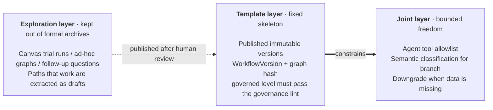
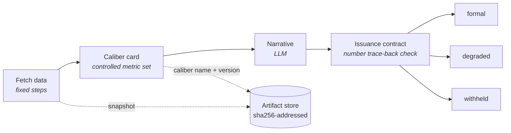
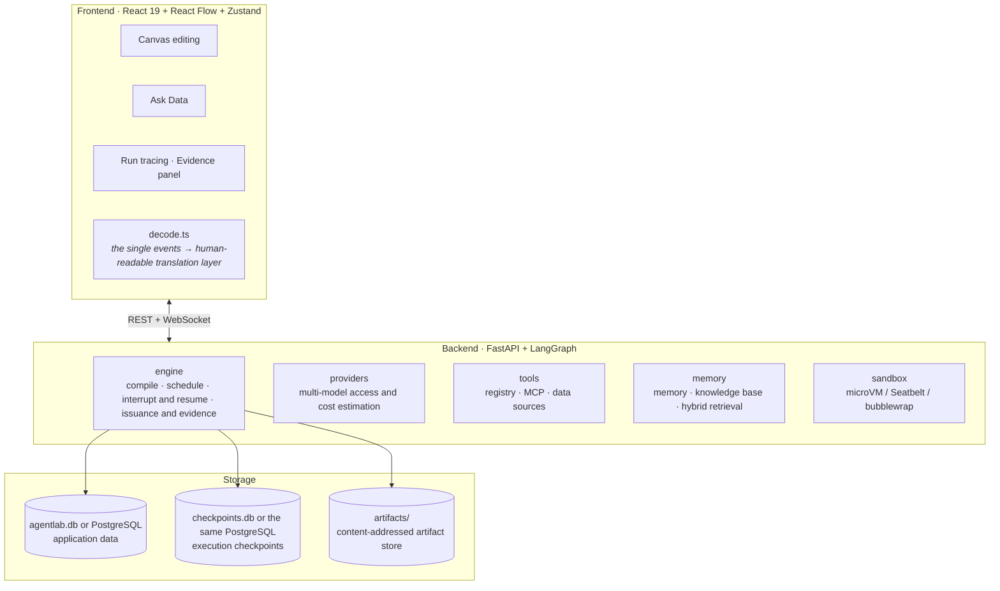

English | [简体中文](README.zh-CN.md)

# AgentLab

**A visual agent-orchestration workbench**: define workflows on a canvas, watch execution node by node at run time, and
put verifiable constraints on what comes out.

**Constrained dynamic orchestration** for general-purpose scenarios: templates define the skeleton, and agents are free
only at the joints they are authorized for. All arithmetic sinks into a controlled metric set, and the narrative layer
has no right to create numbers — the system fills in the numbers in a report from snapshots, and every one of them opens
to its provenance. Formal runs are pinned to immutable versions, and the complete evidence of every execution lands in a
content-addressed artifact store.


<sub>The Research Assistant (「研究助手」) template running on Mock: finished nodes get a check mark, and running nodes show
elapsed time and streaming output. The track along the bottom (「航迹」) is a live timeline; the right column shows the run
steps, driven by the same event stream.</sub>

---

## Contents

- [Quick Start](#quick-start) · [Production Deployment](#production-deployment) · [Core Capabilities](#core-capabilities) · [Constrained Dynamic Orchestration](#constrained-dynamic-orchestration-templates-fix-the-skeleton-agents-fill-the-joints)
- [Clickable Evidence](#clickable-evidence-every-number-in-a-report-opens-to-its-provenance) · [Evaluation and Caliber Ledger](#regression-evaluation-and-the-caliber-ledger) · [Apps](#apps-the-usage-surface-of-published-versions) · [Identity and Permissions](#identity-and-permissions) · [Capability Registry and Endpoints](#capability-registry-and-endpoints)
- [Data Catalog](#data-catalog-helping-copilot-and-agents-understand-business-data) · [Workflow Shapes](#workflow-shapes) · [Node Types](#node-types) · [Architecture](#architecture)
- [Key Design Decisions](#key-design-decisions) · [Runtime Environment](#runtime-environment) · [Using PostgreSQL](#using-postgresql) · [FAQ](#faq) · [Development and Verification](#development-and-verification)

---

## Quick Start

Requirements: conda ([miniforge](https://conda-forge.org/miniforge/) is enough), Node 20+, pnpm.
**No Docker needed** — the code sandbox is built on isolation primitives that ship with the operating system, with an
optional upgrade to microVM.

```bash
conda env create -f environment.yml   # first time: create the agentlab environment and install dependencies
./scripts/dev.sh                      # after that: one command starts the frontend and backend
```

`dev.sh` finds the `agentlab` conda environment automatically and creates it from `environment.yml` when it doesn't
exist. To use a different environment name, set `AGENTLAB_CONDA_ENV`. Backend dependency versions follow
`backend/requirements.lock`: you get exactly the set the tests ran against, not whatever happens to be newest that day
(see [Dependencies and the Lock File](#dependencies-and-the-lock-file)).

The service starts at http://localhost:5273 .

To open it from phones or other computers on the same network, use `./scripts/dev.sh --host`: the frontend listens on
all network interfaces and prints the LAN address at startup; the backend still listens only on 127.0.0.1, and the
frontend dev server forwards the page's `/api` on the local machine. **Login is off by default**: anyone on the same
network who can open the page can use every feature — run workflows, spend the model quota you configured, read data
sources, and execute sandbox code — and approvals and run starts record whatever name each person typed in, unverified.
Only use it this way on a network you trust; for multiple users, turn on login (see
[Identity and Permissions](#identity-and-permissions)). To use PostgreSQL for the app database, add `--postgres` (it
starts a development database in local docker; see [Using PostgreSQL](#using-postgresql)). Unrecognized arguments fail
with an error; run `./scripts/dev.sh --help` for usage.

**You can try everything without configuring an API key.** The built-in Mock provider produces streaming replies, tool
calls, and schema-conforming structured data, so the whole orchestration path (canvas highlighting, approval interrupts,
sandbox execution) runs end to end. To connect a real model, configure it under Settings → Model Access (「设置 → 模型接入」).
If `ANTHROPIC_API_KEY` / `ANTHROPIC_AUTH_TOKEN` / `OPENAI_API_KEY` is present in the environment at startup, it is
imported as a provider automatically. Mock doesn't write citation markers: in an exploratory run the report-writer node
still runs to completion, but every number in it is marked "No evidence" (「无证据」); to see provenance that is clickable
segment by segment, connect a real model.

The 9 built-in templates, from Minimal Q&A (「最小问答」) to Traceable Weekly Report (「可追溯周报」), can be run as they are and
also serve as executable documentation of how each kind of node is used.

---

## Production Deployment

**Without Docker:** `./scripts/prod.sh` builds the frontend and has the backend serve the pages as well. By default it
runs one process (`--workers` starts more, which requires PostgreSQL), without hot reload, at http://127.0.0.1:8000 . It
rebuilds the frontend only when the build output is missing or older than the source; `--build` / `--no-build` forces or
skips the build. `--port` (or `AGENTLAB_PORT`) changes the port; `--host` listens on all network interfaces, and login
is likewise **off by default** — for multiple users, turn on login
([Identity and Permissions](#identity-and-permissions)). The data directory defaults to `data/` under the repository;
`AGENTLAB_DATA_DIR` changes it. The app database defaults to SQLite in the data directory, which
**supports a single process only**: when a service is already using the same data directory, a second process refuses to
start and says so plainly (don't add `--workers` to uvicorn; `prod.sh` stops you first when `--workers` is greater than
1). After switching to PostgreSQL ([Using PostgreSQL](#using-postgresql)) you can run multiple processes:
`./scripts/prod.sh --workers 4`; for the rules, see [Multiple Processes](#multiple-processes). For data sources that
accumulate by period, every historical version is a full copy, so disk usage grows with the number of periods and of
referenced versions. Besides the current version and versions referenced by runs, each data source keeps the 3 most
recently activated versions; the rest are reclaimed and can no longer be activated.

**Docker offline bundle:** `./scripts/package-docker.sh` builds a Linux image (the local architecture by default; use
`--platform linux/arm64` or `linux/amd64` when the target machine differs) and packs it, together with a one-step deploy
script, a configuration template, and deployment notes, into `release/agentlab-<版本>-linux-<arch>.tar` (`<版本>` is the
version). Copy it to an offline machine that has only Docker Engine, unpack it, edit `agentlab.env` as needed, and run
`./deploy.sh`; docker compose isn't needed. For installation, upgrades, backups, sandbox permissions, and common
problems, see [deploy/README.md](deploy/README.md). The app database can use the PostgreSQL shipped in the bundle: for a
new deployment, `./deploy.sh install --postgres` (starts a PostgreSQL container alongside, with no externally exposed
port and a password generated automatically in the data directory); for a deployment already on SQLite,
`./deploy.sh migrate-to-postgres` (stops the service, backs up, imports, verifies, and falls back to SQLite if any step
fails). The database is backed up automatically before `upgrade`, and the schema and default data are filled in
automatically at startup. For the three ways to place the database, see "Using PostgreSQL" (「用 PostgreSQL」) in
deploy/README.md.

By default the image includes the microVM runtime and sandbox image (about 150 MB; `--no-microvm` leaves them out). When
the target machine has KVM, deploy.sh first tries to boot a microVM in a temporary container; if it boots, deploy.sh
hands `/dev/kvm` to the container and code executes inside a microVM, with no network access needed during deployment.
Without KVM (Docker Desktop on Mac or Windows, most cloud hosts), under default permissions the code sandbox falls back
to a local subprocess, and the only isolation boundary is the container itself.


**Upgrading from an older version (app platform)**: the first startup after the upgrade does several things
automatically, all idempotent:

- Existing pending approvals get tasks created for them; plaintext in custom tools' request headers and in MCP
  environment variables gets encrypted; the capability registry is synced once.
- Old versions that were published before levels were recorded and that have formal-run credentials are retroactively
  marked Published (「已发布」). Versions pinned by subworkflows and caliber cards must be published and not retired; when an
  old version without credentials is pinned, formal runs are refused — follow the prompt and pin a published version
  instead.
- HTTP MCP services that point at the local machine or the internal network automatically get an endpoint registered
  with internal network access enabled (`mcp-<服务名>`, named after the service) and are bound to it, with an audit entry.
  After that, a newly created internal-network MCP must first be registered by an admin under Tools → Endpoints
  (「工具 → 端点」).
- When `/api/copilot/generate` edits a graph, it outputs only the change operations instead of a whole new graph; every
  run gets an extra `run.origin` event (inside the sealed scope).

**Upgrading from an older version (2026-10 next round, wave 1)**: several behavior changes affect existing deployments:

- Runs rejected by a human (approvals, action confirmations, form filling, code and tool approvals, double-blind
  recomputation) are recorded as "Cancelled · Rejected" (「已取消 · 被驳回」) and no longer count as failures: notifications go
  out as "Instance finished" (「实例结束」), schedules push "Not issued (rejected)" (「未出具（被驳回）」), and the run can't be
  continued. For gates configured with retry on failure or Continue on error (「出错时继续」), a rejection no longer asks again
  and doesn't carry on downstream either. Old runs that are already sealed aren't rewritten.
- With login on, the people pickers in app entry forms and task forms are checked against a candidate pool (by default,
  the people who can use the app); a name outside the pool gets a 422 (`principal`).
- By default, pages can only be embedded by the same site (`frame-ancestors 'self'`, plus `X-Frame-Options`). Portals
  that already embed AgentLab in an iframe need to add the portal's address to `AGENTLAB_FRAME_ANCESTORS`.
- The public URL (「对外访问地址」) is now a single setting (Settings → General, 「设置 → 通用」; `AGENTLAB_PUBLIC_URL` takes
  precedence, and a malformed value fails at startup). For deployments that filled in the address in Settings, the OIDC
  callback is now built from this address; if it differs from what's registered with the identity provider, update the
  registration. With login on, `/docs` and `/openapi.json` require a builder login.
- Schema introspection now stores column types in each database's full notation (`VARCHAR2(20 CHAR)`, `ENUM('a','b')`):
  after upgrading, click Introspect Schema (「探查结构」) once for each data source. Schema snapshot hashes of new runs will
  change; old runs are unaffected. On MySQL / MariaDB, profiling notes for text columns gain a sentence about the
  collation, ENUM columns gain the values that don't appear in the data, and date columns state how many invalid dates
  were excluded, so the first re-profiling after the upgrade bumps the catalog of each of these tables up one version.
  The profiling setting "Sampled key count" (「抽样键值数」) is renamed "Checked key count" (「核对键值数」) (`DISTINCT … LIMIT`
  doesn't take a random sample).

**Upgrading from an older version (2026-10 next round, wave 2)**:

- Schema introspection becomes a background job (queued with drafting and profiling for the same data source). After
  upgrading, click Introspect Schema (「探查结构」) once for each data source to build the object index; the old schema stays
  as it is until introspection finishes reading. For a database with more than 500 tables and no introspection scope,
  the first introspection is refused and says how many tables matched; first set rules under Introspection Scope
  (「探查范围」) or raise the limit (at most 2,000). Formal introspection no longer accepts `?schema=` for switching schemas
  temporarily (one schema per data source); previews still can.
- At run time, `db_schema__` without a table name lists only the first 50 tables and says how many more there are; you
  can search with `keyword`, and naming a table outside the introspection scope reads its schema on the spot and adds it
  to the scope (at most 8 tables per run, with an audit trail).
- After an exploratory run is sealed, it's matched against published calibers in the background, and a post-seal event
  `ledger.matched` is appended: it shows up in the timeline and in the verifiable report's Appended after sealing
  (「封存后追加」) section, outside the sealed scope. At startup, runs from the last 7 days are matched retroactively; this
  follows the `AGENTLAB_SCHEDULER` switch.
- Report exports and verifiable report downloads each record an audit entry `report.exported`. Runs started from Ask
  Data (「问数据」) carry their conversation and turn (`origin_ref`), and workflows created with Open in Canvas (「在画布里打开」)
  record which turn they came from.

**Upgrading from an older version (2026-10 next round, wave 3)**:

- Schema introspection records a schema version for every table and compares it with the schema read last time: added or
  dropped columns, type changes, nullability changes, comment changes, and added or removed primary keys / unique
  constraints / foreign keys go into the data source's change log (a suspected rename is only reported as "possibly a
  rename" (「可能是改名」), with no conclusion drawn). The first introspection after upgrading only builds a baseline for each
  table and reports no changes. For a formal run started from a published version, if the schema that version references
  has changed since publishing, the run gets an extra "Schema change" (「表结构变化」) reminder (`schema.drift`, inside the
  sealed scope).
- Profiling gains value observation: row counts, code-value distributions (including code-value columns confirmed by a
  human), the latest business date, and daily row counts over the last 35 days, compared with history on the same basis
  to find new code values, sharp shifts in proportions, gaps, missing days, volume drops, and large swings in row
  counts. It runs only when the profiling scope is Value Observation (「取值观察」) or during scheduled maintenance. When a
  code table marked "Complete" (「已列全」) shows a value that isn't in the catalog, the system revokes "Complete" (the
  catalog goes up one version); this is the only thing the machine ever writes into the catalog, and the meaning of the
  new value still has to be filled in by a person. Masked columns aren't observed.
- Data sources can have scheduled maintenance (introspection → profile the tables that need it → value observation, with
  multiple choices allowed). It's simply a schedule whose target is the data source, and there's none by default. A
  schedule's target can also be an evaluation test suite. These two target types don't accept webhooks (they return
  422); notifications go through channel subscriptions under Settings → Notifications (「设置 → 通知」).
- In this wave, the change log, evaluation, and caliber issuance and reconciliation are API-only
  (`/api/datasources/{id}/changes`, `/api/evals/…`, `/api/ledger/answers/{run_id}/…`); the UI ships with the next wave.
- When an Ask Data answer as a whole is equivalent to a published governed caliber (the SQL is proven equivalent, the
  version is governed, and the graph has no human nodes and no writes), the system automatically starts a formal run by
  that caliber, with the origin recorded as "Formal issuance by caliber" (「按口径正式出具」). The `ledger` group in Settings
  (「设置」) can turn off automatic issuance (`auto_issue`); automatic and one-click issuance together are capped at 20 per
  day. Things that aren't Ask Data answers, such as canvas trial runs and personal app refreshes, aren't issued
  automatically.
- When app views, trends, share links, and the view data API take "the latest sealed run" (「最近一次封存」), they count only
  formal runs started by schedules, app entries, on-demand views, the Formal Run (「正式运行」) button on the canvas or
  version page, inbound hooks, and access keys; runs from issuance by caliber or from backfills never replace the
  numbers on a dashboard.
- With login on, the only raw run records, events, and live streams a user can read are those of their own Ask Data
  runs; other runs (including caliber reconciliations started on their behalf) are read through app pages and the
  evidence API, and masked values written in the displayed SQL are replaced with "Masked" (「已遮罩」).
- Notifications gain email: an admin configures SMTP under Settings → Notifications → Mail Service (「设置 → 通知 → 邮件服务」)
  (the password is stored encrypted), after which email channels can be created. Email only confirms handoff to the mail
  server; bounces aren't tracked. A daily task digest is sent at `notify.digest_at` (default 09:00, server time zone) to
  the personal channels subscribed to it; access keys get a reminder 7 days and again 1 day before they expire. Neither
  is sent when login is off.
- Share links (read-only view pages that need no login) are off by default; see [Share Links](#share-links).

**Upgrading from an older version (2026-10 next round, wave 4)**:

- The navigation gains Evaluations (「评测」) (visible to builders and above, ⌥0, placed before Settings (「设置」)); see
  [Regression Evaluation and the Caliber Ledger](#regression-evaluation-and-the-caliber-ledger).
- After a new version of a governed caliber is published, the system looks up, in the background, the answers that used
  the old version, groups them by parameters, and recomputes the difference between the two versions on the same data
  (exploratory runs with the origin "Caliber recall" (「口径召回」); the difference is computed in a recall card). Only when a
  number really changed does the system open a Recall (「召回」) task for the answer's owner and push `ledger.recall`;
  unchanged answers are annotated "Checked against vN, not affected" (「已按 vN 核对，不影响」). Each publish recomputes at most
  `ledger.recall_limit` groups (default 50; 0 means list without computing), and the rest can be continued with Continue
  (「接着算」) in the version history. The automatic batch after publishing and the continuation at startup follow the
  `AGENTLAB_SCHEDULER` switch.
- When a review changes the data catalog items that affect numbers (valid-record condition, deduplication, business
  date, relationships, business key, measure type), or the schema drops a table, drops a column, or changes a column
  type, the answers that used it are marked "Basis changed" (「依据有变」); a task is opened only for answers that newly have
  error-level issues under the new catalog.
- For the step that was rejected, the `node.failed` event additionally carries `reason: "rejected"` (the same field as
  on `run.cancelled`), and the canvas, track, timeline, and Ask Data process all show "Rejected" (「被驳回」) instead of
  drawing a failure. External systems that read events can tell them apart by `reason`; old runs are unchanged.
- The graph-building usage of each Ask Data turn is now recorded after the model stream has been read to the end: output
  tokens reported only at the end of the stream used to go unrecorded, so a turn will cost somewhat more than before —
  the difference is what used to be missed.
- Subscribable notification events gain "Data source has changes to handle" (「数据源有变化要处理」) (global channels) and "Caliber
  version bumped, answer numbers changed" (「口径升版，答案的数变了」) (global channels and the answer owner's personal channels);
  neither message includes numbers.
- Fixes after final acceptance: caliber labels are judged number by number (see
  [Regression Evaluation and the Caliber Ledger](#regression-evaluation-and-the-caliber-ledger)), and the matching
  algorithm moves to version 4; old matching records remain readable and aren't recomputed automatically. Evaluation
  scoring rules move to version 2, and old evaluations can be re-scored under the new rules from the evaluation details
  (reading only the sealed records, without calling models). When Copilot (「助手」) returns only thinking and no operations
  at all, both Ask Data and evaluation automatically try again once. Cancelled and timed-out model calls are also
  recorded as a call (marked "Incomplete" (「未完成」)).
- Drafting and profiling progress on the data catalog page moves to a background job bar (introspection, drafting, and
  profiling are listed in the server's queue order), and the page header keeps only the entry points. Scheduled
  Maintenance (「定时维护」) can be set on the data source card. Links to a particular data source card are now uniformly
  `/data/databases#source-<id>`.

**Upgrading from an older version (2026-10 orchestration improvements, wave 1)**:

- A whole Ask Data turn (building the graph, starting the run, review, retrying per the review, persisting) now runs in
  a server-side background job, and the page only watches: after a disconnect, a refresh, or closing and reopening, it
  picks up where it left off by sequence number, and stopping goes through the API (`/api/chat/turns`). On a service
  restart, a turn still building its graph is marked interrupted and can be retried; a turn that has already started its
  run keeps waiting for it, then reviews and wraps up as usual. A conversation runs only one turn at a time (a turn
  waiting for a person at an approval doesn't count). Ask Data for users (the user role) is now reviewed too; continuing
  a run is still limited to builders and above. Ask Data and evaluation share the same driver (`chat/drive.py`).
- Every step inside a subworkflow now goes into the same run's event stream: the timeline and the Records page (「记录」)
  show extra entries like "Subworkflow › that step" (「子工作流 › 那一步」), and the seal also covers the numbers the subworkflow
  queried. Fields at the subworkflow's exit return to the parent graph carrying their provenance, so the parent graph's
  caliber cards and reports can trace all the way to the cell inside the subworkflow (at most 3 levels); when something
  inside the subworkflow can't be traced back to raw data, the parent graph is downgraded just the same. Reports inside
  a subworkflow are recorded under prefixed node ids, and the parent graph recognizes only its own reports.
- Approvals, supplementary input, draft editing, action confirmations, code and tool approvals, and double-blind
  adjudication can take an extra Reject (「驳回」) exit: after a rejection (including rejection on timeout), the step ends
  normally and execution continues along that exit. When an action confirmation takes the exit, nothing is sent out. The
  instance page and notifications say "Rejected, routed to X" (「被驳回，转到 X」); the run ends along its path, and
  `run.finished` carries `rejected_via`. Without this exit, behavior is unchanged (recorded as "Cancelled · Rejected"
  (「已取消 · 被驳回」)). The pre-publish check blocks reject paths that can never reach the end.
- Schedules can choose Event trigger (「事件触发」): a new period of an uploaded spreadsheet arrives, a formal run of an
  upstream workflow finishes successfully, or a data source has changes marked Action needed (「要处理」). Events are
  recorded where they happen, and the scheduler loop starts runs after debouncing (each period is debounced separately);
  downstream input templates read the event content with `{{ event.* }}`. Saving checks that chains don't form a cycle,
  and at run time chains are limited to 5 levels; runs that passed through a rejection, or that come from app backfills,
  are ignored by default (you can tick a box to accept them). It follows the `AGENTLAB_SCHEDULER` switch: when the
  switch is off, events are kept but not dispatched.

**Upgrading from an older version (2026-10 orchestration improvements, wave 2)**:

- The default is still SQLite in the data directory with a single process, so deployments that don't change their
  configuration behave the same after upgrading; at startup the new columns and indexes of this wave are added
  automatically (run events' `(run_id, seq)` becomes a unique index; if an existing database already has duplicate
  numbers, a log line is written and the index isn't built this time, without affecting startup). The data directory
  gains a `.agentlab-data` marker file, which `deploy.sh` uses (or else `agentlab.db` or `.secret_key`) to recognize the
  data directory — don't delete it.
- The app database can be switched to PostgreSQL: set `AGENTLAB_DATABASE_URL`, and the execution checkpoints go there
  too; import existing data with `python -m app.db copy-to-postgres` (stop the service first; the checkpoints move
  along). Docker deployments can have `deploy.sh` start a built-in PostgreSQL alongside (`install --postgres` for a new
  deployment, `migrate-to-postgres` for one already on SQLite, which falls back to SQLite unchanged on failure); for
  development, use `./scripts/dev.sh --postgres`. Built-in and external are mutually exclusive. See
  [Using PostgreSQL](#using-postgresql).
- With PostgreSQL you can run multiple worker processes (`AGENTLAB_WORKERS`): runs, Ask Data turns, and background jobs
  are claimed in the database; when a process dies, another process takes over or honestly marks the work interrupted;
  stopping works across processes; only one process is on duty as the scheduler; and live events are pushed across
  processes. SQLite supports a single process only: a second process refuses to start. Upgrading requires stopping all
  worker processes first (`deploy.sh upgrade` does exactly this): while the database still has live processes of a
  different version, the new version refuses to start. See [Multiple Processes](#multiple-processes).
- Runs queue by class: interactive (Ask Data, canvas trial runs), app, scheduled, and system (evaluation, recall,
  reconciliation, backfill, issuance). The site-wide limit is still `AGENTLAB_MAX_CONCURRENT_RUNS`; by default a quarter
  of it is reserved for interactive runs, the other classes can borrow the rest while it's idle, and this is adjustable
  under Settings → Run Concurrency (「设置 → 运行并发」). Under full load, evaluation and recall will be slower than before, in
  exchange for Ask Data always having a slot; an evaluation question's time limit doesn't include time spent queuing.
- `deploy.sh upgrade` backs up automatically before upgrading: SQLite is copied to `backups/sqlite/` in the data
  directory, and the built-in PostgreSQL is saved with `pg_dump` to `backups/postgres/`; each keeps the latest 5 copies
  (`BACKUP_KEEP`), readable only by the owner. `restart` restarts only the service by default; `restart --postgres`
  restarts the database too.
- The bubblewrap sandbox no longer inherits the backend's environment variables: code nodes can no longer read variables
  such as model API keys or database addresses. Pass any values the code needs explicitly.
- When a subworkflow runs several times inside a loop, the steps of each execution continue the numbering, and
  idempotency keys for writes to external systems now use the global id within the parent run: previously, a write in
  the loop's second iteration would get the first iteration's receipt and not be sent; now it's sent as normal. Runs
  paused inside a subworkflow before the upgrade still use the old keys when resumed, and writes that already took
  effect aren't resent.
- Ask Data heartbeats are no longer persisted, and event logs are purged for turns that ended more than 14 days ago (the
  turn's Q&A and its answer stay in the conversation as before). When a turn is taken over after a service restart, it's
  re-checked against the account's current role, and turns of accounts that were disabled or lost permission are
  honestly marked interrupted.
- When a multi-row query has no `ORDER BY`, citing one of its cells no longer counts as "from a caliber" (「来自口径」);
  recall and reconciliation honestly mark it "Row order undefined" (「行序不定」) (the E1 statistic changes accordingly). A
  recall whose metrics all have undefined row order concludes "Cannot verify" (「核对不了」) and opens a task, instead of
  saying "Unchanged" (「没变」). When reconciliation needs a person to choose the metrics to compare, the columns that were
  verified number by number are preselected.
- Tasks, notifications, and webhooks state plainly where a rejection went ("Rejected, routed to X" (「被驳回，转到 X」), "This
  path ends here" (「这一路到此为止」)), and inside a subworkflow they say "Subworkflow › x" (「子工作流 › x」); when a step fails
  inside a subworkflow, automatic review reports it only once. User-visible lists break ties between entries with the
  same name and time by id, so both kinds of database give the same order.

---

## Core Capabilities

| Area | Capability |
|---|---|
| **Visual orchestration** | 18 node types, drag and connect; at run time nodes highlight live, dots of light flow along the edges, and streaming tokens appear right inside the card; the track along the bottom (「航迹」) lays out every node's start and end and the degree of parallelism on one timeline, shared by live view and replay; multi-agent nodes expand a collaboration matrix inside the card (who is running, how many in parallel, how much time is saved) |
| **Conversational data access** | The Ask Data (「问数据」) page: ask in natural language, and the system, on its own, connects to data sources, generates a workflow, runs it, and gives a conclusion; when the answer contains numbers, it goes out through a report-writer node and can be clicked open segment by segment; conversations persist and can be shared by link |
| **Multi-model access** | Anthropic / OpenAI / any OpenAI-compatible service (DeepSeek, Kimi, Tongyi, Zhipu, SiliconFlow, Ollama, etc.) + Mock |
| **Toolchain** | 15 built-in tools + custom tools (HTTP template / sandboxed Python) + MCP server integration; MCP and custom tools wait for approval on every call by default, and each can be switched to review by a gating model or to always allow |
| **Capability registry and endpoints** | Every callable tool is registered in one place and governed item by item: read/write effect, approval, field semantics, masking; external systems are registered as endpoints with test / production environments, only registered endpoints can reach the internal network, and auth headers are encrypted; tables read back from endpoints can serve as evidence just like query snapshots ([details](#capability-registry-and-endpoints)) |
| **Agent guardrails** | The same call isn't executed twice, the agent wraps up when consecutive steps bring no new information, token and spending budgets, and context is compressed before wrapping up as it nears the window; the step count is kept only as a backstop (default 100) |
| **Code sandbox** | Two isolation tiers: an OS sandbox (Seatbelt / bubblewrap, cold start about 25ms) or a microVM (its own Linux kernel, with memory limits that really take effect) |
| **Human-in-the-loop** | Execution pauses and is persisted to disk, then continues from the checkpoint after a person approves / rejects / edits the draft; a rejection can take a Reject (「驳回」) exit and continue along it; process restarts lose no state; the human step can be assigned to a position, the initiator, or people computed by an expression, with joint sign-off (any one / all must agree, single veto / at least m people), time limits, and reminders, escalation, or rejection on timeout — never approved automatically; a rejection is a human decision, so the run is recorded as "Rejected" (「被驳回」), not as a failure, and isn't retried |
| **Resume from checkpoint** | A failed run can continue from the failed node without re-executing completed nodes; exploratory runs may modify node configuration (the topology must stay the same), while formal runs are pinned to the published version and can't be continued after a configuration change; continuing a run doesn't change its initiator |
| **Knowledge base** | Hybrid vector + BM25 retrieval, inverted index, optional model reranking; parses PDF / Word / PowerPoint / HTML / Markdown; the embedding model can use a local endpoint |
| **Spreadsheet ingestion** | Excel / CSV uploads become tables you can query with SQL, with an automatically generated `db_query__<name>` tool — numbers are computed by SQL rather than read by the model; complex reports are imported with an extraction recipe (CSV works too), monthly detail files can accumulate by period into one table, and subtotals sandwiched between detail rows are checked and kept out of the data |
| **Data catalog** | For each table of a data source, records the grain, business key, business date, and valid-record condition, each field's meaning, unit, measure type, and code values, and the relationships between tables; drafted from foreign keys, naming inference, data profiling, and the model, taking effect after item-by-item confirmation; in the table details you can chat with Copilot (「助手」) to refine a table, the review queue orders what to review first by impact, and the catalog can be exported and imported into another instance; Copilot's graph building, agents' schema lookups, and SQL checks all read it; schema changes and value changes go into a change log to be handled one by one, and data sources can have scheduled maintenance ([details](#schema-changes-value-changes-and-scheduled-maintenance)) |
| **SQL checks** | Using the data catalog, checks seven kinds of problems, such as double counting after one-to-many joins, summing stocks across time, and adding up ratios; they're returned for correction during Copilot's self-check, block publishing of governed templates, are flagged on query results at run time, and downgrade contract metrics |
| **Cross-database merge** | The merge query node: each database first aggregates to the same key, then the results are merged by key outside the databases; truncated inputs are rejected, and evidence traces all the way back to the raw queries on both sides |
| **Long-term memory** | Memory read/write across runs with automatic deduplication; Copilot proactively records facts worth remembering while it builds graphs |
| **Skill management** | Abstracts methodology into reusable units that mount on nodes and are injected into the system prompt |
| **Natural-language orchestration** | Copilot: generate or rewrite a whole graph from one sentence, with automatic layout; the system prompt gives each data source only a one-line overview, and when Copilot needs table schemas, capability parameters, or workflow versions it "looks" (「查看」) for itself, getting fields, catalog, and join conditions all at once; before delivering, it self-checks with the same rules as the runtime, hands back any problem that would make the run fail, to be fixed first, and doesn't run automatically if they can't be fixed ([details](#copilot-looks-on-demand)) |
| **Structured output** | JSON Schema validation; when output doesn't conform, the errors go back to the model for automatic rework |
| **Output review** | After a run ends, rules scan the event stream, and a model review is called only when an anomaly is found; the review may restructure the answer but **must not introduce numbers that aren't in the original answer** |
| **Tracing and cost** | All events are persisted and replayable; per-node duration, token usage, and cost at list prices; the cost of each Ask Data turn includes Copilot's graph building, table selection, and review |
| **Regression evaluation** | Test suites with expected answers (written as SQL, picked from a caliber, or identified from an Ask Data run; numeric values may not be typed in by hand); runs, in the background, the same Ask Data pipeline that users get (graph building, run, review), scores question by question, reports accuracy with intervals, and records usage and cost by role; comparisons, A/B, and a Catalog contribution (「目录贡献」) contrast; scheduled evaluations push a notification when they regress ([details](#regression-evaluation-and-the-caliber-ledger)) |
| **Caliber ledger** | Each number in an Ask Data answer gets a caliber label (proven equivalent (「等价已证明」) / chosen by Copilot (「助手选用」) / related caliber (「相关口径」) / this run's reasoning (「这次的推理」)); answers equivalent to a governed caliber are formally issued by that caliber automatically, and related calibers can be reconciled with one click, with all three numbers clickable; recurring questions go into a certification queue and are codified into caliber drafts; after a caliber version bump, recall recomputes and notifies only when numbers changed ([details](#regression-evaluation-and-the-caliber-ledger)) |
| **Three-tier issuance** | Caliber card (controlled metric set) + issuance contract: every number in the narrative traces back to the metric set, or the report-writer node checks it by citation, segment by segment, for a formal / degraded / withheld verdict |
| **Clickable evidence** | The report-writer node writes only citation markers, and the system fills in numbers and tables from snapshots; numbers, table and field names, and verbatim knowledge-base quotes are all clickable, pointing all the way to the exact cell in the query result; claim sentences can be required to carry a basis, or be handed to another model acting as judge; the evidence list can be exported, reports export as self-contained HTML (numbers open to their caliber and provenance), and there's also a seal-hash verification document, the "verifiable report" (「可验证报告」) |
| **Pre-publish check** | The governed level adds evidence gates G1–G5; problems come with three kinds of fixes — one-click fix / options / hand over to Copilot — always previewed first and never allowed to lower requirements; old workflows upgrade to a traceable structure with one click |
| **Formal / exploratory tiers** | Formal runs start only from published, non-retired immutable versions (pinned by graph hash), and versions pinned by subworkflows and caliber cards must likewise be published and not retired; canvas trial runs are automatically marked exploratory; every run records its origin (Ask Data, canvas, schedule, app entry, external system…), which is inside the sealed scope |
| **Apps** | The usage surface of published workflows: entry forms, views, tasks, and actions derived deterministically from the version, with Copilot only polishing layout and copy; views read only sealed runs, every number opens to its provenance, and a stamp states the as-of time, the caliber version, and the issuance tier; inbox, instance progress, and confirmation and reconciliation for writes to external systems ([details](#apps-the-usage-surface-of-published-versions)) |
| **Identity and permissions** | Login is off by default; local accounts or generic OIDC single sign-on can be turned on, with three roles — admin / builder / user — plus app-level grants, and administrative operations are audited; with login on, the data that users (the user role) see is always masked ([details](#identity-and-permissions)) |

---

## Constrained Dynamic Orchestration: Templates Fix the Skeleton, Agents Fill the Joints

The steps of most real tasks are known (writing a weekly report, checking data, publishing after approval). Having the
model re-plan on the spot every time reinvents answers that are already known, and it also makes results unreproducible
— and what can't be reproduced can't be accepted.

AgentLab's engine is **compiled**: at run time the model can't modify the graph structure, and its freedom is
structurally confined to the inside of agent nodes and to branch decisions. On top of this, there are three layers:



- **Template layer** — Formal runs accept only published immutable versions. Editing the canvas after publishing doesn't
  affect the published version. Publishing at the governed level must pass the governance lint: supervisor is disabled
  (fully dynamic behavior belongs to the exploration layer), method cards must pin a version, agents may not turn off
  all approvals, and output must have an issuance contract; there are also evidence gates G1–G5 (see
  [Governed Gates and Pre-Publish Fixes](#governed-gates-and-pre-publish-fixes)).
- **Joint layer** — Freedom within the authorized scope. The tool allowlist decay report (`/api/governance/tool-usage`)
  makes tools that are "authorized but never used" visible, giving grounds for narrowing permissions.
- **Exploration layer** — Results are automatically marked exploratory and kept out of formal archives. Paths that work
  are distilled into drafts with Extract Template (「提取模板」) (keeping only the nodes that actually executed and pruning
  the branches not taken), then published after human review. Exploration question clustering suggests which follow-up
  questions should be codified as a section of a template.

### The Issuance Chain

Template ⑧ is the minimal demonstration: an LLM call node writes the narrative, and the exit traces the numbers back by
value. Template ⑨ swaps the narrative for a report-writer node, which fills in numbers by citation (see
[Clickable Evidence](#clickable-evidence-every-number-in-a-report-opens-to-its-provenance)). Both rest on the same
design premise, **a derivation boundary that is closed off tight**: all arithmetic happens inside the caliber card node,
and the narrative layer can only cite.




The validator extracts every number from the narrative and traces each one back to the metric set. It supports thousands
separators, conversion between percentages and ratios, the 千/万/亿 suffixes (thousand / ten thousand / hundred million),
and a rounding tolerance based on the precision as written; dates, enumeration ordinals, and citation markers don't take
part in trace-back. The three-tier verdict and the missing-data declaration are printed along with the output.

Chinese numerals are traced back too — otherwise writing a number a different way would get around the check
("增长三成、客户两千五百家", "grew 30%, 2,500 customers", used to earn a formal stamp). 成, 倍, 百分之, 分之, and 一半 (tenths, times,
percent, fractions, half) are traced back as ratios, and "两千余" ("two thousand-odd") is traced back as the interval
[2000, 3000]; vague references, ordinals, quarter names, and structural enumerations such as "一个问题" ("one issue"),
"十分重要" ("very important"), "从三个方面看" ("from three angles"), "三季度" ("the third quarter"), and "几十家" ("dozens of
companies") don't count as conclusion numbers.

From actual testing: every number in body text written by Opus 5 traced back successfully, but the `100` in the closing
「（约 100 字）」 ("(about 100 characters)") was judged a number outside the set and triggered a downgrade. The fix was to
change the prompt rather than widen the allowlist — exactly how the validator should behave.

**A caliber version bump is an event that forces a decision.** When a pinned method card gets a new version, formal runs
refuse to start until the template explicitly declares a version-bump policy: `recompute` (recompute history) / `dual`
(print both) / `incomparable` (mark as not comparable). There's no default here — the form in which a caliber change
most easily goes wrong silently is "the numbers all look right; they just aren't comparable with last week's".

The complete evidence of every run is stored in the content-addressed artifact store (`data/artifacts/`; the sha256 is
the address, and the hash is re-verified on retrieval); the hash of the event manifest at the run's final state is
recorded on the Run (sealed up to `run.finished`), so any later edit to the log will no longer line up. Verify with one
click on the run details page; the API is `GET /api/runs/{id}/verify`. Events appended after sealing are outside the
verification scope.

---

## Clickable Evidence: Every Number in a Report Opens to Its Provenance

Tracing back by value can only guess the provenance afterwards, at the exit, and once many metrics share the same value
it guesses wrong. Clickable evidence moves the check to the moment of writing, and the provenance is written directly
into the report's data structure.


<sub>The Evidence (「证据」) tab on the Records page (「记录」): clicking 「环比 8.7%」 (period-over-period 8.7%) makes the right
column point from the caliber card's original formula and substituted formula all the way to the cited cell in each of
the two queries, ending with the seal verification; bottom left is the evidence list. Mock can't write a report with
citations, so this run was faked with a frontend test fixture (`frontend/src/run/__tests__/evidence-query.json`, sample
data); the other entries in the list are real Mock runs.</sub>

**Citation is rendering.** In the report-writer node (`report`), the model writes only citation markers, and the system
fills in the values from snapshots:

```
[[m:gmv]]  [[m:gmv|万]]                    caliber card metric; display conversion (here 万, units of 10,000) is also done by the system
[[i:week]]                                 run input
[[v:Q1.r0.gmv]]                            one cell of a query snapshot; the hash is re-verified on retrieval
[[table:Q1 cols=region,amount rows=0-4]]   the system builds the whole table from the snapshot; every cell is clickable
[[t:orders]]  [[c:orders.week]]            table name, field name; names written in backticks are checked too
[[q:K1|原话]]                              verbatim knowledge-base quote (原话 = the quoted words); must appear word for word in the chunks hit by that retrieval
[[see:m:gmv,Q1]]                           basis of a claim sentence; attached at the end of the sentence, not rendered
```

What you see in the streaming output is the final number. Bare numbers and citations that can't be parsed are judged
violations on the spot and sent back for rewriting (`max_repairs`, default 1); if it still doesn't pass, `on_violation`
either fails the node (the default for formal runs) or marks the violations in the report (the default for exploratory
runs). When the issuance contract specifies `report_from`, verification goes by citation: the hash is re-verified when
the report document is retrieved, everything is recomputed independently once, and only when every number carries a
citation is it judged a formal (complete) issuance. A pure metrics dashboard (the contract specifies only
`metrics_from`, there's no report-writer node upstream, and the output contains no model-written text) uses
**metric issuance**: there's no narrative to check, so the metrics themselves are checked — whether all required metrics
are present, whether each metric's inputs trace back to raw data (cells of query snapshots, run inputs), and whether the
numbers in output fields all trace back to metrics; the governed level requires every metric to trace back to raw data
statically.

**The data retrieval chain.** When agents, tool nodes, code nodes, and knowledge retrieval fetch data, it's all recorded
in the evidence ledger, and the report's source list is numbered Q1… / K1… from the ledger. A caliber card expression
can be written as `cell(nodes.pull, 0, 'gmv')`, making the provenance precise to the cell. When an agent turns on
`cite_fields` (together with `output_schema`), each field marks which cell of which query it came from, and that's then
checked against the snapshot: on a mismatch the snapshot wins and a warning is raised, and anything not found is
recorded as null rather than defaulted to 0. Code nodes have an `evidence_role`: `source` means data retrieval and
`compute` (the default) means computation — numbers computed in the sandbox can't be cited directly by a report; they
have to go into a caliber card. Data sources can set masked columns with `mask_columns` (this only reduces exposure; it
isn't a security boundary).

**What you see when you click.** For a number: the metric's original formula, substituted formula, and recomputed
result; whether the inputs match the snapshot; the query's SQL; the cited row plus 2 rows before and after, highlighted
down to the cell; and finally the seal status. Only artifacts returned by events inside the sealed scope are accepted.
Cells of uploaded spreadsheets can be traced to the cell in the original sheet (an inferred source). For table and field
names: which query they appear in, the type, and the table they belong to. Names that appear nowhere in the schema
snapshot, the SQL, or the result columns are marked as suspicious entities ("May be a fabricated name" (「可能是编造的名字」),
with the 3 closest matches); when a snapshot was truncated and can't be checked, it only says it can't be checked,
without wrongly calling the name fabricated.

**Claim sentences.** The report node's `claims`: `off` (default) does nothing; `require_citation` requires claim
sentences to carry a basis, and those without one count as gaps; `judge` additionally asks another model to rule on each
sentence against the evidence as supported (「支持」) / partially supported (「部分支持」) / unsupported (「不支持」) / not a claim
(「不是结论」) — it only annotates and never rewrites the body, and it warns when the judge model is the same as the writing
model. In formal runs the judging happens inside the node, and the verdicts are sealed together with the report; when
claims are unsupported, the issuance is downgraded or withheld per `on_unsupported`. In exploratory runs, whichever
sentence you click is the one that gets judged, and the verdict is recorded as an event appended after sealing, so seal
verification still matches. There are caps on the sentences, spending, and duration per report, the spending per click,
and the total spending per day (defaults: 40 sentences, $0.05, 30 seconds; $0.01 per click; $2 per day), and each one
can be set to unlimited.

**Audit and old runs.** `GET /api/runs/{id}/evidence/audit` groups entries by no evidence / suspicious entity / has
provenance / old-run guess, and can export JSON and CSV. Old answers without a contract are matched by value against
sealed query cells and caliber card values, with at most 3 candidates per number, collapsed by default and labeled
"Guessed source, not evidence" (「猜测的来源，不能当证据」). Old workflows can be upgraded to a traceable structure with one click:
reports written by LLM calls are replaced with report-writer nodes, the input → agent → output of Ask Data (「问数据」) gets
a report writer inserted in the middle, and agents with `output_schema` get `cite_fields` turned on; for sandbox code
feeding a caliber card, it only suggests marking it `source` and doesn't change it on anyone's behalf. The upgrade only
shows a preview; it saves only after a person confirms.

**Two kinds of export.** Export (「导出」) on an Ask Data answer or on a run's output in run details exports the report as
one self-contained HTML file (`GET /api/runs/{id}/report.html`): the body is rendered on the server, so it's readable
without running scripts (email attachment previews often don't run scripts); with scripts running, every number, every
number without evidence, and every suspicious table or field name is clickable — the panel is the same provenance chain
the evidence panel assembles on the web page (caliber, source, calculation, SQL, cited rows), with the seal status
marked item by item, and masked columns say "Masked" (「已遮罩」) under the same rules as the web page. Unsealed runs export
as usual (for the same reason you can read their reports on the web). Export Verifiable Report (「导出可验证报告」) under
Provenance Details (「凭证详情」) on the Records page (`GET /api/runs/{id}/bundle.html`) is a different file: a seal
verification document. The recipient, without connecting to the service, recomputes the hashes in the browser and checks
that no number, document, or run record has been altered; the provenance panel for a number likewise includes the
caliber, original formula, substituted formula, inputs, and recomputation, and the query snapshots that caliber card
inputs point to come attached to the file, so the citation chain recognizes those citations. To prove nothing was
altered, use the verifiable report; to let people read the report and look up where the numbers came from, use the
report export.

### Governed Gates and Pre-Publish Fixes

On top of the governance lint, the governed level adds evidence gates. They look only at the graph and its
configuration, and make "every number is clickable" hold structurally:

- **G1** At an exit with a contract, the text in output fields may come only from report-writer nodes
- **G2** Model-written text doesn't bypass the report-writer node to flow straight into the exit
- **G3** The report-writer node states `numbers: strict`, `on_violation: fail`, and `claims: require_citation` (or
  `judge` with a budget)
- **G4** Caliber card inputs don't come from sandbox code in the compute role
- **G5** Agents that feed a caliber card have `output_schema` configured and `cite_fields` turned on

At the governed level these are errors that block publishing; at the published level they're only warnings; versions
already published keep running as usual, and the next publish is checked against the new rules.

Opening the publish dialog first runs the pre-publish check (`POST /api/workflows/{id}/publish-check`, with the same
criteria as actual publishing), and the results are visible in the issues panel at other times too. Fixes (`/autofix`)
come in three kinds: a one-click fix when there's only one right answer; options when a person has to decide, without
choosing on their behalf; and structural ones handed over to Copilot (「助手」). All are previewed first, and nothing is
saved or published automatically. Changes that lower requirements — deleting nodes, deleting contracts, relaxing
approvals, turning off strict, changing the level — are always refused, and Copilot's proposals have to pass this check
too; after a fix is applied the check reruns, and the errors must decrease, with no new ones appearing. The one-click
upgrade (`POST /api/copilot/upgrade-evidence`) goes through the same check.

---

## Regression Evaluation and the Caliber Ledger

**Evaluation** (the Evaluations (「评测」) navigation item, builders and above) is a yardstick for after you switch models,
change prompts, or change the catalog:

- **Test suites**: each item is a question plus an expected answer. The expectation can be a SQL statement (selecting a
  cell or a column; recomputed on every evaluation instead of freezing the value; rejected if it queries masked
  columns), a metric of a published caliber, or a query identified from an Ask Data (「问数据」) run; you can also expect "No
  data" (「没有数据」) or expect a clarifying question back. Numeric values may not be typed in by hand; text key points are
  judged by the judge, listed separately, and not counted toward accuracy. After a caliber version bump, questions that
  use it show a notice at the top, and each question takes one of three options: switch to pinning the new version,
  compute one expectation for each of the old and new versions, or archive the old question and create a new one; until
  handled, the question is skipped in evaluations. Test suites can be imported and exported.
- **Starting an evaluation**: choose variants (Copilot (「助手」) model, writing model, judge on/off, catalog set to current
  / snapshot / verified only / off, how many repetitions), and see an estimated cost first; the Catalog contribution
  (「目录贡献」) preset runs "current vs. off" in one go. Evaluations run in the background, and each question goes exactly
  the way a user's question would in Ask Data; questions that stop at an approval aren't approved on anyone's behalf and
  are recorded as they are. Concurrency, per-question time limits, and per-evaluation and daily spending all have caps
  (Settings → Preferences → Evaluation, 「设置 → 偏好设置 → 评测」), and evaluation spending is tallied separately. An evaluation
  can be stopped, and you can retry only the unfinished questions; a service restart marks it interrupted, and it
  doesn't resume by itself.
- **Results**: an overview (accuracy and traceable accuracy with Wilson intervals, the distribution of paths and
  issuance tiers, usage and cost by role, duration percentiles), a per-question table (verdict, the numbers in the
  expectation and in the answer, where the SQL differs, how many times tables were looked at, cost; click through to the
  run), a comparison with the previous evaluation or a baseline (per-question transitions and attribution), and an A/B
  paired table (exact McNemar; display only, not a gate). Evaluation runs are excluded from usage statistics.
- **Scheduled**: a schedule's target can be a test suite; if any question goes from pass to fail, it pushes "Scheduled
  evaluation regressed" (「定时评测有退步」), and the message contains only the test suite name, the pass count, the number of
  regressed questions, and a link.

The **caliber ledger** matches Ask Data answers against published calibers:

- **A caliber label for each number**: after an exploratory run is sealed, it's matched against published calibers in
  the background. Numbers whose SQL is proven equivalent are labeled "Proven equivalent" (「等价已证明」); those Copilot
  assembled from a caliber it chose are labeled "Chosen by Copilot" (「助手选用」); those that use the same table but aren't
  equivalent are labeled "Related caliber" (「相关口径」), with a note on where they differ; and those unrelated to any
  caliber say "This run's reasoning" (「这次的推理」). The evidence panel's provenance chain gains a Caliber (「口径」) step at the
  top, and every Ask Data turn gets a one-line summary underneath; while matching has no result yet, it says "Matching
  calibers" (「正在比对口径」) and refetches with backoff. Judging is number by number: when a report cites several columns of
  one query (sales, order count, first and last day), each number is compared on its own column against the caliber's
  metric column, and extra queried columns don't affect that number; this per-column comparison is used only when
  removing the other columns wouldn't change the number (cases with DISTINCT, truncation after sorting by another
  column, or extra grouping columns are still compared as a whole query). A question is issued automatically only when
  every number in it that comes from data is proven to come from the same caliber. In a caliber's data-fetch SQL, it's
  best not to round (`ROUND(SUM(x), 2)`) or wrap things in `COALESCE(…, 0)`: leave rounding and defaults to the caliber
  card's decimal places and display, or Ask Data queries written without rounding will never be recognized as equivalent
  (where they differ is stated plainly).
- **Issuance and reconciliation**: when a question as a whole is equivalent to a governed caliber, a formal run by that
  caliber starts automatically (this can be turned off, and there's a daily cap); answers labeled "Chosen by Copilot"
  get one-click issuance. For a related caliber, clicking See the difference (「看差多少」) starts a read-only reconciliation
  run, where this run's number, the caliber's number, and the difference each open to their provenance; you can give
  feedback on whether the reconciliation's explanation was useful. Users can reconcile; formal issuance by caliber is
  limited to caliber versions pinned by apps they're allowed to use.
- **Distill**: question types that keep recurring (a query of the same shape ≥3 times from ≥2 conversations, or
  questions clustering into one group, or answers repeatedly exported or made into apps) go into Distillable questions
  (「可沉淀的问题」) in the workflow picker, and can be codified into a caliber draft (cited queries become data-fetch nodes,
  and literals that vary across turns automatically become parameters), to be published after review.
- **Recall**: after a new version of a governed caliber is published, the system looks up the Ask Data answers, formal
  runs, apps pinning it, and exports that used the old version, groups them by parameters, and recomputes the difference
  between the two versions on the same data; only when a number changed does it open a Recall (「召回」) task (the old
  value, the new value, the difference, and the original answer's value at the time are all clickable, and it can be
  reissued under the new version), while unchanged ones are only recorded in the ledger. The publish dialog previews the
  scale beforehand.
- **Statistics**: four measures — equivalence hits, reconciliation, question repetition, and recall (E1–E4) — are
  computed live by `GET /api/ledger/stats`, and the Caliber hits & repetition (「口径命中与重复度」) tab on the evaluation page
  plots the trends.

## Apps: The Usage Surface of Published Versions

Once a workflow is published, the people who read the numbers and the people who get work done use it in Apps (「应用」). An
app isn't a new engine, nor an embedded low-code platform: every number comes from a sealed formal run of the pinned
version, and every start is a formal run of the pinned version. The interface layer holds no logic — bindings only take
existing values, visibility conditions can only compare, do boolean operations, take values, and use `in`, with no
arithmetic; all evaluation happens on the server, and invisible components and masked values never leave the server.

**How to create an app**

1. Publish the workflow on the canvas and click Make App (「做成应用」) in the publish-success notice; or click Make App on an
   Ask Data (「问数据」) answer: this first extracts the run into a workflow (keeping only the steps that actually executed),
   which you publish on the canvas, and then you come in from the publish-success notice.
2. The system derives an app draft from this version deterministically, without calling a model: entry fields become
   forms, caliber cards become metric blocks, reports become report blocks, data-fetch nodes become tables, human nodes
   become tasks (with positions left empty for someone to bind), and Call Tool (「调用工具」) nodes that write to external
   systems become action confirmations and action status. Views prefer to bind to existing schedules.
3. Adjust it in the app editor: the page tree and properties panel, a preview based on the draft (no run is started),
   and checks. The Copilot (「助手」) on the right can only polish layout, copy, and controls; it can't change the pinned
   version, the entry mappings, or the forms' data constraints.
4. Bind positions to people or groups (required for process apps), set grants, inbound hooks, and notification
   subscriptions, then publish. When the pinned workflow version is newer than the one in the previous app version,
   publishing requires choosing a disposition for it: Recompute with the new caliber (「按新口径重算」), Both versions side by
   side (「两版并列」), or Before and after not comparable (「前后不可比」).

**What kinds of apps you can build**

| Type | Capabilities used |
|---|---|
| Data dashboard | Views read a schedule's latest sealed formal run: stamp, metric blocks, multi-period trends (drawn according to the version-bump disposition), tables, line / bar charts, reports |
| Parameterized report | An entry form starts a formal run, and you see the result on the instance page; or a parameter form on the page runs on demand and caches the result |
| Approval process | Tasks assigned to a position / the initiator / people computed by an expression, with any one / all / at least m people, time limits and escalation, an inbox, and Started by Me (「我发起的」) |
| Write back to external systems | Call Tool nodes write to registered endpoints, the confirmation card shows a masked preview and a content hash, and unknown results go to a person for verification |
| External system trigger / callback | Signed inbound hooks: start an instance, or call back the Wait for External System (「等外部系统」) step |
| Hybrid | Start a handling process from a dashboard, and finally write back to the system |

**Views and stamps** — Every view carries a stamp: as of when (including the reporting period and data version), which
caliber version (workflow name vN · first 8 characters of the hash, plus the caliber card's caliber name and version),
which issuance tier, and where the data came from (schedule "…" run n / on-demand run / this instance). When the
schedule has already moved on to a new version while the app is still pinned to the old one, the stamp says so plainly.
By default, on-demand views run only when you click Refresh (「刷新」); a given set of parameters runs only once at a time
within a process; views that query a live database must set a freshness period; and each app has a daily cap (the
setting `apps.on_demand_daily_limit`, default 200).

**Processes and tasks** — Each interrupt corresponds to one approval (for the engine) and one task (for people);
everyone's decisions are aggregated by the task service, and the run resumes once, only when they're all in. The graph
names only positions; binding positions to people or groups is done in the app. Runs without an app (canvas, schedules)
are assigned to anyone, behaving as before; the old APIs `/api/approvals/{id}/decide` and `/api/runs/{id}/resume` still
work. The scheduler loop checks time limits every 15 seconds — when the scheduler is off (`AGENTLAB_SCHEDULER=0`), there
are no reminders, no escalations, and no automatic verification.

**Writing to external systems** — Write capabilities can only be placed in Call Tool (「调用工具」) nodes. An effect record is
written first and then the request is sent; within one execution, the idempotency key for the n-th send is
`{action_key}:{n}`. The confirmation card shows a masked preview and a content hash, and if anything upstream changes
after confirmation, sending is refused. When the result is unknown, the run is suspended and not sealed: if a query
capability is registered, the result is verified automatically by idempotency key; if not, a verification task is opened
(took effect, fill in the external order number / didn't take effect, send again / didn't take effect, give up). A write
whose result is unknown is never resent automatically. Formal runs write to the production environment; exploratory runs
write to the test environment, or do a dry run without sending any request when there's no test environment. Runs with
effect records can't be deleted.

**Inbound hooks** — Declared by name in the spec (start an instance / call back a task), with a secret generated in the
app editor (shown only once). The external system sends a signed request to `/api/hooks/{钩子 id}` (the hook id):
`X-AgentLab-Timestamp` and `X-AgentLab-Signature: sha256=HMAC-SHA256(密钥, "时间戳." + 请求体)` (密钥 = the secret, 时间戳 = the
timestamp, 请求体 = the request body), with a 5-minute time window and a required `Idempotency-Key`. What a hook does
follows the declaration in the app's currently published version; requests to hooks that aren't published or have been
disabled are rejected.

**Backfill with the new caliber** — When the pinned version is bumped and the chosen disposition is Recompute with the
new caliber (「按新口径重算」), a manager can click Backfill history with the new caliber (「按新口径补算历史」): it takes the old
version's inputs from the most recent few periods on the same origin and starts a formal run with the new version for
each (the origin is recorded as backfill with the new caliber), skipping inputs that have already been computed.
Workflows with external side effects (processes, human nodes, writes to external systems) aren't backfilled.

**Upgrade safety** — Process instances may wait for days, so upgrading in the meantime is normal. Instances paused at a
human node, or at the start of a write node waiting for confirmation, can all continue after an upgrade; writes with
unknown results continue after verification and aren't resent. Instances paused at an approval in the middle of an Agent
can't continue after an upgrade, so `process.wait_mid_agent` warns at publish time, and an app that references the
workflow as a process is blocked outright.

**Form submissions and attachments** — Each form submission is one row in a record table managed by the platform
(`data/records/`; one SQLite file per table version, append-only): writes go only through the platform capability
`records_append` of a Call Tool node, and one submission lands as exactly one row; a correction appends a new row that
points at the original row, leaving the original unchanged, and the correcting row still records the original submitter
(who can still see it), while the person who made the correction is recorded in the action record and the audit log.
Dashboards query with `db_query__<记录表>` (the record table's name), and a run sees only the records that existed when it
started; users see, row by row, only what they submitted themselves (the Record List (「记录列表」) component), while
summaries in formal runs cover everything. When a form only adds optional fields, columns are added within the same
version; changing a type, deleting a field, or adding a required field produces a new version, and old records are kept
as they are: when a dashboard queries the new version, old versions are read-only and are merged into the same `records`
table (fields the old version lacks, or whose type changed incompatibly, are null), and every version is fixed to the
records as of the run's start; instances started before the new version was published and still in progress finish
writing to the old version, and those started afterwards write only to the new one. Writes to record tables are
serialized site-wide (a lock in the database when running multiple processes), sized for the pace of manual data entry
and not suited to high-frequency writes many times per second. Attachments in forms are uploaded first (`data/files/`,
stored by content hash, read-only) and bound to the run on submission, and only people who can read that run or that
record row can download them; uploads not submitted within 24 hours are cleaned up automatically.

**A fake external system for acceptance testing**: `python scripts/fake-erp.py --port 8765`, which can switch between
"normal / time out after a successful write / 500 / 4xx"; its API is described at the top of the script.

### Share Links

To show a dashboard to people who don't have an account, use a share link: an admin first turns on Allow creating share
links (「允许建分享链接」, off by default) in the Apps (「应用」) section of Settings → Preferences (「设置 → 偏好设置」), and then someone
who can manage the app creates one under Positions & Grants (「岗位与授权」) in the app editor.

- **What it shows**: only views fed by schedules (the latest sealed formal run). Choose Always latest (「始终最新」) or Pin
  this period (「固定这一期」, the period that was current when the share was created); on-demand views, instances, and entry
  forms aren't shown, and someone opening the link never starts a run. Process components and report bodies are replaced
  with explanation blocks; the body and provenance are in Download report (「下载报告」).
- **Link**: `/s#<key>` — the key comes after `#`, so it never enters server logs and isn't sent out in the Referer
  header; the database stores only its hash. An expiry is required, at most 90 days, and links can be revoked; when a
  link is revoked or expired, or the app is no longer published, opening it returns 410 with the reason stated. Once an
  admin turns the switch off, existing share links stop opening too.
- **Embedding**: which sites may embed share pages is set by `AGENTLAB_EMBED_ORIGINS`; a share created without ticking
  Allow embedding in other sites (「允许嵌入到别的站点」) shows no content inside an iframe. A same-site portal (under the same
  registrable domain) that wants to embed the whole site uses `AGENTLAB_FRAME_ANCESTORS`, with login working as usual;
  embedding the whole site in a cross-site portal isn't supported (browsers don't send the session cookie into a
  cross-site iframe) — use share links instead.
- **Audit trail**: creating and revoking are written to the audit log, and opens are only counted; access keys can't
  call the share API.

## Identity and Permissions

There are three login modes, and the environment variable `AGENTLAB_AUTH_MODE` (`off` / `local` / `oidc`) takes
precedence over Settings → Identity (「设置 → 身份」):

- **off** (default): the previous behavior. `X-Actor` carries a self-reported name, everyone is equivalent to an admin,
  and the app home page says so.
- **local**: username + password (`hashlib.scrypt`). When switching to it from a deployment where login was never on,
  the first admin must be created in the same save; for a new deployment whose environment variable specifies `local`
  directly, the first admin is created on the login page (available only while there's no admin yet).
- **oidc**: generic OIDC, authorization code + PKCE; non-standard protocols such as Feishu and WeCom aren't supported
  for now. Configure the identity provider's address, the client ID and secret, and at least one admin mapping (an admin
  username or admin group). Roles are recomputed from the mapping at every login, and the `groups` claim is synced into
  read-only groups. The callback URL is `<对外地址>/api/auth/oidc/callback` (`<对外地址>` is the public URL); behind a reverse
  proxy, set `AGENTLAB_PUBLIC_URL`.

Sessions live in an HttpOnly, SameSite=Lax cookie, and the database stores only the token's hash; they expire after 12
hours idle or after 7 days at most (`AGENTLAB_AUTH_SESSION_IDLE_HOURS`, `AGENTLAB_AUTH_SESSION_MAX_DAYS`), and whether
the cookie carries Secure depends on whether the request is https (`AGENTLAB_AUTH_COOKIE_SECURE` can force it). With
login on, non-GET requests must carry the `X-AgentLab-Request` header, and requests with an `Origin` must come from this
site or from an address in `AGENTLAB_CORS_ORIGINS`. After consecutive failed logins, the wait time grows each time.

If you forget the password or misconfigure single sign-on, run this on the server:

```bash
cd backend && python -m app.auth reset-admin --username admin   # without --password, a random one is generated and printed once
```

**Roles**: admin ⊇ builder ⊇ user. Apps additionally have three grant levels: Use (「使用」), View all instances (「查看全部实例」),
and Manage (「管理」) (Manage granted to a user counts as View all instances). When builders bind positions and grant
access, they choose from a read-only people directory (`GET /api/directory`: username, display name, whether disabled,
group names), and names not in the directory or disabled can't be added; single-sign-on people and groups enter the
directory only after their first login, and those not yet in it can be added only after confirmation. With login on,
confirmations of publishing, starting runs, and data imports are always recorded as the logged-in person, and the
interface no longer has a name field.

| What you can do | Admin | Builder | User |
|---|---|---|---|
| Ask Data (「问数据」), Copilot (「助手」) | ✓ | ✓ | Not by default; an admin can enable it in Settings → Identity (「设置 → 身份」) |
| Orchestration, exploratory runs, publishing at the published level, data sources, data catalog, schedules, knowledge base, custom tools | ✓ | ✓ | ✗ |
| Publishing at the governed level, demoting a governed workflow to published, retiring versions | ✓ | ✗ | ✗ |
| Records page (「记录」), live run streaming | ✓ (except other people's personal apps) | ✓ (except other people's personal apps) | Only their own Ask Data runs |
| MCP stdio, endpoints and credentials, capability governance, model access | ✓ | Read-only | ✗ |
| Apps: use / view all instances / build and publish | ✓ | Can use and view; managing requires being the creator or having a Manage grant | Use and view per grants |
| Shared blueprints: read, edit, trial run, create publish plans | ✓ | Ones they created, and ones that come from apps they manage | ✗ |
| Create personal apps, refresh, submit for review | ✓ | ✓ | Not by default; an admin can enable it in Settings → Apps (「设置 → 应用」) |
| Other people's personal apps: name, owner, created and updated times, archiving | ✓ | ✗ | ✗ |
| Other people's personal apps: pages, refresh and trial-run runs, evidence, attachments, blueprints | ✗ | ✗ | ✗ |
| Handle tasks assigned to oneself, verify actions | ✓ | ✓ | ✓ |
| Users, groups, login modes, audit | ✓ | ✗ | ✗ |

**Ask Data for users** (once an admin enables it) can only start exploratory runs: the graph may contain only input, LLM
call, Agent, report writer, output, knowledge retrieval, data shaping, conditional branch, caliber card, merge query,
and Call Tool (「调用工具」); Agent and Call Tool nodes can only use data source queries and read-only built-in tools; query
results are masked at the tool boundary first, and data sources are always read-only (Call Tool nodes and Agents go
through the same gate), and tools changed to write in capability governance aren't executed either; the memory scope is
fixed to their own. Conversations are isolated by the person who created them.

**Personal apps**: Save as My App (「存成我的应用」) on a blueprint makes an app that only its owner sees; for users, an admin
has to enable this in Settings → Apps (「设置 → 应用」). The graph uses the same allowlist as Ask Data for users, and the
data-fetch nodes of templates such as Periodic Dashboard (「周期看板」) and Exception Handling (list only) (「异常处置（只看清单）」) are
simply Call Tool nodes that query data sources; every refresh is an exploratory run, query results are masked at the
tool boundary first, data sources are always read-only, and refreshes share a per-person daily cap with on-demand views.
Only the owner can read refreshes and trial runs of personal blueprints: admins and builders can't see these runs,
evidence, artifacts, or attachments either, and they aren't listed in run lists. In the app list, admins see only the
name, owner, and created and updated times, and can archive, but can't see pages or blueprints. Personal apps have no
entry form, and refreshes carry no attachments; if attachments need to be submitted along with a form, submit it for
review so that a builder can turn it into a regular app.

**Which roles can see raw values**: the masked columns set on a data source are a boundary for users when login is on —
query snapshots are given only after derived masking is applied, raw tool snapshots and result previews in run events
are never given, and artifacts are given per an allowlist. For builders, admins, and everyone when login is off, masking
only reduces exposure, and full snapshots can still be fetched by artifact id. Administrative operations (login modes,
users and roles, groups, endpoints, capability governance, app publishing, version retirement) are written to the audit
log.

### Access Keys

External systems (portals, OA, BI) call the API with access keys, which take effect only when login is on:

- **Who can hold one**: service accounts (created by an admin under Settings → Access Keys (「设置 → 访问密钥」), starting with
  `svc-`, with no password, unable to log in, and unable to be assigned tasks); personal access keys require an admin to
  turn on a switch (off by default), after which people create their own on the same page. A key is shown only once,
  when it's created or rotated, and the database stores only its hash; an expiry is required (at most 365 days, default
  90 days). On rotation the old key expires after 24 hours, revocation takes effect immediately, and keys stop working
  once their owner is disabled.
- **What it can do**: always evaluated with the user role's permissions — it sees only apps granted to the owner (or to
  their groups, or to everyone), and the data it sees is always masked, even for an admin's key. Permissions are granted
  per an API allowlist (read apps and views, start entries, refresh views, read tasks, reply to tasks, read reports; a
  new key has only the read permissions ticked by default), and APIs outside the allowlist always return 403. Starting
  entries and refreshing views require an `Idempotency-Key`, so an external system retrying after a timeout won't start
  an extra one. Replying to tasks is only for personal keys, and only for approvals, supplementary input, and draft
  editing. Each key is limited to 120 requests per minute.
- **Audit trail**: creating, revoking, rotating, and toggling are all written to the audit log; every request is logged
  (kept for 90 days); runs started with a key record which key in `run.origin`.
- **View data**: `GET /api/apps/{app_id}/views/{view_id}/data` returns the stamp, the manifest hash, and the raw values
  of the caliber card metrics (masked ones are `null`), and you can check the manifest hash against the verifiable
  report. The full API list and error codes are under Settings → Access Keys → API Reference (「设置 → 访问密钥 → 接口说明」).

```bash
curl -H "Authorization: Bearer agl_…" https://agentlab.example/api/auth/me
curl -H "Authorization: Bearer agl_…" -H "Idempotency-Key: order-20261016-001" \
     -H "Content-Type: application/json" -d '{"input": {…}}' \
     https://agentlab.example/api/apps/<app_id>/entries/<entry_id>
```

## Capability Registry and Endpoints

Tools → Capabilities (「工具 → 能力」) registers built-in tools, data sources, custom tools, and MCP tools in one place, and
each name is the tool name used in graphs. It syncs automatically at startup and whenever an object is created, updated,
or deleted; when the source is deleted, the entry is marked "Missing" (「缺失」) rather than deleted. Admins can govern each
entry: effect (read-only / write / depends on arguments), approval (follow trust settings / always confirm / no
approval), whether unattended writes are allowed, where the returned table is located, field semantics (shaped like the
data catalog's "items", with inferred items going to Pending review (「待审阅」)), masked fields, credential mode, and query
capability. Every change increments the version number; a formal run pins it when started, publishing records the
version, and later changes only trigger a reminder.

- **No approval in formal runs**: capabilities declared read-only with approval set to no approval execute directly in
  formal runs, so Agents with MCP or custom tools no longer stop halfway to wait for approval. Write statements on a
  writable data source don't skip approval just because of a declaration.
- **Write capabilities can only be placed in Call Tool (「调用工具」) nodes**: when the tool list of an Agent or of a
  multi-agent collaboration includes a write capability, the pre-publish check reports an error at every level, and the
  runtime refuses it too. Trial runs on the Tools page and executions from the tool library always do a dry run when
  they hit a write capability: nothing is sent, and the method, URL, header names, and body that would have been sent
  are returned. When trial-running an unsaved draft, the request is assembled from the draft's configuration, and read
  vs. write is decided by whichever is stricter of the saved governance and the draft's method. Trial runs and endpoint
  test connections report success or failure by HTTP status: only 2xx counts as success, and when the connection works
  but returns 404 or 401, the status code is reported as it is. A query capability can only be a read-only capability on
  the same endpoint and bound to that endpoint.
- **Registered endpoints**: admins register external systems' addresses and auth headers for two environments, test and
  production. Only endpoints that are registered and have Allow internal network access (「允许访问内网」) turned on can reach
  the internal network. HTTP tools bound to an endpoint fill in only the method, path template, query parameters, and
  body; path parameters are encoded segment by segment when substituted, the model can't get at arbitrary addresses, and
  redirects aren't followed. Formal runs go to the production environment; in exploratory runs, writes go to the test
  environment (a dry run if there isn't one), and reads go to production. When the credential mode is Service credential +
  identity assertion (「服务凭据 + 身份断言」), requests additionally carry `X-AgentLab-Assertion` (an EdDSA JWT valid for 5
  minutes; `aud` is the endpoint name, `sub` is the run's initiator, and the person who confirmed the action is in
  `act`); the public key is at `/api/auth/jwks`.
- **Endpoint reads can serve as evidence**: once a read-only, endpoint-bound tool declares a table (where the rows are
  and where each column is), its results land as endpoint snapshots shaped like query snapshots: reports number them Q1…
  as usual, cells open to their provenance, run comparison compares them as usual (it compares the requests), and
  masking goes by column name. Python tools and MCP aren't included.

## Data Catalog: Helping Copilot and Agents Understand Business Data

Table and field names don't explain the business: does a row stand for a ticket or for one ticket check, can
`visitor_count` be summed by day, which column joins two tables, and will the join turn one-to-many? When Copilot (「助手」)
builds graphs and agents write SQL, they can only guess, and when the guess is wrong the query still runs, but the
numbers are wrong. The data catalog records these facts and hands them to three readers:

- **Copilot graph building**: the system prompt has a one-line overview per database (number of tables, how many have
  catalog entries, whether there's masking), listing neither table names nor fields. When Copilot needs to see a table
  it "looks" (「查看」) for itself, and the server provides everything at once (see
  [Copilot Looks On Demand](#copilot-looks-on-demand)).
- **Schema lookups at run time**: `db_schema` attaches the catalog when it returns a table's schema.
  **Masked columns get only their name and type**: their comment, and the catalog's Chinese name, code values, and
  description for that column, are not given to the model. Copilot's looks, `db_schema`, and
  `/api/datasources/{id}/schema?table=` share one description (`data/schema_view.py`); the cost is that the catalog
  agents see at run time lacks the masked-column part.
- **SQL checks**: seven kinds of problems are checked against the catalog — double counting after a one-to-many join,
  summing stocks across time, adding or averaging ratios, a missing valid-record condition, nonexistent code values, not
  using the agreed business date, and join conditions that don't match known relationships. They're sent back for
  correction during Copilot's self-check, block publishing of governed templates, are flagged on query snapshots at run
  time, and downgrade the issuance when the source query of a contract metric has errors. Syntax that can't be parsed is
  always skipped: better to miss a problem than to raise a false alarm.

Every catalog item carries a source and a status. The source is a database comment, a foreign key, naming inference,
data profiling, model drafting, or a person; the status is inferred, verified, confirmed, or rejected. Inferred items
are only hints, and only verified and confirmed items feed error-level checks; rejected items keep their ids and won't
be brought back by the next drafting or inference.

| Stage | How it works |
|---|---|
| Drafting | During introspection, reads foreign keys and unique constraints; infers relationships from `xxx_id` and `xxxId`, including when table names carry a business prefix; optionally lets the model draft the Chinese name, grain, table kind, business key, business date, and each column's meaning, unit, and measure type. For sources from imported spreadsheets, the system already generates notes from the verification results, and the catalog neither duplicates nor rewrites them |
| Model drafting | Runs as a background job, table by table; each table records its status and reason and is merged into the catalog as soon as it's written, and wide tables are merged after each segment; closing the dialog doesn't stop it, you can stop it or retry only the failed tables, and the list marks tables whose last drafting failed or only partly completed. On stop or service restart, segments already written into the catalog are kept; on service restart, unfinished jobs are marked interrupted and don't resume by themselves — click Retry (「重试」) to redraft those tables (what was already written isn't lost). There's no overall time limit; it relies on stop-loss rules and manual stopping: when 7 of the last 10 calls produced nothing, later segments are no longer split smaller, and when 3 consecutive segments of the same table produced nothing, the rest of that table's segments are skipped. The model's thinking is kept, with an output budget of 32768 (falling back to 8192 when the provider won't accept it); each call covers at most 40 columns, and for wide tables the table-level items are drafted first, then the columns are split evenly into several segments, queued in table order without jumping ahead of narrow tables; when the budget runs out or a call times out, the segment is split smaller and asked again (both halves of a timed-out segment are asked at the same time, and once it's down to 10 columns per segment and still timing out repeatedly, it's not split any further); after two such occurrences in total, newly started segments are halved (minimum 10 columns); each segment, together with the pieces it was divided or split into, gets at most 8 calls, and progress shows how many pieces a segment was divided into; for missing tables and columns, only the missing ones are asked again, and from a truncated reply the fully written part is kept first; when 4 of the last 6 calls produced nothing, it suggests switching models. When something wasn't produced, the reason states which segment and which columns, and "Split and retried" (「已拆小重试」) appears only after segments that really were split. Synchronous drafting and background jobs are mutually exclusive. When redrafting, items the model left empty this time, or that failed validation, don't delete what was drafted before; columns the model was unsure about and left empty (ones the catalog doesn't have a Chinese name and meaning for yet) are recorded per table, and you can add drafting instructions and redraft. Database comments that are just the table or column name itself, or that are written in identifier style, aren't recorded in the catalog (neither as the Chinese name nor as a description or meaning). The drafting instructions (「起草要求」) stored on the data source are given to the model together with this run's additional notes, to help it understand the business and keep terms consistent; they can't override the "record only data facts" rule, and what comes back is still validated item by item. Choose the model under Drafting model (「起草模型」) in Settings → Preferences (「设置 → 偏好设置」); left empty, it follows Copilot's model. AI drafting for recipe-based spreadsheet import uses it too |
| Proposals for error-preventing facts | While drafting, the model also proposes a valid-record condition (「有效记录条件」, a SQL condition) and a dedup rule (「去重规则」), each with its basis; for sources with profiling on, the catalog's code values are given to the model as well (not for masked columns). Conditions are parsed with sqlglot in the data source's dialect; they may reference only this table's columns, may not contain subqueries, aggregates, or window functions, and may use only a few common functions — anything else isn't accepted (with the reason in the per-table notes); on sources with profiling on, the share of rows excluded is counted through the read-only guard, conditions that exclude 0% or 100% aren't accepted, and accepted ones get "Profiling check: excludes x% of rows" (「剖析核对：排除 x% 的行」) in the notes. These are all recorded as inferred; error-level SQL check rules accept only ones a person has confirmed, and the proposals are ranked at the front of the review queue |
| Review queue | Lists only inferred items, ordered by "how many times runs used the table × how much the item affects numbers × source": valid-record conditions, dedup rules, business dates, and relationships come first, business keys and measure types next, and Chinese names, meanings, and units last, with each item stating why it's ranked there; filter by category and table, and multi-select to confirm, reject, or undo review in bulk (optimistic locking per table, with conflicts flagged one by one); you can see which runs used a table, and how many items have been confirmed for frequently used tables, for all tables, and for the items that affect numbers |
| Table Copilot (「表助手」) | Chat with Copilot on the table details page to refine this one table: it can see the schema, the current state of the catalog (each item's source and status), relationships, profiling results, drafting instructions, and the columns left empty in the last drafting (masked columns: name only); it proposes changes in batches following your instructions, each with before, after, and basis (validated like the catalog: formulas aren't accepted, and column names must exist in the schema), and asks you back when it isn't sure; only on sources with profiling on does it run queries through the read-only guard to verify (at most 5 per request, with results masked first). Proposals accumulate in Pending changes (「待保存的修改」) and are saved in one go after confirmation (at most 200 items at a time), recorded as confirmed by a person, with each item's basis saved separately as that item's Basis at confirmation (「确认时的依据」) (kept apart from notes and visible in the table details; removed when undoing review returns the item to inferred). Conversations aren't stored on the server, and it changes only the catalog, never the business database |
| Export and import | Exports one JSON file (the catalog of all tables, each item's status, and drafting instructions) to import into another instance or data source: first preview which tables and columns match, and whether each item will be added, updated, or kept, with conflicts and skips listed one by one; items a person confirmed or rejected are carried over as they are, where the target already has a confirmed item with a different value, the target's is kept and recorded as a conflict, inferred items in the file only fill gaps, and columns not in the schema are skipped with the reason stated; import isn't possible while drafting or profiling is in progress. Drafting instructions are written only when the target has none |
| Data profiling | Off by default, enabled per data source. Runs as a background job, table by table: for each table you can see check progress, query count, elapsed time, and which item is being checked; closing the dialog doesn't stop it, and you can stop it or retry only the unfinished tables; on service restart, unfinished jobs are marked interrupted and don't resume by themselves. The budget is per table (by default at most 40 queries and 60 seconds per table), and when one table uses up its budget only that table stops, while the next one gets a full budget; there's no cap for the job as a whole, which relies on stop-loss rules and manual stopping: it stops after 3 consecutive failed queries, or when 7 of the last 10 queries time out, so as not to put load on the business database. Queries are sent one at a time, read-only, through the guard; large tables use statistics to estimate row counts, and masked columns aren't sampled; every query sent leaves an audit trail (with values replaced by "?", and the sampled key values never enter AgentLab's database). Sampling verifies inferred relationships, filling in coverage and cardinality, and the ones that hold up are promoted to verified; status columns get code-value candidates, with meanings left for a person to fill in. By default it profiles "tables that need profiling" (「需要剖析的表」): those never profiled, not finished last time, or that have since gained relationships awaiting verification or new code-value or date columns; on the same data source, drafting and profiling queue up serially, and the scope is set from the catalog as it stands when profiling starts, so you can simply click profile right after drafting finishes. The table list has a Profiling (「剖析」) column, and the table details show the last profiling result |
| Corrections in conversation | When a user says "status=9 means voided" (「status=9 表示作废」), Copilot produces a catalog change proposal listing before, after, and the reason; it's saved only after a person confirms, and the reason is recorded as the item's Basis at confirmation (「确认时的依据」); formulas aren't accepted and are left to caliber cards |
| Versions and reminders | The catalog is frozen into the evidence along with the schema snapshot, so you can look up which version every run used. Publishing records the catalog versions of the tables a template references, and a formal run gives a reminder when the catalog has changed; where an agent writes SQL only at run time, there's a separate reminder for "possibly involved" (「可能涉及」). It only reminds and never blocks the run |

The catalog records only data facts, not calculation formulas: "the number of visitors in the park is a stock and can't
be summed across days" (「在园人数是存量，不能跨天相加」) goes into the catalog, while "period-over-period = (this month − last month) ÷
last month" (「环比 =（本月 − 上月）÷ 上月」) goes into a caliber card. This is also why there's no separate metric-compiling
semantic layer — calibers are already pinned and governed by caliber cards and versions, and building another layer
would produce two sets of calibers.

Cross-database questions don't use federated queries: each database first aggregates to the same key, then the
**merge query** node merges by key outside the databases (in-memory SQLite, with the same read-only guard). Truncated
inputs are rejected, mismatched key types and row counts that grow after the merge both trigger warnings, and the
numbers in the report trace all the way back to the raw queries on both sides.

---

### Large Databases: Introspection Scope and On-Demand Inclusion

A database with thousands of tables doesn't have to be read in full. Introspection first builds an object index of the
whole database (one dictionary query per database type: name, type, comment, estimated row count), and then reads the
tables in scope according to the Introspection Scope (「探查范围」) rules (wildcards, with exclusions taking precedence; by
default at most 500 tables, with an upper limit of 2,000); tables with data catalog entries and tables used by SQL
hard-coded in published templates are always in scope. Copilot's looks and the runtime `db_schema__` first search by the
need (BM25; masked columns by name only), and naming a table outside the scope reads its schema on the spot, read-only,
and adds it to the scope with an audit trail. "Table no longer exists" (「表已不在」) is said only when a table really was
dropped; out of scope, schema unreadable, and never in the index are each reported separately. Row counts and date
ranges from profiling are also given to Copilot and agents, with the note "for reference when writing queries only; not
to be used as numbers in an answer" (「只供写查询参考，不能作为回答里的数」), and masking is re-filtered according to the settings at that
moment.

### Schema Changes, Value Changes, and Scheduled Maintenance

Introspection records a schema version for every table and compares it with the previous one to find schema changes
(added or dropped columns, type changes, nullability changes, comment changes, added or removed keys and foreign keys; a
suspected rename is only reported as "possibly" (「可能」)). Profiling's value observation (row counts, code-value
distributions, the latest business date, daily row counts over the last 35 days) is compared with history taken on the
same basis to find value changes (new code values, sharp shifts in proportions, gaps, missing days, volume drops, large
swings in row counts); for large tables it states the basis as it is (whole table, window, block sampling, first N
rows), and observations on different bases aren't compared. Both kinds of change go into the same change log:

- **Where to look**: the data catalog's Changes (「变化」) view groups entries into Action needed / Reminder / Note
  (「要处理 / 提醒 / 说明」), the badge on a data source card is the number of entries that need action, and the table details
  have a Schema & value changes (「结构与取值变化」) section. Each entry states its impact: the catalog items that mention these
  columns and their status, the published templates that hard-code the column, and which SQL will now fail because the
  column doesn't exist.
- **How to handle them**: Clean up catalog items (「清理目录项」), Add code values (「加入码值」), Redraft (「重新起草」), Re-profile
  (「重新剖析」), Got it (「知道了」), or False positive (「误报」; a reason is required); every action goes through the catalog's
  existing write paths and records the catalog version or the job it created. The machine does only one thing by itself:
  when the data proves a code table is no longer complete, it revokes "Complete" (「已列全」).
- **Scheduled maintenance**: Scheduled Maintenance (「定时维护」) on the data source card — choose the steps (introspect the
  schema, profile the tables that need it, value observation) and an off-peak time window, and it's saved as a schedule
  whose target is that data source; there's none by default. It queues with drafting and profiling on the same data
  source, and steps that didn't run record the reason as it is.
- **Notifications**: "Data source has changes to handle" (「数据源有变化要处理」) gives only the source name, the count, and a
  link, without table names, column names, or values.

### Copilot Looks On Demand

Previously, before every turn began, the server stuffed table schemas into Copilot's system prompt according to the
database's size: even saying "hello" (「你好」) meant selecting tables first and then generating with more than ten thousand
characters of schema attached. Now Copilot decides for itself whether to look:

- **Only an overview by default**: one line per data source; the canvas and Ask Data (「问数据」) additionally list
  capabilities from the capability registry, with Ask Data listing only read-only ones. Small talk or a prompt edit
  calls the model only once.
- **Look**: Copilot outputs one line, `{"op":"look","need":…,"targets":[{"kind":"table","source":…,"name":…}]}`; as soon
  as the server reads it, it stops that output, performs the look, and returns the result as the next message, and
  Copilot carries on writing without repeating operations already applied. Three kinds of objects can be looked at:
  tables; capabilities (name, parameters, returned fields, read/write, whether confirmation is required — no addresses
  or credentials); and workflow versions (only published, non-retired ones are listed). Named targets are fetched
  directly; when only a need is given, all candidates are returned if there are no more than 12 tables, otherwise tables
  are selected by the need (thinking off, 20-second time limit), adding intermediate tables within two hops along
  relationships, up to 16 tables and 12,000 characters at a time. When nothing can be selected, or the selection comes
  out empty, it says so plainly and hands the table list back for Copilot to name the tables. At most 3 looks per turn,
  plus 1 more for self-check fixes.
- **Looks done by the system**: pre-publish fixes and the evidence upgrade look up, by name, the tables used by the SQL
  that needs fixing; app polishing first looks at the workflow version the app pins.
- **Audit trail**: every look emits a look event (what was looked at, how it was arrived at, what wasn't found, the
  catalog version, elapsed time), which is stored in the turn's `meta.looks`; the next turn says "Looked at in the
  previous turn: …" (「上一轮查看过：…」), and follow-up questions look things up by name directly.
- **Ask before acting**: when it must clarify before it can act, Copilot outputs `{"op":"ask","question":…}` and the
  turn ends there; changes already applied are delivered as usual but not run automatically.
- **One generation process**: draft → look → keep writing → self-check fixes exists in only one place
  (`api/copilot_gen.py`), shared by the canvas, Ask Data, `/generate`, pre-publish fixes, the evidence upgrade, and app
  polishing.

## Workflow Shapes

**Human-in-the-loop and branching** — execution pauses at a `human` node and is persisted to disk, and after the person
decides, it continues along the corresponding exit:


**Multi-agent collaboration** — a supervisor assigns tasks to multiple specialists as the work progresses; this is an
exploration-layer capability and is disabled for governed-level publishing:


Nodes pass data to each other with template syntax:

```
{{ input.question }}        entry input
{{ vars.answer }}           variable written by some node's assign_to
{{ nodes.n1.text }}         output of the given node
{{ vars.items | json }}     filters: json / compact / upper / length / first …
```

**Conditions and expressions are not templates.** Branch conditions, while-loop conditions, shaping expressions, caliber
card metrics, and skip conditions are expressions that are evaluated directly, so write variables bare:
`vars.gate != 'ok'`, `len(vars.items) > 0`. An extra `{{ }}` wrapper leaves no ambiguity about the meaning, so it's read
as `vars.gate` with just a hint; real mistakes are blocked at validation instead of blowing up when that step is reached
— filters such as `| length` (write `len(x)` instead), `{'a', 'b'}` sets (use a list instead), unknown functions,
writing `==` as `=`, and `{{ }}` inside quotes (it won't be rendered, so the condition never holds). Validation, the
self-check by Copilot (「助手」), and the runtime use the same parser, so "validation says it runs, but it errors when run"
can't happen.

**Code node results have to be printed.** `assign_to` receives stdout: a bare expression on the script's last line
produces no output (echoing it is notebook behavior), so the variable will be empty. To hand an object downstream, use
`print(json.dumps(结果))` (结果 = the result); when stdout is JSON it's parsed into an object automatically. Validation
blocks Python code that sets `assign_to` but has no output anywhere.

Edges mean parallelism: several edges out of one node form a fan-out, and when several edges flow into the same node it
automatically waits for them to converge — the join node waits until every other pending task in the graph has finished
and then runs once, so it isn't triggered twice when one branch is long and the other short; a join after an either-or
branch doesn't wait for the path that wasn't taken. The cost is that it also waits for branches that have nothing to do
with it but happen to still be running.

Automatic layout layers the graph topologically: parallel branches land in the same column, nodes within a layer are
ordered with a median heuristic to reduce crossings, a branch node's exits run top to bottom in their declared yes/no
order, and loop back edges don't take part in layering (otherwise the loop body would be pushed to the left of the loop
node). Between layers, corridor width is reserved according to "the maximum number of edges through this corridor that
overlap vertically", and the frontend's `canvas/routing.ts` uses that to give each edge its own vertical lane — so
fan-out and converging edges don't stack on the same segment, and long edges that span layers route around through gaps
where there are no nodes.

---

## Node Types

| Category | Nodes | Description |
|---|---|---|
| Start/end | `input` `output` | Declare input fields / collect structured output |
| Model | `llm` `agent` `supervisor` `report` | Single call / loop with tools / multi-agent collaboration / report writer (writes only citation markers; the system fills in the numbers) |
| Execution | `tool` `code` `merge` | Call a tool directly / execute code in the sandbox / merge the results of several queries (aligned by key across databases) |
| Control | `branch` `loop` `subgraph` | Conditional or semantic branch / iteration and conditional loop / nested workflow |
| Context | `memory` `retrieve` `transform` | Long-term memory read/write / knowledge retrieval / data shaping |
| Gatekeeping | `human` `validate` `metrics` | Human-in-the-loop (can be assigned to a position, joint sign-off, time limits and timeout handling, forms can be drafted by an upstream Agent) / Schema validation and automatic rework / caliber card |

---

## Architecture



```
backend/                  FastAPI + LangGraph
  app/engine/             compiles and executes canvas JSON → StateGraph
    schema.py             graph definition and static validation
    compiler.py           compilation: node wrapping, events, retries, conditional routing
    runner.py             execution scheduling, event bus, interrupts and resumption
    issuance.py           issuance contract: number trace-back and the three-tier verdict
    evidence.py           clickable evidence: evidence ledger, citation markers, chunking and verifying report documents (pure functions)
    judge.py              claim-sentence judge: prefiltering, cost cap, writing verdicts back
    governance.py         publishing gates: governed lint and evidence gates G1–G5
    autofix.py            automatic pre-publish fixes; upgrade.py does the one-click upgrade to a traceable structure
    guards.py             agent guardrails: repeated calls, budgets, context compression
    review.py             output review: event-stream rule scan + model review
    expressions.py        template interpolation + AST-allowlist expression evaluation
    nodes/                executors for each node type (report.py is the report writer)
  app/data/               data source access: connections, SQL guard, schema introspection, spreadsheet import
  app/providers/          multi-model access and cost estimation
  app/sandbox/            four backends: microVM / Seatbelt / bubblewrap / bare subprocess
  app/tools/              tool registry, built-in tools, MCP, custom tools
  app/memory/             memory, knowledge base, inverted index, hybrid retrieval, document parsing
  app/api/                REST + WebSocket (the evidence API is in evidence.py)
frontend/                 React 19 + React Flow + Zustand
  src/canvas/nodeDefs.ts  node metadata — drives the properties panel, the node library, and the connection handles
  src/canvas/routing.ts   edge routing: staggered ports, corridor lanes, detours for long edges
  src/run/decode.ts       the single translation layer from the event stream to human-readable steps
  src/run/EvidenceDoc.tsx renders the report segment by segment: numbers, names, and quotes are all clickable fragments; EvidencePanel.tsx is the provenance chain
  src/store/studio.ts     canvas state + mapping from the event stream to highlights
environment.yml           conda environment definition
scripts/dev.sh            one-command startup
scripts/check-all.mjs     main entry for the frontend checks: runs every check-*.mjs in parallel lanes and summarizes them in one table
```

---

## Key Design Decisions

### Why LangGraph

The hard part of visual orchestration isn't drawing nodes and edges; it's pausing, resuming, and replaying. LangGraph's
checkpointer and `interrupt()` handle these at the lowest level: human intervention is one interrupt plus one
`Command(resume=...)`, and after a process restart execution can still continue from the checkpoint;
`aget_state_history()` gives a state snapshot of every step directly.

A second benefit follows from this: **tool approvals inside an agent aren't billed twice**. `interrupt()` causes the
whole node to replay, so a naive implementation would re-execute the model calls made before it. Model calls and tool
executions inside agent nodes are all wrapped in LangGraph's `@task`, so their results go into the checkpoint and a
replay reads them straight from the cache.

### The Event Stream Is the Only Data Source for Visualization

Nodes emit events through `get_stream_writer()`, and the runner converts them into `RunEvent`s, persists them, and
broadcasts them. Canvas highlighting, the token stream, tool cards, and the timeline are all driven by the same events —
refreshing the page or joining midway still gets the complete process (the WebSocket backfills history first, then
switches to live).

Correspondingly, the frontend has only one translation layer, `run/decode.ts`, which the canvas's right column, the Ask
Data page (「问数据」), and the run details page all share. Having several separate ones would mean the same run tells three
different versions of the story on three pages, and users would have no way to tell which one is true.

### Canvas Motion Means "Something Is Happening", Not Decoration

Everything that moves on the canvas corresponds to a real event: an arc of light circling the border = this node is
running; a scan line sweeping across = it's producing output; a green sweep = it just finished; a shake = it just
failed; amber breathing = it's waiting for a person; dots of light on an edge = data is flowing from this side to that
side. When running a graph with a dozen or more nodes, you need to see "who's moving" at a glance — purely decorative
motion can't do that; it only makes the canvas noisy.

Multi-agent nodes **expand a collaboration matrix inside the card**: the roster is fixed and never reordered, members
who have been dispatched light up and show their current task, and bar lengths are normalized to "the slowest member in
this round" — with three members side by side as three bars of different lengths, why the wall-clock time equals the
longest bar rather than the sum of all three is obvious without any explanation; the footer shows how much parallelism
saved in total. When a branch node finishes, it lights up the exit that was taken and dims the rest, and the edges
actually traversed stay on the canvas: that's this run's execution path.

The matrix and the swim lanes in the right column read **the same** `reduceTeam` (`run/decode.ts`), so the two never
show different degrees of parallelism. When motion is turned off at the system level (`prefers-reduced-motion`), the
light effects aren't drawn at all rather than being frozen — an arc of light stuck on its last frame and dots of light
piled up at the starting point look like broken rendering; in the static state, "who's running" is carried by a solid
dot and the words "In progress" (「进行中」).

### Agent Guardrails Replace a Fixed Step Count

Agent nodes used to be capped at "at most 12 steps" across the board. A fixed step count is meant to guard against four
things, and each of them has a guard that fits better (`engine/guards.py`):

- **Loops that don't converge**: the same tool with the same arguments isn't executed a second time, and the previous
  result is handed back to it instead; after 3 consecutive steps that bring no new information, it wraps up
- **Spending that keeps snowballing**: each node tracks a token budget (default 2 million) and a spending budget
  (unlimited by default), and both can be set to unlimited in Settings (「设置」)
- **Context filling up**: at 60% of the window, early tool results are compressed first, and at 85% it wraps up
- **Genuinely runaway agents**: the step count is kept only as a backstop, default 100, adjustable in Settings and
  capped by `AGENTLAB_MAX_AGENT_STEPS`

When it nears any of these limits, the model is reminded once first. The limits are snapshotted when the run starts, and
resuming and continuing use the same snapshot — when resuming after an approval the node replays in full, and if the
limits changed, the point where the loop stops would no longer line up with the checkpoint. When downstream structured
validation fails, the error states which upstream agent wrapped up early.

### Sandbox: Two Isolation Tiers, and the Gap That Must Be Declared

The lightweight tier uses access control built into the operating system: Seatbelt (`sandbox-exec`) on macOS and
bubblewrap on Linux, with a cold start of about 25ms and nothing extra to install. The heavyweight tier is microVM
(libkrun + Hypervisor.framework), which boots a virtual machine with its own kernel.

Both tiers guarantee three constraints: **network off by default**, **home directory unreadable**, and
**only the workspace writable**. On the Seatbelt side, the policy is enforced by the kernel and inherited by child
processes — a `cat` started with `subprocess` inside the sandbox likewise gets `Operation not permitted` when it reads
the home directory; the interpreter deliberately uses the clean Python under `sys.base_prefix` rather than the project
environment, so sandboxed code can't import FastAPI, SQLAlchemy, or any module related to credential handling.

**Seatbelt's limitations**: it provides access control, not virtualization. The process table is shared (the host's
process list is visible); code runs as the current user (unlike a container, it doesn't drop privileges to nobody);
**macOS doesn't enforce `RLIMIT_AS`, so memory usage can't be limited** (in testing, with 256MB set, 900MB could still
be allocated). The CPU time, single-file size, and wall-clock timeout limits do work.

**What microVM fills in is exactly this memory gap.** Tested on this machine: the host is Darwin 27.0.0, the VM runs
Linux 6.12.99 (built by libkrunfw), PID 1 is `init.krun`, `/Users` doesn't exist inside the VM, and `free` shows only
512MB. Requesting 900MB gets the process killed by the kernel's OOM killer while the VM survives — the problem of
`RLIMIT_AS` being toothless on macOS isn't fixed here; it structurally doesn't exist. Two VMs can't see each other
either.

The cost: the runtime is about 50MB, and the OCI image's **first pull measured 54.5 seconds**; once cached, a warm start
takes 0.19 seconds and execution inside the VM takes 7–30ms. The cost is concentrated in the first time rather than
every time — so while the image isn't cached, auto mode prefers Seatbelt to avoid a one-minute wait (explicitly
specifying strict isn't subject to this).

> **Network isolation is incomplete, and this has to be stated up front.**
> With `network=false`, HTTP/HTTPS and DNS resolution are both cut off, but **UDP/53 can't be blocked** — in testing,
> hand-crafted DNS packets still got real responses. `default_egress=DENY`, `Rule.deny_dns()`, explicitly denying UDP,
> and `max_connections=0` have all been tried, and the UDP channel could never be closed (the rules `deny_dns` generates
> apply only to the host, and DNS egress is hard-coded as allowed in microsandbox's network stack).
> That is, **the DNS-tunnel exfiltration channel is always open**. This isolation is enough to guard against "code
> accidentally going online to install dependencies", but not enough to guard against "malicious code stealing data".
> Accordingly, the settings page marks the network item yellow, as "Partially effective" (「部分生效」), rather than green —
> showing all green when only half is blocked is more dangerous than showing all red. Real exfiltration protection has
> to be implemented at the network layer.

### Why Retrieval Is Hybrid

The default embedding is local feature hashing: no network, no model download, usable with zero configuration, but weak
at semantic generalization. BM25 fills in exact keyword matching. Each is normalized and then weighted, the weights are
adjustable in the UI, and hits show the semantic score and the keyword score separately.

Measured results (an evaluation set of 24 documents / 16 questions, hit@1):

| Configuration | hit@1 | Literal | Semantic |
|---|---|---|---|
| Keyword only (alpha=0) | 88% | 100% | 75% |
| Vector only (local hashing, alpha=1) | 81% | 88% | 75% |
| Hybrid + Qwen3-Embedding-4B | 94% | 100% | 88% |
| The above plus model reranking | 100% | — | — |

One result worth noting: vector only (81%) is lower than keyword only (88%), and only hybrid reaches 94%. Proper nouns
rely on BM25 and paraphrases rely on vectors, each carrying half the load — on this corpus hybrid retrieval is
necessary, not decoration. The sample is 16 questions, so a single question is worth 6 percentage points: the direction
of the conclusion can be trusted, but its precision shouldn't be over-read.

The embedding model can use any OpenAI-compatible endpoint (LM Studio, Ollama, vLLM, TEI). The dimension is obtained by
actually probing rather than inferred from the model name — locally deployed models vary in dimension (1024 for bge-m3,
2560 for Qwen3-Embedding-4B), and the consequence of a wrong guess isn't a small error: every stored vector would be
judged incompatible with the current embedder, and retrieval would fall back to keywords entirely.

### Spreadsheet Data Must Become Tables

If Excel / CSV went into the knowledge base, they could only be chunked and retrieved, and the numbers would become
whatever the model "reads" out of fragments. This project's basic convention, though, is "all arithmetic sinks into SQL
or caliber cards" — the output review layer can catch numbers that appear out of nowhere, but not "one cell misread from
a pile of fragments".

So after upload, a spreadsheet is stored as a SQLite file and registered as a data source of `kind=sqlite`, with a
`db_query__<name>` tool generated automatically. Column types are inferred column by column (INTEGER / REAL / TEXT), and
empty cells are stored as NULL — if an integer column were stored as TEXT, `ORDER BY` would degrade to lexicographic
order (`'10' < '9'`) without producing any error.

### Security Boundaries

- Branch conditions use an AST-allowlist evaluator rather than `eval`
- HTTP tools resolve the domain and then check every IP, blocking internal, loopback, and cloud metadata addresses, and
  they don't follow redirects (each hop is validated again). When a local proxy has fake-ip on, resolution returns fake
  addresses in the 198.18 range: once the fake-ip range is configured, such results are verified against public DNS
  (DoH) to find the real address before deciding, and anything that can't be verified is treated as blocked
- File tool paths must still be inside the workspace after `resolve()`
- The SQL guard uses allowlisted verb checks + body scanning + multi-statement blocking + a result-set cap; `DROP` /
  `TRUNCATE` / `GRANT` and the like are always refused, even on writable data sources. Statements that begin as queries
  but write (`WITH … DELETE`, `SELECT … INTO`, `EXPLAIN ANALYZE`, `PRAGMA … =`, `set_config()`, etc.) are treated as
  writes
- Read-only data sources are also read-only **at the connection layer**, not just by the guard's guesswork: SQLite is
  opened with `mode=ro`, and PostgreSQL / MySQL sessions use read-only transactions.
  **Oracle has no session-level read-only switch**, which leaves only the guard — configure a read-only account for
  read-only data sources
- Human approval accepts only an explicit approval (`true` / 同意 ("agree") / approve), and any reply it can't understand
  is treated as a rejection. Whether something is dangerous is judged call by call: for the same `db_query__<源>` (the
  source name), queries execute directly, while writes on a writable source need confirmation first and are committed
  only after confirmation. Members of a collaboration team can't stop to wait for a person, so calls that need
  confirmation aren't executed, and the member is told to try another approach
- The platform can't tell what MCP and custom tools do, so by default every call waits for approval (three levels: `ask`
  / `gated` / `always`). On the Tools page (「工具」), each one can be changed to Always allow · gated (「始终允许 · 门控把关」)
  (every call first has its arguments reviewed by a gating model, and anything uncertain, erroring, or timing out goes
  back to a person) or to Always allow (「始终允许」); Always allow on an approval card equals the former. The level is
  snapshotted when the run starts, and resuming and continuing use the same snapshot; formal runs ignore the level and
  always wait for approval
- API keys are encrypted with Fernet before being stored, and only masked values are returned to the frontend; endpoint
  auth headers, custom tool request headers, and MCP environment variables and request headers are likewise encrypted,
  with only masked values returned
- The internal network is open only to registered endpoints (an admin turns on Allow internal network access
  (「允许访问内网」)), and metadata addresses and high-risk ports are still blocked; addresses given by the model still get the
  full SSRF check
- With login on: for session cookies, the database stores only the token's hash; non-GET requests are checked for the
  source-marker header and Origin; users can read only runs they're authorized for, and the query results they see are
  always masked
- Writes to external systems must go through a Call Tool (「调用工具」) node: the effect record is written before sending, and
  the content hash on the confirmation card is recomputed and compared before sending; a write whose result is unknown
  is never resent automatically
- Security response headers: `nosniff`, `Referrer-Policy`, and `frame-ancestors` (default `'self'`;
  `AGENTLAB_FRAME_ANCESTORS` lists the same-site portals allowed to embed the whole site, and when it's only `'self'`,
  `X-Frame-Options: SAMEORIGIN` is added too). A strict `script-src` is currently sent only as
  `Content-Security-Policy-Report-Only`, to be enforced after one version goes by with no false positives. HSTS is left
  to the reverse proxy
- Errors from the APIs integrators use (apps, tasks, artifacts, role denials) always carry a machine-readable code
  (`code`), while `detail` is human-readable wording and may change
- Evaluations, caliber reconciliations, and caliber recalls are runs the system starts on someone's behalf: their
  evidence can be inspected as usual, but they're excluded from usage statistics (exploration question clustering, tool
  allowlists, catalog usage counts), and the Records page (「记录」) doesn't list them by default, stating how many were
  left out

---

## Runtime Environment

### Sandbox Backend Selection

The Runtime Environment (「运行环境」) settings page lists every candidate and its availability, and marks the one currently
selected. When the microVM dependencies are installed and the image is cached — and, on Linux, `/dev/kvm` is also
accessible — auto selects `microvm`; otherwise macOS uses `seatbelt`, and Linux uses `bubblewrap` once `bwrap` is
installed (`apt install bubblewrap`). An installed `bwrap` counts as available only if it can actually create
namespaces: on the first selection after startup it really launches `bwrap` once as a probe; under Docker's default
permissions or Ubuntu 24.04's AppArmor restrictions the probe fails and `bubblewrap` is skipped, with the Selection
reason (「选择原因」) saying so. When none is available, it degrades to `local` — **this path has no access control at all**,
and the UI clearly marks it in red. You can force a choice with `AGENTLAB_SANDBOX_BACKEND`, or choose the isolation tier
on an individual code node (strict = microVM, fast = OS sandbox).

### Enabling microVM

Three preparations, **all one-time** — day-to-day startup still needs only `./scripts/dev.sh`:

1. Python package: already included when the environment is created from `environment.yml` (including the `[microvm]`
   extra)
2. Runtime (about 50MB, placed in `~/.microsandbox`): once per machine
3. OCI image (measured at about 55 seconds): once per image

Items 2 and 3 are done by hand; after installing, check this machine's virtualization support with `doctor`, then
restart `dev.sh`:

```bash
conda run -n agentlab python -c "exec('import asyncio, microsandbox as m\nasync def main():\n    await m.install()\nasyncio.run(main())')"
conda run -n agentlab microsandbox pull python:3.12-slim   # the default image; if you changed AGENTLAB_MICROVM_IMAGE, pull that one
conda run -n agentlab microsandbox doctor
```

The image has to be pulled first: auto only selects microVM when its image is already cached (so the first code run
doesn't hang for a minute) and skips it otherwise, while the image is only pulled when code runs inside a microVM — if
you don't pull it by hand, auto will never select it. Once the backend has selected a sandbox, the whole process keeps
using it, so after installing you have to restart `dev.sh` for it to select again. If you don't want to wait, you can
also explicitly set `AGENTLAB_SANDBOX_BACKEND=microvm`, and the image is pulled the first time code runs.

If pulling the image fails with `registry error: error sending request for url (https://index.docker.io/...)`, Docker
Hub can't be reached. msb honors `HTTPS_PROXY` / `ALL_PROXY`, so point it at a proxy:
`HTTPS_PROXY=http://<代理地址>:<端口> microsandbox pull python:3.12-slim` (proxy address and port); or pull from a mirror you
can reach (write the full name, such as `<镜像源>/library/python:3.12-slim`, where `<镜像源>` is the mirror), then set
`AGENTLAB_MICROVM_IMAGE` to the same name so AgentLab uses exactly the copy you pulled.

`install` has to be called inside a running event loop: writing `asyncio.run(m.install())` would call it outside the
loop first and fail with `RuntimeError: no running event loop`, hence the extra `async def` wrapper. Linux needs
`/dev/kvm`, and the current user also needs permission for it — when doctor reports "/dev/kvm is not accessible by your
user":

```bash
sudo usermod -aG kvm $USER               # permanent; takes effect only after you log in again
sudo setfacl -m u:$USER:rw /dev/kvm      # usable immediately in the current session
```

You can also just run `microsandbox doctor --fix`. Run doctor again afterwards, and everything should be ✓. All green in
doctor doesn't mean item 2 is installed: doctor only checks the msb and libkrunfw bundled in the wheel, whereas AgentLab
decides with `microsandbox.is_installed()`, which looks at `~/.microsandbox` — so you still have to run the install
command above.

All three live on disk, so restarting the machine or reopening the terminal doesn't mean redoing them. When the
`microvm` entry on the Runtime Environment (「运行环境」) settings page shows `warm` as true, all three are in place, and auto
will upgrade to `microvm` automatically. The image can be changed with `AGENTLAB_MICROVM_IMAGE`, and how long idle VMs
are kept before being reclaimed is controlled by `AGENTLAB_MICROVM_IDLE_SECONDS`.

### Optional Dependencies

`environment.yml` installs all of them by default. When installing extras separately, pass the lock file so the versions
match what was tested:

```bash
pip install -e 'backend[docs]' -c backend/requirements.lock     # PDF / Word / PowerPoint / Excel parsing
pip install -e 'backend[db]' -c backend/requirements.lock       # MySQL / PostgreSQL / Oracle drivers
pip install -e 'backend[microvm]' -c backend/requirements.lock  # microVM sandbox
pip install -e 'backend[postgres]' -c backend/requirements.lock # PostgreSQL for the app database (asyncpg, psycopg 3, the official checkpoint library)
pip install -e 'backend[dev]' -c backend/requirements.lock      # pytest
```

### Dependencies and the Lock File

`backend/pyproject.toml` specifies version ranges and `backend/requirements.lock` specifies exact versions: all backend
dependencies (including transitive dependencies and all extras) are locked to the set the tests ran against, and the
lock works across platforms. `environment.yml` uses it as a constraint when installing packages, so another machine gets
the same set too.

The LangGraph / LangChain family is allowed only up to the next minor version in `pyproject.toml`: the engine depends
directly on their checkpoint format, interrupt / resume, and streaming events, and these have changed behavior even in
minor releases. The checkpoint format itself lives in `langgraph-checkpoint` (langgraph only requires it to be <5, so
it's pinned separately); both checkpoint libraries, for SQLite and for PostgreSQL (`langgraph-checkpoint-sqlite`,
`langgraph-checkpoint-postgres`), read and write according to it, and `copy-to-postgres` can move checkpoints only
because both sides use the same version of the format. From 3.1.3 on, `langgraph-checkpoint-postgres` requires
`langgraph-checkpoint` 4.3, so it's locked at 3.1.2, and the three have to be upgraded together. The same goes for
aiosqlite and SQLAlchemy — `db/base.py` patches aiosqlite, and the connection pool runs into that patch when it closes
connections; after the app database moves to PostgreSQL the patch stays in place, because uploaded spreadsheets and
manually registered SQLite data sources still go through aiosqlite.

`[postgres]` holds what the app database needs on PostgreSQL: on the SQLAlchemy side it goes through asyncpg (the same
package `[db]` uses to connect to business databases), and the checkpoint library is the official
`langgraph-checkpoint-postgres`, which only works with psycopg 3 and `psycopg-pool`. psycopg comes with `[binary]`:
libpq is bundled in the wheel, so neither the image nor the local machine needs a separately installed PostgreSQL
client.

Upgrading dependencies is something you do deliberately; after changing them, run the tests once before committing:

```bash
./scripts/lock-deps.sh --upgrade-package langgraph   # upgrade one package (plus whatever has to move with it)
./scripts/lock-deps.sh --upgrade                     # upgrade everything to the latest that pyproject allows
./scripts/lock-deps.sh                               # only added a new dependency: add it and leave the locked ones alone
pip install -e 'backend[microvm,dev,db,docs,postgres]' -c backend/requirements.lock   # install into the current environment
```

Regenerating the lock file requires [uv](https://docs.astral.sh/uv/); installing the dependencies themselves uses only
pip.

### Data Location

Everything lives in `data/`: `agentlab.db` for application data, `checkpoints.db` for execution checkpoints,
`artifacts/` for the artifact store, `workspace/` for sandbox files, `uploads/` for uploaded files, `records/` for the
form-submission record tables, `files/` for form attachments, and `.secret_key` for the encryption key. Deleting `data/`
restores factory settings. When the app database uses PostgreSQL (next section), `agentlab.db` and `checkpoints.db` are
no longer used, and the application data and checkpoints are both in PostgreSQL; everything else stays in `data/` as
before, so you still need the data directory and still need to back it up.

### Using PostgreSQL

The default app database is SQLite in the data directory: one machine, one process, nothing to install. Running multiple
processes is possible only after switching to PostgreSQL ([Multiple Processes](#multiple-processes)). To put the app
database (workflows, runs, events, approvals, tasks, data catalog, evaluations…) and the execution checkpoints in
PostgreSQL, set one variable:

```bash
AGENTLAB_DATABASE_URL=postgresql+asyncpg://agentlab:<密码>@127.0.0.1:5432/agentlab   # postgresql:// is accepted too
```

- It needs the `[postgres]` extra (already included in `environment.yml` and in the Docker image); the database has to
  be created first (`CREATE DATABASE agentlab`), and the tables are created when the service starts; for a database
  created by an older version, missing columns and indexes are added at startup, the same as with SQLite. The first line
  of the startup log states which kind of database is in use, and which host and which database (without the password).
- If you set this without having installed `[postgres]`, startup fails right away and says what to install
  (`pip install -e 'backend[postgres]' -c backend/requirements.lock`).
- SSL: append `?sslmode=require` to the URL (or `verify-ca`, `verify-full`; asyncpg's own `?ssl=require` is accepted
  too), which is converted at startup into the parameter asyncpg understands. Certificate files don't go in the URL
  (asyncpg doesn't accept parameters like `sslrootcert`, and startup fails if you include them); set the environment
  variables `PGSSLROOTCERT`, `PGSSLCERT`, and `PGSSLKEY` instead — both the app database's asyncpg and the checkpoint
  library's libpq honor them. asyncpg doesn't accept other libpq parameters in the URL either (`application_name`,
  `connect_timeout`, and the like), and these are likewise reported at startup.
- Checkpoints (LangGraph's four tables checkpoints, checkpoint_blobs, checkpoint_writes, and checkpoint_migrations,
  whose names don't clash with the app's tables) go into the same database by default; to put them elsewhere, set
  `AGENTLAB_CHECKPOINT_URL=postgresql://…` (this one uses libpq syntax, so `sslrootcert` and the like can be written in
  it directly).
- Connection pool: each process keeps `AGENTLAB_DB_POOL_SIZE` (default 10) connections open and opens up to
  `AGENTLAB_DB_MAX_OVERFLOW` (default 20) more at peak, checks liveness before handing out a connection, and replaces
  each connection every 30 minutes; the checkpoint library has a separate small pool. With PgBouncer in front, follow
  the three deployments in "Direct connections and PgBouncer" below (transaction mode requires turning on
  `AGENTLAB_DB_PGBOUNCER=1` and giving a separate direct-connection URL).
- Counting connections: each process uses at most `AGENTLAB_DB_POOL_SIZE + AGENTLAB_DB_MAX_OVERFLOW` (default 10 + 20 = 30)
  app database connections, and the checkpoint library's pool at most `min(AGENTLAB_MAX_CONCURRENT_RUNS, 20)` (at least
  4, default 20), for a total of at most 50 per process; the import command takes a few more. PostgreSQL defaults to
  `max_connections=100`, and you also have to leave a few for `psql`, backups, and superusers
  (`superuser_reserved_connections` defaults to 3): one process fits, but N processes need N times as many — either
  raise `max_connections` (roughly "number of processes × 50 + 20"), shrink both pools (for example POOL_SIZE=5,
  MAX_OVERFLOW=10, MAX_CONCURRENT_RUNS=10, for at most 25 per process), or put PgBouncer in front.
- Behavior matches SQLite: string columns have no length limit (SQLite never checks length anyway; lengths written in
  the ORM models are only indicative); text is compared and sorted by bytes (columns carry COLLATE "C", as in SQLite,
  regardless of the locale chosen when the database was created); integer columns are BIGINT; JSON columns store the raw
  text (PostgreSQL json, not JSONB: JSONB reorders the keys of objects); times are stored as UTC without a time zone;
  when sorting, NULLs in nullable columns take SQLite's positions (first in ascending order, last in descending; this
  covers only sorting directly by a column, not by expressions such as aggregates or coalesce — lists all carry an extra
  tie-breaker such as id, so ties sort the same on both databases); and filtering by a key inside JSON compares by JSON
  type (true doesn't equal 1). Two kinds of values that SQLite stores but PostgreSQL rejects are replaced: NaN /
  Infinity in JSON are written as null, and NUL characters in text (inside JSON or in ordinary text columns) are
  removed.
- Case-insensitive search (the run list by name, the object index by comment): text columns are COLLATE "C", and ILIKE
  on such a column only handles ASCII case, so case folding follows the locale chosen when the database was created —
  with a locale such as `en_US.UTF-8` or `C.UTF-8`, É/é and fullwidth Ａ/ａ both match; a database created with the plain
  `C` locale handles only ASCII.
- You still have to set `AGENTLAB_DATA_DIR`: artifacts, uploaded spreadsheets' version databases, originals,
  attachments, record tables, sandbox workspaces, and `.secret_key` are all still files.
- When the database can't be reached yet at startup (started together with the database's container while the database
  is still initializing): it retries with backoff (1, 2, 4, 5, 5… seconds), logging "App database not ready yet"
  (「应用库还没就绪」) each time, and waits at most `AGENTLAB_DB_STARTUP_TIMEOUT` (default 90) seconds before exiting with an
  error; errors that waiting won't fix, such as a wrong password or a database that doesn't exist (SQLSTATE classes 28,
  3D, 42), fail immediately. Creating tables and adding columns and indexes happen under an advisory lock in the
  database, and default data is filled in under a cross-process lock, so when several worker processes start at the same
  time, each of these is done only once.

**Starting together with the database.** Deployment: the offline bundle's `./deploy.sh install --postgres` comes with a
built-in PostgreSQL, and `migrate-to-postgres` switches an SQLite deployment over (see "Using PostgreSQL"
(「用 PostgreSQL」) in [deploy/README.md](deploy/README.md)). Development: `./scripts/dev.sh --postgres` starts (or reuses,
if it already exists) a local `postgres:16` container, `agentlab-dev-postgres`, exposed only on `127.0.0.1:55432`, with
its data in the docker volume `agentlab-dev-pgdata`; the password is generated automatically the first time in
`data/.postgres-dev/` (the backend reads it via `PGPASSFILE`), and the backend's `AGENTLAB_DATABASE_URL` is set to point
at that container; Ctrl-C stops only the frontend and backend, and the database container is kept for reuse next time.
Change the container name, port, volume, and image with `AGENTLAB_DEV_PG_CONTAINER`, `AGENTLAB_DEV_PG_PORT`,
`AGENTLAB_DEV_PG_VOLUME`, and `AGENTLAB_DEV_PG_IMAGE` (as environment variables or in `.env`, with environment variables
taking precedence; `.env.example` lists the app database, connection pool, PgBouncer, and multi-process settings, plus
these). Without `--postgres`, everything is as before: SQLite, no docker.

**Moving over from SQLite.** `python -m app.db copy-to-postgres` imports `agentlab.db` and `checkpoints.db` from the
data directory into PostgreSQL, and runs paused at an approval or interrupted can still continue after the import:

```bash
# 1. Stop the service (the import checks for this: if agentlab.db-wal / checkpoints.db-wal is still next to the source, or a service is already connected to the target database, it refuses)
# 2. Back up the data directory (copy it while the service is stopped)
# 3. Verify only: count what the source has and what the target already has, writing nothing
cd backend && python -m app.db copy-to-postgres ../data postgresql+asyncpg://agentlab:<密码>@127.0.0.1:5432/agentlab --dry-run
# 4. Import: create the tables and insert table by table in batches in foreign-key order; at the end, verify each table by primary key and the checkpoints by count; the exit code is non-zero if anything wasn't imported
cd backend && python -m app.db copy-to-postgres ../data postgresql+asyncpg://agentlab:<密码>@127.0.0.1:5432/agentlab
# 5. Set AGENTLAB_DATABASE_URL (with AGENTLAB_DATA_DIR still pointing at the original data directory) and start the service
```

- Without a target URL, `AGENTLAB_DATABASE_URL` is used; `--checkpoint-url` imports the checkpoints into a different
  database; `--work-dir` holds the snapshot (leave as much space as the two databases take up; defaults to the system
  temp directory). It reads a snapshot copied out through SQLite's backup API, first brings the snapshot up to the
  current schema, and never changes the source's contents.
- Rerunning is idempotent: rows the target already has with the same primary key (or that collide with another unique
  constraint) are left untouched, and only the missing ones are added, with no duplicates and no overwrites — so rows
  changed on SQLite after the import won't be carried over by a rerun; to redo everything, empty the target database and
  import again. Checkpoints work the same way: existing ones aren't rewritten.
- Only the two things above can be checked: a service connected to a different data directory, or a service on another
  machine connected to the target database, can't be detected, and you have to make sure of that yourself. When the
  service stops normally it closes all its connections and the -wal files go away with them; any still present were left
  by a previous force-kill — after confirming the service is stopped, add `--assume-stopped`.
- Data in old databases that SQLite can store but PostgreSQL won't accept is handled on the snapshot first and listed
  plainly in the report: NOT NULL columns left holding NULL because an old version added the column without a default
  are filled with the ORM model's default (the startup migration fills them the same way on SQLite, so both sides store
  the same thing); **orphan rows** — rows whose foreign key points at a row that no longer exists (left over because
  SQLite didn't enforce foreign keys at the time) — have their foreign key set to null where it is SET NULL, and
  otherwise (CASCADE, non-nullable) aren't imported; their counts are listed per table, and they don't count as
  verification failures (they should have been deleted along with their parent rows anyway). Auto-increment primary key
  sequences continue after the largest number SQLite has used (deleted numbers aren't reused).
- Leaving `agentlab.db` in the data directory after the import is fine (it can serve as a fallback): it still counts as
  AgentLab's own file and can't be registered as a data source.

**Backups.** Use `pg_dump` for PostgreSQL (if the app tables and the checkpoints are in the same database, one dump
covers both), and copy the whole data directory as before. Ideally, do both together while the service is stopped; if
you don't stop the service, dump the database first and then copy the data directory: artifacts and originals are
content-addressed and append-only, so every file the database references is there when you copy the data directory. The
exception is the form-submission record tables `records/*.db`: they're SQLite files appended in place, so copying them
directly while the service is running may capture a half-written file — either copy them with the service stopped, or
copy them one by one with SQLite's backup API (`sqlite3 data/records/x.v1.db ".backup /备份目录/x.v1.db"`, where `/备份目录/` is
your backup directory).

For **multiple machines**, see the next section, [Multiple Processes](#multiple-processes).

**Tests.** `scripts/test-postgres.sh` starts a temporary container from the `postgres:16` image already present in local
docker (bound only to a random port on 127.0.0.1 and deleted afterwards) and runs the full backend suite against it;
arguments are passed to pytest as they are. Tests that hold only on SQLite are marked `sqlite_only` and skipped on
PostgreSQL.

The event log of each Ask Data (「问数据」) turn (`chat_turn_events` in `agentlab.db`: the operations of Copilot (「助手」),
phases, runs, reviews, and final outcome, which the page replays first before switching to live) only serves turns in
progress: turns that ended (succeeded, failed, cancelled, interrupted) more than 14 days ago are cleaned up by the
scheduler loop once an hour and deleted as whole turns; reopening an ended turn reads that turn's row in the
conversation (answer, graph, review, usage, number of attempts), which isn't affected. Copilot's heartbeats while it
waits for the model are sent only on the live stream and never persisted.

### Multiple Processes

When the app database is PostgreSQL, you can start several worker processes that point at the same database and the same
data directory:

```bash
AGENTLAB_DATABASE_URL=postgresql+asyncpg://… ./scripts/prod.sh --workers 4      # one machine: uvicorn starts 4 processes sharing one port
AGENTLAB_WORKERS=4 …                                                             # Docker: add this line to agentlab.env (deploy/README.md)
```

Starting one copy each in several containers or on several machines also works (put a load balancer in front; WebSocket
and SSE don't need sticky sessions). **SQLite supports a single process only**: there's a file lock on the data
directory, so a second process refuses to start and says so plainly; it likewise refuses when `AGENTLAB_WORKERS` is
greater than 1 while the app database is SQLite.

| Setting | Default | What it means |
| --- | --- | --- |
| `AGENTLAB_WORKERS` | 1 | How many worker processes to start (`prod.sh` and the Docker entrypoint pass it to uvicorn as `--workers`) |
| `AGENTLAB_WORKER_HEARTBEAT_S` | 5 | How often each process renews its lease and picks up the requests sent to it (such as stops) |
| `AGENTLAB_WORKER_LEASE_S` | 30 | How long a lease lasts (at least 3 times the heartbeat): how long after a process dies (force-killed, power loss) another process takes over |
| `AGENTLAB_SCHEDULER_TICK_S` | 15 | Interval between ticks of the scheduler loop |

Multiply the connection count from "Counting connections" in the previous section by the number of processes; in
addition, each process has one extra connection dedicated to sending and receiving inter-process notifications (LISTEN /
NOTIFY), which doesn't come out of the connection pool, and a cross-process lock (a session-level advisory lock)
occupies one connection while it's held.

**Direct connections and PgBouncer.** A few kinds of connections depend on session state: the one that sends and
receives inter-process notifications (LISTEN), cross-process locks (session-level advisory locks, which must be acquired
and released on the same session), and the checkpoint library (prepared statements, plus a session lock when creating
tables). Ordinary queries go through `AGENTLAB_DATABASE_URL`; when `AGENTLAB_DATABASE_DIRECT_URL` is set (with the same
syntax), the connections above go through the direct-connection URL (the checkpoint library uses it by default too,
unless `AGENTLAB_CHECKPOINT_URL` is given separately); when it isn't set, everything uses the same URL. Three
deployments:

| Deployment | How to configure |
| --- | --- |
| Direct PostgreSQL | Set only `AGENTLAB_DATABASE_URL`. The simplest, and the recommended setup for multiple processes |
| PgBouncer session mode (`pool_mode=session`) | Just point `AGENTLAB_DATABASE_URL` at PgBouncer: in session mode each client connection has a server connection to itself, so all the session state is there |
| PgBouncer transaction mode (`pool_mode=transaction`) | Point `AGENTLAB_DATABASE_URL` at PgBouncer, and also set `AGENTLAB_DB_PGBOUNCER=1` and `AGENTLAB_DATABASE_DIRECT_URL` (direct to PostgreSQL, or to PgBouncer's session-mode database). Startup is refused when no direct URL is given |

What `AGENTLAB_DB_PGBOUNCER=1` does (only for the ordinary URL): it doesn't use the client-side connection pool (leaving
that to PgBouncer); it turns off SQLAlchemy's and asyncpg's prepared statement caches (in transaction mode the next
statement may land on a different server connection, where the cached prepared statement doesn't exist); asyncpg still
prepares each statement before executing it (SQLAlchemy's asyncpg dialect always does this, within the same transaction
and on the same server connection), using random names so they don't collide with ones left behind by other clients — on
the PgBouncer side, configure `server_reset_query = DISCARD ALL` plus `server_reset_query_always = 1` to clean up
leftover prepared statements, or use 1.21 or later with `max_prepared_statements` turned on. Transaction-level advisory
locks (used when handing out slots, for same-source queues, and when creating tables) still hold in transaction mode:
the lock is acquired and released within the same transaction. These points were checked against the documentation and
code of SQLAlchemy, asyncpg, and psycopg, but haven't been run against a real PgBouncer (there's no image for it on this
machine).

**Claims and leases.** Each process registers a row in the database (host, pid, a random string generated at startup)
and renews its lease on every heartbeat tick. Runs, Ask Data turns, background jobs (introspection, drafting, profiling,
evaluation, shadow drafting), documents being processed, and publish plans being executed all record the process that
claimed them; leases are per process, so when a process dies, all the rows it claimed expire together. A process that
shuts down gracefully hands over and deletes its own registration, and other processes take over immediately; for a
force-killed one, they wait for its lease to expire. The cleanup at startup only touches rows whose owner is gone, and
never those of other live processes. The takeover rules:

| What | After the owner is gone |
| --- | --- |
| Running runs | Marked interrupted (can be continued from the checkpoint), with an added note "The service did not shut down cleanly last time" (「服务上次未正常关闭」) — steps with side effects aren't rerun automatically; a person clicks Continue Run (「继续运行」) |
| Queued runs | Marked failed (they never started executing and have no checkpoint, so "resuming" could only fabricate a result), with a failure reason added |
| Runs paused at an approval | Belong to no process: whoever receives the decision carries on, and the same decision is executed by only one process (approvals and runs are both updated conditionally) |
| Ask Data turns | Ones still building the graph are marked interrupted (Retry This Turn (「重试本轮」) is available); for ones that have already started a run, the process that takes over keeps waiting for that run, then reviews and wraps up as usual |
| Drafting, profiling, introspection, evaluation, shadow drafting | Marked interrupted (unfinished tables and questions are recorded as stopped); click Retry (「重试」) in the UI to carry on |
| Documents being processed, publish plans being executed | Documents are marked failed (please upload again); publish plans are changed to stopped, halted at the step that didn't finish, and can be continued |
| Pending approvals, writes with unknown results | Missing tasks are created; for unknown results with no verification scheduled yet, verification is added (ones whose run is still executing in another live process are left alone) |

**Stopping.** When a run, an Ask Data turn, or a background job is running in another process, Stop (「停止」) writes a
request for the owner (on PostgreSQL, NOTIFY wakes it up, within one heartbeat tick at the latest), and the owner stops
and wraps up under its own process's rules (`run.cancelled` records who stopped it), so in the UI it looks the same as
with a single process; if the owner is gone, takeover follows the table above.

**Run concurrency.** Each execution segment (a start, carrying on after an approval, continuing a run) needs a slot
before it begins. Slots are divided by origin into four classes and counted across all processes together: interactive
(Ask Data, canvas trial runs, formal runs started by hand, blueprint trial runs, personal app refreshes), app (app
entries, on-demand views, hooks, the API), scheduled (schedules, event triggers), and system (evaluation, caliber
recall, reconciliation, backfill, formal issuance by caliber). The site-wide limit is `AGENTLAB_MAX_CONCURRENT_RUNS`
(default 20), and part of it is **a reserve for interactive runs** (by default 1/4 of the site-wide limit, at least 1
and at most the site-wide limit minus 1): the app, scheduled, and system classes combined can never use the reserve, so
there's always a slot when someone uses Ask Data or does a trial run; outside the reserve they can **borrow** — each of
the three classes' limits defaults to "site-wide limit − reserve", so evaluations can use all of those slots when nobody
is using Ask Data, and you can lower that in Settings. The interactive class's own limit defaults to the site-wide
limit. While waiting for a slot, priority decides (by default interactive 40 > app 30 > scheduled 20 > system 10, first
come, first served within the same level), and what's already executing isn't interrupted. Change these under Settings →
Preferences → Run Concurrency (「设置 → 偏好设置 → 运行并发」) (admins); after a change, every process hands out slots by the new
values within a few seconds at most. A single process hands out slots the same way.

**Scheduler leader.** Only one process is on duty (a single lease in the database): claiming schedules, dispatching
events, delivering webhooks, business-process time limits and verification, the daily digest, all kinds of periodic
cleanup, retroactive caliber matching and continuing automatic recalls, and taking over rows left by processes that are
gone all happen only in the process on duty; the other processes stand by, and when the one on duty is gone, a standby
takes over (a graceful shutdown hands over immediately). Nothing can run twice during the switchover: schedule claims
are conditional updates, and trigger and delivery records have unique constraints. Access key request logs accumulate in
each process's own memory, and each process writes them to the database at its heartbeat tick.

**Live streams.** Run events and Ask Data turn events are all persisted first. When the process a page's WebSocket / SSE
is connected to isn't the one executing it, it follows along from the database by seq: the executing process sends a
NOTIFY (carrying only the run / turn id and seq) for every batch of events it commits, and other processes read from the
database when they receive it; there's a fallback if a NOTIFY is lost (run streams recheck the database every 2 seconds,
Ask Data streams every heartbeat tick). The two things that aren't persisted — body tokens and thinking deltas, and the
Ask Data Copilot's keep-alive heartbeats — are forwarded only to processes where someone is watching (a short batch is
packed into a NOTIFY). Replay, reconnection, and heartbeat semantics are unchanged; sequence numbers are assigned by the
executing process, other processes hand events for an executing run over to it to record, and appends to a paused run
continue numbering from the last row in the database (conditional updates prevent number collisions).

**In-process accounting and caches.** Everything that must be consistent site-wide is in the database: the daily
spending accounts (judge, verification, evaluation) lock their row first before reading and writing; per-minute rate
limiting for access keys and the backoff after failed logins are recorded in the database; on-demand introspection,
adding tables to the scope, version storage for uploaded spreadsheets, record table writes, single-flight and daily caps
for on-demand views, personal app refreshes, issuance, recall, backfill, and scheduled starts use cross-process locks
(PostgreSQL advisory locks); same-source queues (drafting, profiling, introspection, one after another) are recorded in
the database. Login settings, the public URL, the embedding model, the capability registry's governance snapshot, data
source connection pools, and app page caches still live in each process's memory; the process that makes a change
refreshes immediately, and the others reload once they receive a notification (or within one heartbeat tick at the
latest). Pure performance caches stay in the process, where staleness is harmless: Ask Data vectors, value guesses,
schema snapshots, the masking sets of data-fetch snapshots, OIDC metadata, DoH resolutions, xlsx column scans, and the
SQL shapes used in caliber matching. Each process's own concurrency gates (caliber matching, automatic comparison,
drafting model calls, upload parsing) count per process, so the total grows with the number of processes.

**Multiple machines.** Several machines need to share one data directory: put it on shared storage (NFS or the like),
mounted on every machine at **the same absolute path** (the database records the absolute paths of uploaded
spreadsheets' version database files), and the machines' clocks still need to be synchronized (NTP): leases go by the
database's clock, so however far apart the machines' clocks are doesn't affect who counts as alive, but judgments such
as "stopped for two lease durations" look at times each machine wrote using its own local clock. When the database
server's own clock jumps forward by more than one lease (rare), every process finds its lease already expired when it
renews, and they all fence themselves off together: runs halfway through execution are marked interrupted, and clicking
Continue Run (「继续运行」) in run details continues from the checkpoint; background jobs are handled under the "owner is
gone" rules; and each process automatically re-registers with a new identity, after which new starts proceed as usual. A
backward jump causes no fencing; it's just that a process that really is gone takes that much longer to be taken over. A
jump in the local wall clock (an NTP step correction, a manual time change) causes no fencing: whether a renewal was
late is judged by a monotonic clock that counts sleep time, and when the two disagree, the lease in the database wins.
Files are always written to a temporary file first and then renamed, so readers never see a half-written file; writes to
uploaded spreadsheets' version databases and to record tables go one after another under a lock in the database. But to
be honest: the data directory still contains SQLite files — the version databases of uploaded spreadsheets (read-only
after publishing), the form-submission record tables (`records/*.db`, appended in place), and databases created by code
inside the sandbox — and for SQLite files on a network file system, read/write consistency relies on file locks, which
aren't reliable on NFS: if one machine reads while another is appending, it may read inconsistent pages. So with
multiple machines, deployments that write a lot to record tables are better off running multiple processes on one
machine, or putting the data directory on storage with reliable file locking. Sandbox sessions (microVM) belong to each
process and aren't shared across processes.

**Upgrades.** Processes of an old and a new version connected to one database at the same time aren't supported, and the
code blocks it: each process registers with its code version (package version, build number or git commit, and a source
fingerprint — the source plus the dependency lock file, so upgrading only a dependency also counts as a different
version) and its schema version; while the database still has live processes of a different version, a new-version
process refuses to start before adding columns, and the error lists every such process, the version of each, and whether
its heartbeat is still going; processes of the same version join as usual. Upgrade steps:

1. Stop all old-version processes (a graceful shutdown deletes its own registration immediately; for a force-killed one,
   its lease has to expire, and the new process waits for that at startup);
2. Back up (`pg_dump` plus the data directory; see the previous section);
3. Start the new version: the first process adds the columns and indexes, and the ones after it join as usual.

If you start the new version after stopping only some of them, the new version won't start and the old version keeps
running as usual, so the two never each write the same rows by their own rules.

**Tests.** `scripts/test-multiprocess.sh` starts a temporary database from `postgres:16` in local docker, starts two
worker processes on it, and runs end to end with the demo model (`backend/tests/test_multiprocess_e2e.py`, skipped by
default and run when `AGENTLAB_MULTIPROCESS_E2E=1`): a run is claimed by either process, a stream on the other process
receives the live events, the same decision is executed only once, stopping works across processes, a schedule fires
only once, priorities take effect when evaluation and Ask Data run concurrently, the daily spending cap isn't exceeded,
and after one process is force-killed its work is taken over or honestly marked interrupted. The check scripts'
`--stacks` (isolated replica services) supports SQLite only.

---

## FAQ

**The model returns empty content.** Models after Claude 4.6 enable thinking by default, and with too small a
`max_tokens` you get "Thinking used up the budget; the body is empty" (「思考耗尽额度，正文为空」). Increase the node's max_tokens,
or turn thinking mode off. The timeline shows a corresponding hint.

**A relay gateway returns 401.** Some gateways accept only `Authorization: Bearer`, and reject a request that also
carries `x-api-key`. In the provider settings, tick Authenticate with Authorization: Bearer
(「用 Authorization: Bearer 认证」).

**Data source schema introspection fails.** Introspection failure and "Not yet introspected" (「尚未探查」) are two different
states: clicking the button won't fix the former; deal with the timeout or change the schema first. The data source card
shows the failure reason and the list of databases available on that server. The agent side gets the facts too, and is
told it can query `information_schema` directly to confirm the table structure itself.

**The web tool reports "Resolved to internal address 198.18.x.x; blocked" (「解析到内网地址 198.18.x.x，已拦截」).** The local proxy
(Clash / mihomo, etc.) has TUN + fake-ip turned on, so looking up any domain first returns a fake address in the 198.18
range, which is then blocked as an internal address. Add the line `AGENTLAB_HTTP_TOOL_FAKE_IP_RANGES=198.18.0.0/15` to
`.env` and restart the backend: resolution results that fall in that range are then verified against public DNS to find
the real address, with public addresses allowed and internal ones still blocked. The DoH URLs used for verification are
set by `AGENTLAB_HTTP_TOOL_DOH_URLS` (comma-separated). If you'd rather not change the configuration, switch the proxy's
DNS to redir-host, or add the domains you need to reach to `fake-ip-filter`.

**Port conflicts.** The frontend defaults to 5273 and the backend to 8000; change them with `AGENTLAB_WEB_PORT` /
`AGENTLAB_PORT`.

**After changing backend code, a run in progress shows as interrupted.** `dev.sh` has hot reload on, so changing one
backend file means one service restart. The run is suspended (not cancelled) and its checkpoint is intact: click Resume
(「接着跑」) on the run details page; finished nodes won't rerun, and later human approvals still stop and wait for a person
as usual.

**A run is aborted with a message that it exceeded the time limit.** A single execution (the stretch between two human
interventions) is limited to 600 seconds by default, and a single model call times out after 300 seconds without output
by default. Most likely the model or a tool isn't responding; if it really needs longer, increase
`AGENTLAB_MAX_RUN_SECONDS` / `AGENTLAB_MODEL_TIMEOUT_SECONDS`. The current values are shown on the Runtime Environment
(「运行环境」) settings page.

**A run reports "Used up N steps without finishing" (「走满了 N 步还没跑完」).** A loop gets its own step budget, computed from
the iteration count declared in its `max_iterations`, so it can run as many iterations as are configured, unconstrained
by the global limit. Hitting this error usually means a cycle where a branch connects back upstream with no loop node to
cap its iterations: wrap it in a loop node. If you really do need more steps, increase `AGENTLAB_MAX_GRAPH_STEPS`
(default 200).

**An agent wrapped up before it finished querying.** A hint in the timeline states the reason: the steps were used up,
several consecutive steps brought no new information, the token or spending budget ran out, or the context approached
the window limit. Following the hint, adjust the steps or budget on the node or in Settings (「设置」) — budgets can be set
to unlimited; see [Agent Guardrails](#agent-guardrails-replace-a-fixed-step-count).

---

## Development and Verification

```bash
# Backend: about 14300 tests; with -n auto they run in parallel in about 1–2 minutes
cd backend && env -u ANTHROPIC_API_KEY -u ANTHROPIC_BASE_URL -u ANTHROPIC_AUTH_TOKEN -u OPENAI_API_KEY \
  python -m pytest -n auto

# Frontend type check
cd frontend && npx tsc -b

# Frontend checks: 43 items, 8 lanes in parallel by default. They connect to 5273 / 8000, so start ./scripts/dev.sh first
node scripts/check-all.mjs
# Start 2 extra "backend + vite" stacks used only by the checks, each with its own copy of the data, about 6.5 minutes; editing code while they run doesn't interrupt them
CHECK_DATA_SRC=<数据目录> node scripts/check-all.mjs --stacks 2 --lanes 12
# Run only some of the items (names without the check- prefix)
node scripts/check-all.mjs evidence publish
```

To run the same suite with the app database on PostgreSQL (it starts a temporary `postgres:16` container and deletes it
afterwards; see [Using PostgreSQL](#using-postgresql)):

```bash
PYTHON=$(conda run -n agentlab which python) ./scripts/test-postgres.sh
```

Don't leave out the `env -u` in front of pytest: providers without a configured key fall back to keys in environment
variables, and the seed at startup would also use them to create a provider — with a real key left in the environment,
the tests might really call the API.

The 43 `check-all` items, in the order of `ORDER` in `scripts/check-all.mjs`:

| Category | Checks |
|---|---|
| No browser | `tokens` (static design-token scan) `copy` (UI copy) `trace` (pure functions of the run-state core) `decode` (event translation layer) |
| Routing, components, and guardrails | `canvas-layout` `ui-kit` `guards` |
| Shell, answer stream, and run states | `shell` `stream` `evidence` (clickable evidence) `run-states` (node cards) `canvas-fx` (canvas surface layer) |
| Pages | `studio` `publish` (pre-publish check and autofix) `chat` `runs` `manage` `versions` (uploaded spreadsheet versions) `catalog` (data catalog) `catalog-loop` (Table Copilot (「表助手」), review queue, export and import) `catalog-profile` (per-table data profiling jobs) `catalog-changes` (changes, the changes section in table details, scheduled maintenance, the background job bar) `ui` (end to end, with real data) |
| Review suite and exports | `schedules` (schedules) `compare` (run comparison) `verify` (double-blind recomputation, adversarial review) `inquiry` (approval inquiry) `challenge` (adversarial review) `bundle` (verifiable report) `whatif` (what-if sandbox) `report-export` (report export) |
| Evaluation and caliber ledger | `evals` (test suites, adding questions, starting and progress, results, comparison and A/B, caliber hits and repetition) `ledger` (the Caliber (「口径」) step in evidence, turn summaries, issuance and reconciliation, distillable questions) |
| App platform | `apps` (app pages, stamps, clicking numbers to see provenance, entry validation, instance pages) `inbox` (joint sign-off progress, timeouts, the hash card for action confirmation, verification) `app-editor` (app editing, derivation, checks, choosing a disposition at publish time, Copilot) `capabilities` (capabilities, endpoints, identity, notifications, audit) `access-keys` (access keys) `share` (share links and the /s page) `blueprint` (creating apps, blueprint cards, trial runs, publish summaries) `personal` (personal apps) `records` (record list) `files` (file controls) |

Full output is written to `/tmp/agentlab-checks/<时间>/` (a timestamped directory), and the terminal gets only the
summary; items that failed during the parallel run are rerun on their own at the end, and ones that pass only on the
rerun are listed separately as "Flaky" (「偶发」). With `--stacks`, each stack copies the data and picks free ports
automatically, the backend runs without hot reload and vite doesn't watch files, and everything is cleaned up after a
finish, an error, or an interruption. `scripts/e2e-check.mjs` really starts a run (Mock, costs nothing) and leaves
records in the database, so it isn't part of check-all. `scripts/check-auth.mjs` (login, navigation collapsed by role,
401 redirecting to login) has to run on its own against a separate service with local-account login turned on, so it
isn't part of check-all either.

The division of labor among the three layers of frontend verification: `check-decode` guards "is the translation right",
`check-stream` guards "is it drawn right", and `check-ui` guards "does the whole path go through". The three can each
pass while the whole is broken — for example, every Step field is correct, yet the component renders it as a screen full
of escaped JSON.

`check-canvas-fx` guards against "the events are right, but the UI didn't keep up": it pours scripted events into the
store (going through the same applyEvent / NodeCard / FlowEdge that the page uses; only the source of the events is a
script) and asserts that the collaboration matrix really appears, the degree of parallelism is computed correctly, bar
lengths are proportional to durations, the exit a branch took lights up, and light effects really aren't drawn when
motion is turned off at the system level. Actually running a multi-agent graph needs a model connection and a wait of a
dozen or more seconds, and still may not hit the moment when "three members are running at once" — a check like that
would turn into a flaky failure.

`check-canvas-layout` on its own guards the only computable part of "does the graph look good": it hands fixture graphs
to the backend's `/api/copilot/layout` for layout, then directly calls `import('/src/canvas/routing.ts')` to compute the
paths with the very routing code running on the page, and then makes geometric assertions — no two edges overlap on the
same segment, no edge passes through the middle of someone else's card, and both ends of every edge attach to a node's
border. When edges pile up in a tangle, `check-ui` and `e2e-check` won't say a word.

## License

This project is **source-available** and is licensed under the
[PolyForm Noncommercial License 1.0.0](https://polyformproject.org/licenses/noncommercial/1.0.0).

### Noncommercial Use

You may use, study, modify, experiment with, and develop upon this software for purposes permitted under the PolyForm
Noncommercial License 1.0.0.

Typical permitted noncommercial uses include:

* personal research;
* learning and education;
* experimentation;
* evaluation and testing;
* hobby projects;
* noncommercial software development.

See the [`LICENSE`](./LICENSE) file for the applicable license terms.

### Commercial Use

**Commercial use is not permitted without prior written authorization from Yilun JIANG.**

If you intend to use this software in a commercial product, commercial service, SaaS offering, customer project,
commercial deployment, or other commercial context, you must obtain a separate commercial license before doing so.

For commercial licensing, see [`COMMERCIAL-LICENSE.md`](./COMMERCIAL-LICENSE.md) or contact:

**Yilun JIANG**
**[me@thearchyhelios.com](mailto:me@thearchyhelios.com)**

### Copyright

Copyright (c) 2026 Yilun JIANG.

All rights reserved except as expressly granted under the applicable license.

