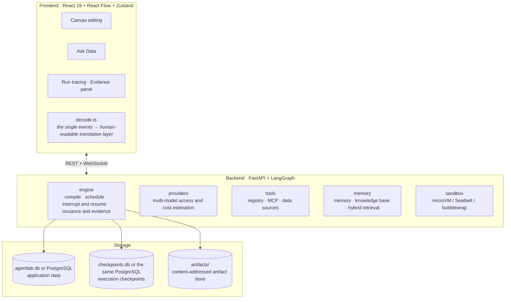
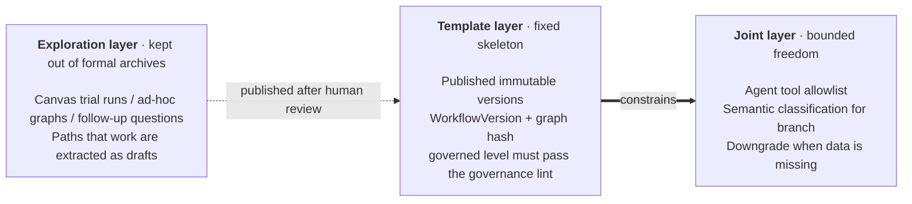

English | [Simplified Chinese](../zh-CN/architecture.md)

# Architecture and Design Decisions

This page covers AgentLab's overall architecture and the reasons behind its key design decisions. It is for people who want to change the code or understand why the system works the way it does. For the directory layout and the development workflow, see [Development](development.md). The user interface is currently available in Simplified Chinese only.

## Overview

## Constrained dynamic orchestration

The steps of most real tasks are known in advance: writing a weekly report, checking data, publishing after approval. Having the model re-plan on the spot every time reinvents answers that are already known and makes results unreproducible, and what can't be reproduced can't be signed off.

So AgentLab's engine is **compiled**: at run time the model can't change the graph structure, and its freedom is structurally confined to the inside of agent nodes and to branch decisions. On top of that there are three layers:

- **Template layer**: formal runs accept only published immutable versions; governed-level publishing must pass the governance check and the evidence gates.
- **Joint layer**: freedom within the authorized scope; the tool allowlist decay report surfaces tools that are authorized but never used, as grounds for narrowing permissions.
- **Exploration layer**: results are marked exploratory and kept out of formal archives; paths that work are turned into drafts with Extract Template and published after human review.

For how to publish and how to go from exploration to a template, see [Workflows](workflows.md#publishing-and-versions).

## Why LangGraph

The hard part of visual orchestration isn't drawing nodes and edges; it's pausing, resuming, and replaying. LangGraph's checkpointer and `interrupt()` handle these at the lowest level:

- Human intervention is one interrupt plus one `Command(resume=...)`, and after a process restart execution can still continue from the checkpoint.
- `aget_state_history()` gives a state snapshot of every step directly.

This brings another benefit: **tool approvals inside an agent aren't billed twice**. `interrupt()` makes the whole node replay, so a naive implementation would re-execute the earlier model calls. Model calls and tool executions inside agent nodes are all wrapped in LangGraph's `@task`, so their results go into the checkpoint and a replay reads them from the cache.

## The event stream is the only data source for visualization

Nodes emit events through `get_stream_writer()`, and the runner turns them into `RunEvent`s, stores them, and broadcasts them. Canvas highlighting, the token stream, tool cards, and the timeline are all driven by the same events: refreshing the page or joining midway still gets the complete process (the WebSocket backfills history first, then switches to live).

Correspondingly, the frontend has only one translation layer, `run/decode.ts`, shared by the canvas's right column, the Ask Data page, and the run details page. With several separate layers, the same run would tell three versions of the story on three pages, and users would have no way to tell which one is true.

## Canvas motion shows only real events

Everything that moves on the canvas corresponds to a real event (for the meanings, see [Workflows](workflows.md#what-the-motion-means)). When a graph with a dozen or more nodes is running, you need to see at a glance who is moving; purely decorative motion can't do that and only makes the canvas noisy.

- The collaboration matrix and the swim lanes in the right column read **the same** `reduceTeam` (`run/decode.ts`), so the two never show different degrees of parallelism.
- When motion is turned off at the system level, light effects are not drawn at all rather than frozen: an arc of light stuck on its last frame and dots piled up at the starting point look like broken rendering.

## Guardrails instead of a fixed step count

A fixed step count is meant to guard against four things: loops that don't converge, spending that keeps growing, context filling up, and genuinely runaway agents. Each has a guard that fits better (`engine/guards.py`): repeated calls aren't executed again, token and spending budgets, compressing and then wrapping up as the context nears the window, and a step count kept only as a backstop. For the values, see [Workflows](workflows.md#guardrails).

The limits are snapshotted when the run starts, and resuming or continuing uses the same snapshot: when a run resumes after an approval, the node replays in full, and if the limits had changed, the point where the loop stops would no longer match the checkpoint.

## Two sandbox tiers

The lightweight tier uses the operating system's own access control (Seatbelt, bubblewrap) and starts fast, but on macOS it can't limit memory; the heavyweight tier, microVM, has its own kernel, so memory limits really take effect, at the cost of a wait the first time the image is pulled. That is why auto mode uses the lightweight tier while the image isn't cached. For each tier's guarantees, limits, and measurements, see [Identity, Permissions, and Security](identity-and-security.md#code-sandbox).

## Why retrieval is hybrid

The default embedding is local feature hashing: no network, no model download, usable with zero configuration, but weak at semantic generalization. BM25 adds exact keyword matching.

Measured on an evaluation set of 24 documents and 16 questions (hit@1):

| Configuration | hit@1 | Literal | Semantic |
|---|---|---|---|
| Keyword only (alpha=0) | 88% | 100% | 75% |
| Vector only (local hashing, alpha=1) | 81% | 88% | 75% |
| Hybrid + Qwen3-Embedding-4B | 94% | 100% | 88% |
| The above plus model reranking | 100% | — | — |

- Vector only (81%) is lower than keyword only (88%), and only hybrid reaches 94%. Proper nouns rely on BM25 and paraphrases rely on vectors, each carrying half the load: on this corpus, hybrid retrieval is necessary, not decoration.
- The sample is only 16 questions, so one question is worth 6 percentage points. The direction of the conclusion can be trusted; its precision shouldn't be over-read.

The embedding model's dimension is found by probing, not inferred from the model name. Locally deployed models vary in dimension (1024 for bge-m3, 2560 for Qwen3-Embedding-4B); a wrong guess isn't a small error: every stored vector would be judged incompatible with the current embedder, and retrieval would fall back to keywords entirely.

## Why spreadsheets must become tables

If Excel or CSV files went into the knowledge base, they could only be chunked and retrieved, and the numbers would become whatever the model "reads" from fragments. But this project's basic convention is "all arithmetic sinks into SQL or caliber cards": output review can catch numbers that appear out of nowhere, but not one cell misread from a pile of fragments. So an uploaded spreadsheet becomes a SQLite file registered as a data source (see [Data Sources](data-sources.md#upload-spreadsheets)).

## Edge routing

After automatic layout, the corridor between two layers is made as wide as the maximum number of edges through it that overlap vertically. The frontend's `canvas/routing.ts` uses that to give each edge its own vertical lane, staggers the ports, and routes long edges that span layers through gaps where there are no nodes. `check-canvas-layout` guards this with geometric assertions (see [Development](development.md#frontend-checks)).
