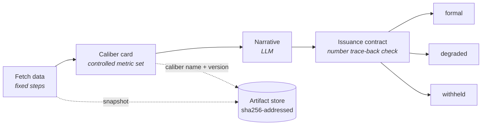

English | [Simplified Chinese](../zh-CN/evidence.md)

# Evidence and Issuance

This page covers where the numbers in a report come from and how to check them: caliber cards and issuance contracts, the three issuance tiers, citation markers in the report-writer node, what happens when the queried range has no data, what you see when you click a number, sealing and verification, the two kinds of export, and the review tools: double-blind recomputation, adversarial review, approval inquiry, the what-if sandbox, and run comparison. It is for builders, approvers, and people who read reports. The user interface is currently available in Simplified Chinese only.

## The basic idea

All arithmetic happens inside caliber card nodes; the narrative can only cite, never compute new numbers. A caliber card is a controlled metric set: how each metric is fetched and computed is written as an expression, with a caliber name and a version. The system fills the numbers into the report from snapshots, and every one of them opens to its provenance.

Two built-in templates demonstrate this chain:

- Template 8: an LLM call node writes the narrative, and the exit traces the numbers in it back to the metric set by value.
- Template 9: a report-writer node replaces the narrative, and numbers are filled in by citation.




## Issuance contracts and tiers

An issuance contract is set on the `output` node and decides the tier the output is issued at: formal (complete issuance), degraded, or withheld. The verdict and the missing-data declaration are printed with the output. When data is missing, the output is downgraded rather than forced through.

### Tracing back by value

When the contract checks values only, the validator extracts every number from the narrative and traces each one back to the metric set:

- It handles thousands separators, conversion between percentages and ratios, the Chinese suffixes for thousand, ten thousand, and hundred million, and a rounding tolerance based on the precision as written.
- Dates, enumeration ordinals, and citation markers are not traced back.
- Numbers written in Chinese numerals are traced back too; otherwise rewording a number would get around the check. Fraction, multiple, percentage, and half forms are traced back as ratios, and an approximate form such as "two thousand-odd" is traced back as the interval [2000, 3000]. Vague references, ordinals, quarter names, and structural enumerations (such as "one issue", "very important", "from three angles", "the third quarter", or "several dozen") don't count as conclusion numbers.

Measured: every number in body text written by Opus 5 traced back successfully, but the `100` in a closing "(about 100 characters)" was judged a number outside the set and triggered a downgrade. The fix was to change the prompt, not to widen the allowlist, which is exactly how the validator should behave.

### Checking by citation

When the contract sets `report_from`, the check goes by citation: the hash is verified again when the report document is retrieved, everything is recomputed independently, and only when every number carries a citation is the issuance judged complete.

### Metric issuance

A pure metrics dashboard (the contract sets only `metrics_from`, there is no report-writer node upstream, and the output contains no model-written text) is issued by its metrics. With no narrative to check, the metrics themselves are checked:

- whether all required metrics are present;
- whether each metric's inputs trace back to raw data (cells of query snapshots, run inputs);
- whether the numbers in the output fields all trace back to metrics.

The governed level requires every metric to trace back to raw data statically.

When the source query of a contract metric has SQL check errors, the issuance is downgraded (see [Data Catalog](data-catalog.md#sql-checks)).

## Caliber cards

- An expression can be written as `cell(nodes.pull, 0, 'gmv')`, which makes the provenance precise to the cell.
- Leave rounding and default values to the caliber card's decimal places and display settings instead of writing them into the data-fetch SQL (for why, see [Caliber Ledger](evaluation-and-ledger.md#a-caliber-label-for-each-number)).
- When publishing at the governed level, caliber card inputs can't come from sandbox code in the compute role (gate G4).

### Caliber version bumps

When a pinned method card gets a new version, formal runs refuse to start until the template explicitly declares a version-bump policy:

| Policy | What it does |
|---|---|
| `recompute` | Recompute history |
| `dual` | Print the old and new versions side by side |
| `incomparable` | Mark before and after as not comparable |

There is no default. The way a caliber change most easily goes wrong without anyone noticing is "the numbers all look right; they just aren't comparable with last week's". When the version an app pins is bumped, the app also needs a disposition; see [Apps](apps.md#create-an-app).

## The report-writer node

In the report-writer node (`report`), the model writes only citation markers, and the system fills in the values from snapshots. What you see in the streaming output is the final number.

### Citation markers

```
[[m:gmv]]  [[m:gmv|<unit>]]                caliber card metric; the system also handles display unit conversion
[[i:week]]                                 run input
[[v:Q1.r0.gmv]]                            one cell of a query snapshot; the hash is verified again on retrieval
[[table:Q1 cols=region,amount rows=0-4]]   the system builds the whole table from the snapshot; every cell is clickable
[[t:orders]]  [[c:orders.week]]            table name, field name; names written in backticks are checked too
[[q:K1|<quote>]]                           verbatim knowledge-base quote; must appear word for word in the chunks that retrieval hit
[[see:m:gmv,Q1]]                           basis of a claim sentence; attached at the end of the sentence, not rendered
```

### Handling violations

- Bare numbers and citations that can't be parsed are flagged as violations on the spot and sent back for rewriting (`max_repairs`, default 1).
- If the text still doesn't pass, `on_violation` decides: fail the node (the default for formal runs) or mark the violations in the report (the default for exploratory runs).

## The data retrieval chain

- Data fetched by agents, tool nodes, code nodes, and knowledge retrieval is recorded in the evidence ledger. The report's source list is numbered from the ledger: Q1… for queries, K1… for knowledge-base chunks.
- When an agent turns on `cite_fields` (together with `output_schema`), each field records which cell of which query it came from, and that is checked against the snapshot: on a mismatch the snapshot wins and a warning is raised; anything not found is recorded as null, not defaulted to 0.
- A code node's `evidence_role` is `source` (data retrieval) or `compute` (computation, the default). Numbers computed in the sandbox can't be cited directly by a report; they must go through a caliber card.
- Cells of uploaded spreadsheets can be traced back to the cell in the original sheet (an inferred source).
- Tables read back from registered endpoints can serve as evidence too (see [Tools](tools.md#endpoint-reads-can-serve-as-evidence)), and a subworkflow's provenance travels back to the parent graph (see [Workflows](workflows.md#subworkflows)).
- A data source can set masked columns (`mask_columns`). For builders, admins, and everyone when login is off, masking only reduces exposure and is not a security boundary; for users with login on, it is a boundary (see [Which roles can see raw values](identity-and-security.md#which-roles-can-see-raw-values)).

## No data in the queried range

Query a table that keeps only the latest day (fully reloaded every day) for last week and the week before, and whole columns come back as 0. Those zeros don't mean nothing happened; the table simply has no data for that period. Keep computing with them, and the report ends up saying "0 last week" and "0.00% week over week".

- When a query result has a numeric column that is entirely 0 or empty, the system narrows the SQL to the expression that computes that column, extracts the tables and time conditions it uses, checks on the spot the earliest and latest dates actually present in that column of the table, and compares them with the queried range. It counts as no data only when they don't overlap at all; when a column uses several ranges (this week minus last week), every range must fail to overlap.
- What it finds is written into the query result and the snapshot for people and the model to read: which period was queried, which period the table actually has data for, and that these zeros don't mean the period was really 0. The timeline records a warning, and the query step in the evidence panel lists those columns.
- The caliber card computes as usual; metrics taken from those columns are marked "No data in range", with the reason (columns with data in the same query are unaffected). The issuance contract counts them as gaps and downgrades the issuance, and the same goes for a report that cites such a cell directly. For outputs without an issuance contract, the app's stamp states plainly that these zeros don't mean 0.
- The report-writer node is reminded not to write 0, flat, or 0%, but to state plainly that the table has no data for the period and up to which date data exists.
- In Ask Data, the review records it as a gap worth one rebuild, so the turn can start over per the review with a table that has data for the period (see [Output review](ask-data.md#output-review)). When Copilot checks a graph it is building, it also checks hard-coded SQL; if it finds this problem, it is told to switch tables, or, if there is no such table, to tell the user plainly.
- Double-blind recomputation records inputs on those columns as "Can't recompute".
- It errs on the side of missing cases: the live checks are time-limited (10 seconds each, 20 seconds in total); on a timeout or failure it falls back to the range recorded by profiling or value observation and notes which day's profiling or observation it used (see [Data profiling](data-catalog.md#data-profiling)), and with neither it doesn't judge. SQL it can't parse and date formats it doesn't recognize aren't judged, and masked columns aren't checked. A result with no rows at all is outside its scope.

## What you see when you click a number


<sub>The Evidence tab on the Records page: clicking "period-over-period 8.7%" makes the right column point from the caliber card's original formula and substituted formula all the way to the cited cell in each of the two queries, ending with the seal check; bottom left is the evidence list. Mock can't write a report with citations, so this run was faked with a frontend test fixture (`frontend/src/run/__tests__/evidence-query.json`, sample data); the other entries in the list are real Mock runs.</sub>

- **Numbers**: the metric's original formula, substituted formula, and recomputed result; whether the inputs match the snapshot; the query's SQL; the cited row plus 2 rows before and after, highlighted down to the cell; and finally the seal status. Only artifacts returned by events inside the sealed scope are accepted. The provenance chain also starts with a Caliber step (see [Caliber Ledger](evaluation-and-ledger.md#a-caliber-label-for-each-number)).
- **Table and field names**: which query they appear in, their type, and the table they belong to. A name found nowhere in the schema snapshot, the SQL, or the result columns is marked as a suspicious entity ("May be a fabricated name", with the 3 closest matches). When a snapshot was truncated and can't be checked, it only says so, without wrongly calling the name fabricated.
- **Knowledge-base quotes**: must appear word for word in the chunks that retrieval hit.

## Claim sentences

The report node's `claims` setting decides how claim sentences are handled:

| Value | What it does |
|---|---|
| `off` (default) | Nothing |
| `require_citation` | Claim sentences must carry a basis; those without one count as gaps |
| `judge` | Also asks another model to rule on each sentence against the evidence: supported / partially supported / unsupported / not a claim |

- The judge only annotates and never rewrites the body. It warns when the judge model is the same as the writing model.
- In formal runs, the judging happens inside the node and the verdicts are sealed with the report; when a claim is unsupported, `on_unsupported` downgrades or withholds the issuance.
- In exploratory runs, a sentence is judged when you click it, and the verdict is recorded as an event appended after sealing, so seal verification still matches.
- There are caps (defaults): 40 sentences, $0.05, and 30 seconds per report; $0.01 per click; $2 per day. Each can be set to unlimited.

## Old runs and the one-click upgrade

- `GET /api/runs/{id}/evidence/audit` groups entries into no evidence / suspicious entity / has provenance / old-run guess, and can export JSON and CSV.
- Old answers without a contract are matched by value against sealed query cells and caliber card values, with at most 3 candidates per number, collapsed by default and labeled "Guessed source, not evidence".
- An old workflow can be upgraded to a traceable structure with one click: reports written by LLM calls are replaced with report-writer nodes; a report writer is inserted in the middle of Ask Data's input → agent → output; agents with `output_schema` get `cite_fields` turned on. For sandbox code that feeds a caliber card, the upgrade only suggests marking it `source` and doesn't change it for you.
- The upgrade only shows a preview; it saves only after a person confirms (and it must pass the pre-publish check; see [Workflows](workflows.md#pre-publish-check-and-fixes)).

## Sealing and verification

- The complete evidence of every run is stored in the content-addressed artifact store (`data/artifacts/`): the sha256 is the address, and the hash is verified again on retrieval.
- The hash of the event manifest at the run's final state is recorded on the run, sealed up to `run.finished`. Any later edit to the log no longer matches.
- Verify with one click on the run details page; the API is `GET /api/runs/{id}/verify`.
- Events appended after sealing are outside the verification scope, for example claim verdicts made on click in exploratory runs, and `ledger.matched` from caliber matching. They appear in the timeline and in the verifiable report's "Appended after sealing" section.

## Exports

The two exports serve different purposes: to prove nothing was altered, use the verifiable report; to let people read the report and look up where the numbers came from, use the report export.

**Report export**: Export on an Ask Data answer or on a run's output in run details (`GET /api/runs/{id}/report.html`) produces one self-contained HTML file.

- The body is rendered on the server, so it is readable without running scripts (email attachment previews often don't run scripts).
- With scripts running, every number, every number without evidence, and every suspicious table or field name is clickable. The panel shows the same provenance chain as the evidence panel on the web page (caliber, source, calculation, SQL, cited rows), with the seal status marked item by item.
- Masked columns say "Masked", following the same rules as the web page.
- Unsealed runs export as usual, for the same reason you can read their reports on the web.

**Verifiable report**: Export Verifiable Report under Provenance Details on the Records page (`GET /api/runs/{id}/bundle.html`) produces a seal verification document.

- The recipient recomputes the hashes in the browser, without connecting to the service or installing anything, and checks that no number, document, or run record has been altered.
- The provenance panel for a number likewise shows the caliber, original formula, substituted formula, inputs, and recomputation; the query snapshots that caliber card inputs point to come attached to the file.
- It proves only that the file is internally consistent: numbers, documents, and run records agree with one another and haven't been altered. To check authenticity, compare the seal hash on the page with the seal verification of this run in the system (`GET /api/runs/{id}/verify`); the page says so prominently.
- Events appended after sealing (annotations such as on-demand judging and approval inquiries) are listed separately, with only their type, sequence number, and a content summary, and aren't part of the manifest.
- When a data source has masked columns, query snapshots that can't be shown to leave them untouched, and caliber cards with inputs from masked columns, are given by id only, without content. Masking only reduces exposure and is not a security boundary.
- Export is available only after the run has finished and been sealed. If a run that ended in failure is continued later, it is sealed again, and the exported file no longer matches the seal in the system.

Each export records an audit entry, `report.exported`.

## The review suite

Before a report is issued, you can have another model query the database to check it; afterwards, you can change inputs or pick a baseline to see how the numbers move.

- Double-blind recomputation, adversarial review, and approval inquiry share one read-only verification agent. It gets only read-only query tools for the data sources, and write statements are refused even on writable sources; cells taken from masked columns are replaced with "Masked" before they reach the model. Numbers it writes itself aren't trusted: the system takes every number by cell reference from the agent's own query snapshots.
- Queries from double-blind recomputation and adversarial review are sealed with the run and can be drilled into from the evidence panel; inquiry queries are listed under the Q&A. None of them enter the report's writing catalog, so writers never cite them. The comparisons from double-blind recomputation, the review records, and the inquiry answers form the Verification Records group on the Artifacts tab of run details.
- Under Settings → Preferences → Verification, the three share a verification model and a daily spending cap ($2 by default), and each has its own switch and caps; anything set on a node takes precedence. When no verification model is set, the evidence judge's model is used. It's better to pick one that differs from the models that write the report and query the data: a model has a hard time spotting its own mistakes.
- Double-blind recomputation and adversarial review follow the verification settings captured when the run started: if the settings change while the run waits on an approval, it resumes with the original ones. With multiple processes, the daily spending of the judge and of verification is counted site-wide (see [PostgreSQL and Scaling](postgresql-and-scaling.md#state-shared-across-processes)).
- The what-if sandbox and run comparison only recompute from the run records: they call no model, don't query business databases, and don't change the original run. The verifiable report is an export; see [Exports](#exports).

### Double-blind recomputation

A caliber card's formula is deterministic and can be recomputed; what goes wrong is the numbers fed into it: which table was queried, which day a record is attributed to, whether refunds were excluded. Before issuance, double-blind recomputation hands every input of a metric that comes from a query to a verification agent that can't see the original SQL, has it compute the input independently, then plugs the result back into the original formula and compares it with the original value.

- Usage: a Double-Blind Recomputation node on the canvas, placed after the caliber card and before the output. Choose the caliber card to recompute (no need when there is only one upstream) and the metrics to recompute (by default, every metric whose inputs come from queries), then write a caliber description for each metric, such as "Sales are counted by payment time, excluding refunds". The blind side can write its queries only from the metric name, this description, and the data catalog, so the more specific the description, the more meaningful the comparison.
- The blind side sees neither the original SQL nor the original result, nor the column names the original flow chose: a column name would reveal which column the original attributed by, the blind side would compute the same number by following it, and traps like order date versus payment date would slip through.
- The two sides agree when they differ by no more than the Allowed Relative Error (one in a million by default; absolute error when the original value is 0). When everything agrees, the run passes.
- On a disagreement, the run pauses, and the approval card explains, input by input, where the two SQL statements differ. For each metric, the reviewer chooses "Use the original flow's result", "Use the blind result", or "Both are wrong". Choosing the blind result doesn't replace the number in the report: the latter two choices, and metrics left without a choice, count as issuance gaps and downgrade the issuance; with When the Original Flow Isn't Adopted set to Fail, the node fails instead. This step can take a Reject exit (see [Rejection](workflows.md#rejection)).
- When the two sides differ in exactly one respect that matches a data catalog fact (filtering on different date columns, one extra condition excluding invalid records, deduplicating or not), the reviewer's choice is written into the catalog as a manually confirmed business date, valid-record condition, or dedup rule; a metric's own filter scope doesn't count. The approval card previews what each choice would write; when in doubt, nothing is written and the reason is stated.
- Recorded as "Can't recompute" and counted as gaps: the blind side hit a cap, errored, or returned no number; an input comes from a masked column; an input lands on a column whose queried range has no data (see [No data in the queried range](#no-data-in-the-queried-range)); the run's time limit was near and there was no time left. When time runs short, select fewer metrics, or put a human approval before the double-blind node (time limits are counted separately before and after an approval).
- Only metrics whose inputs come from query results are recomputed; the node doesn't support retry on failure; and when the blind model is the same as the original flow's, the run warns that the recomputation lacks independence.

### Adversarial review

The claim-sentence judge looks only at the evidence the writer attached, but that evidence may have been cherry-picked: sales queried with refunds included, or only one month looked at. Adversarial review works from the other direction and writes its own queries to look for counterexamples.

- Usage: an Adversarial Review node on the canvas, wired as report writer → adversarial review → output. On a side branch or after the output, the downgrade can't happen, and the canvas warns about it. With only one report upstream, there's no need to choose Report to Review.
- From each report it picks up to 5 key claim sentences (those with a basis, or with comparisons or causation, come first; the same report always yields the same sentences) and sends a read-only verification agent to each in turn, querying the data sources that sentence cites (for a sentence without a basis, the data sources the report cites). The agent first works out "if this sentence were false, what would the data show", then goes looking.
- Each sentence is ruled as holds up, weakened, refuted, or inconclusive, and numbers in the rationale may only cite cells from the agent's own queries. A refuted ruling must cite the agent's own query results in its rationale, or it isn't accepted; a sentence for which no query succeeded is inconclusive.
- When a Claim Is Refuted offers Downgrade Issuance (the default; the refuted claim counts as an issuance gap), Flag Only, and Fail and Stop the Run.
- When there is a human approval downstream, its card carries a summary of the review, stating whether the issuance will be downgraded and how many sentences couldn't be checked. Each sentence's ruling, rationale, and queries are saved in the review record and sealed with the run.
- Default caps: 4 queries and 90 seconds per sentence, with sentences checked one after another. When the run's time limit is near, the remaining sentences aren't started and are recorded as not checked.
- The rulings come from the adversarial model, not from a system check. The canvas and the run both warn when the adversarial model is the same as the writing model.

### Approval inquiry

An approval card shows only the report body and a summary of the checks. When an approver has a question about a sentence ("does this number include refunds?", "what if test accounts are excluded?"), there's no need to reject and rerun or to query the database yourself: you can ask on the spot.

- Usage: on the report awaiting approval, click Inquire at the end of a sentence, select a passage of the text, or use Ask About the Whole Report. The verification agent answers by querying, read-only, the data sources this run used; it usually takes a few dozen seconds.
- The answer leads with the conclusion. Its numbers may only cite cells from the agent's own queries, metrics already in the report, or run inputs, and all of them open to their provenance; bare numbers are flagged. The answer notes that it was given by the verification model and is not a system check.
- The report isn't changed by a single character. The question and answer go into the run record and are sealed with the run.
- Only one inquiry per run is answered at a time, and the run can't be approved or rejected while an answer is pending.
- After sealing, only exploratory runs whose seal verifies can still be questioned: the Q&A is appended after sealing, as an annotation rather than evidence, and the agent queries the data as it is now, which the end of the answer notes. Formal runs accept no more inquiries once sealed.
- Default caps: 6 queries and 120 seconds per inquiry; hitting a cap or a failed query is noted at the end of the answer. With Approval Inquiry · Enabled turned off, there's no entry point, and existing Q&A is still listed.
- Masked values stay out of answers: an assembled answer in which a masked value can still be recognized isn't handed out.

### What-if sandbox

Use it when you want to know what a number would become if an input took a different value or a few rows were removed, and which places in the report would change with it, without touching the original run.

- Usage: in the evidence panel, open a number on a caliber card and click What-If. Change the value of an input, or tick rows to exclude in the query results behind it (ticked rows are treated as absent; rows the metric doesn't use can't be ticked).
- The result shows the new value, the what-if substituted formula, and the change; it lists the places in the report that would change (you can jump to each) and the downstream caliber cards that might be affected: they cite this card's metrics, and the what-if doesn't recompute them.
- It computes the way the caliber card does: the same original formula, the same evaluator, the same rounding.
- A what-if is never an issuance: nothing goes into the run record, the report isn't changed, and only the person who ran it sees the result.
- Runs still in progress or paused on an approval can be explored too, and the page says "The run isn't sealed, and the data may still change"; when seal verification fails, it says the data behind the what-if may have been altered.
- When a what-if isn't possible, the page states why instead of saying "No change": inputs from masked columns show no value and can't be changed (change an input or exclude a row, compare the old and new values, and the masked cell can be worked out), and such a metric's original value also shows as "Masked"; a card that didn't record all its inputs, a container input whose full value can't be recovered (old runs didn't save it), or a query snapshot that can't be read also rules out a what-if.

### Run comparison

For two runs of the same workflow (this week's and last week's weekly report, say), it breaks down each metric's change: did the data change, the caliber, or the template or SQL?

- Usage: Compare With Previous Run in the More menu of run details. When the previous run didn't succeed, the menu says Compare With Last Successful Run; with no default baseline, it's Choose a Baseline…. On the comparison page you can change the baseline or swap the two sides.
- Default baseline: for a run started by a schedule, the last run of the same schedule that finished successfully and was sealed; for other runs, or when the schedule has no earlier successful run, the same within the same workflow and run class.
- Both runs must be finished, sealed, and pass seal verification, and only runs of the same saved workflow can be compared.
- Each metric falls into one class: data only, caliber and data, SQL structure changed (including changed configuration of an upstream node), parameters only (such as different dates), added, removed, incomparable, or unchanged. The caliber covers the formula, the caliber version, decimal places, units, and whether the metric is a ratio; turning thousands separators on or off doesn't count.
- When the caliber and data both changed and a strict split is possible, the caliber effect and the data effect are given separately, and they add up to the total change.
- For metrics in the data-only, parameters-only, and caliber-and-data classes, when attribution is possible, the dimension values (regions, say) with the largest changes are listed, up to 10. Every item traces back to the query snapshots on both sides; queries run by verification take no part in the comparison.
- Values from masked columns never appear in the result, and metrics that use masked columns aren't split.
- When a scheduled run finishes successfully and is sealed, it is compared once automatically with the same schedule's last successful run; the trigger history and notifications show only which run was the baseline and how many metrics fall into each class, never the actual numbers.
