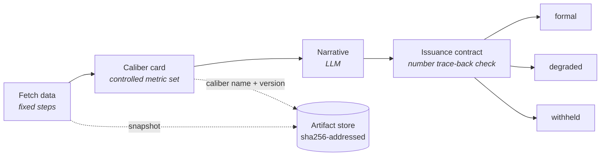

English | [Simplified Chinese](../zh-CN/evidence.md)

# Evidence and Issuance

This page covers where the numbers in a report come from and how to check them: caliber cards and issuance contracts, the three issuance tiers, citation markers in the report-writer node, what you see when you click a number, sealing and verification, and the two kinds of export. It is for builders and for people who read reports. The user interface is currently available in Simplified Chinese only.

## The basic idea

All arithmetic happens inside caliber card nodes; the narrative can only cite, never compute new numbers. A caliber card is a controlled metric set: how each metric is fetched and computed is written as an expression, with a caliber name and a version. The system fills the numbers into the report from snapshots, and every one of them opens to its provenance.

Two built-in templates demonstrate this chain:

- Template 8: an LLM call node writes the narrative, and the exit traces the numbers in it back to the metric set by value.
- Template 9: a report-writer node replaces the narrative, and numbers are filled in by citation.




## Issuance contracts and tiers

An issuance contract is set on the `output` node and decides the tier the output is issued at: formal (complete issuance), degraded, or withheld. The verdict and the missing-data declaration are printed with the output. When data is missing, the output is downgraded rather than forced through.

### Tracing back by value

When the contract checks values only, the validator extracts every number from the narrative and traces each one back to the metric set:

- It handles thousands separators, conversion between percentages and ratios, the Chinese suffixes for thousand, ten thousand, and hundred million, and a rounding tolerance based on the precision as written.
- Dates, enumeration ordinals, and citation markers are not traced back.
- Numbers written in Chinese numerals are traced back too; otherwise rewording a number would get around the check. Fraction, multiple, percentage, and half forms are traced back as ratios, and an approximate form such as "two thousand-odd" is traced back as the interval [2000, 3000]. Vague references, ordinals, quarter names, and structural enumerations (such as "one issue", "very important", "from three angles", "the third quarter", or "several dozen") don't count as conclusion numbers.

Measured: every number in body text written by Opus 5 traced back successfully, but the `100` in a closing "(about 100 characters)" was judged a number outside the set and triggered a downgrade. The fix was to change the prompt, not to widen the allowlist, which is exactly how the validator should behave.

### Checking by citation

When the contract sets `report_from`, the check goes by citation: the hash is verified again when the report document is retrieved, everything is recomputed independently, and only when every number carries a citation is the issuance judged complete.

### Metric issuance

A pure metrics dashboard (the contract sets only `metrics_from`, there is no report-writer node upstream, and the output contains no model-written text) is issued by its metrics. With no narrative to check, the metrics themselves are checked:

- whether all required metrics are present;
- whether each metric's inputs trace back to raw data (cells of query snapshots, run inputs);
- whether the numbers in the output fields all trace back to metrics.

The governed level requires every metric to trace back to raw data statically.

When the source query of a contract metric has SQL check errors, the issuance is downgraded (see [Data Catalog](data-catalog.md#sql-checks)).

## Caliber cards

- An expression can be written as `cell(nodes.pull, 0, 'gmv')`, which makes the provenance precise to the cell.
- Leave rounding and default values to the caliber card's decimal places and display settings instead of writing them into the data-fetch SQL (for why, see [Caliber Ledger](evaluation-and-ledger.md#a-caliber-label-for-each-number)).
- When publishing at the governed level, caliber card inputs can't come from sandbox code in the compute role (gate G4).

### Caliber version bumps

When a pinned method card gets a new version, formal runs refuse to start until the template explicitly declares a version-bump policy:

| Policy | What it does |
|---|---|
| `recompute` | Recompute history |
| `dual` | Print the old and new versions side by side |
| `incomparable` | Mark before and after as not comparable |

There is no default. The way a caliber change most easily goes wrong without anyone noticing is "the numbers all look right; they just aren't comparable with last week's". When the version an app pins is bumped, the app also needs a disposition; see [Apps](apps.md#create-an-app).

## The report-writer node

In the report-writer node (`report`), the model writes only citation markers, and the system fills in the values from snapshots. What you see in the streaming output is the final number.

### Citation markers

```
[[m:gmv]]  [[m:gmv|<unit>]]                caliber card metric; the system also handles display unit conversion
[[i:week]]                                 run input
[[v:Q1.r0.gmv]]                            one cell of a query snapshot; the hash is verified again on retrieval
[[table:Q1 cols=region,amount rows=0-4]]   the system builds the whole table from the snapshot; every cell is clickable
[[t:orders]]  [[c:orders.week]]            table name, field name; names written in backticks are checked too
[[q:K1|<quote>]]                           verbatim knowledge-base quote; must appear word for word in the chunks that retrieval hit
[[see:m:gmv,Q1]]                           basis of a claim sentence; attached at the end of the sentence, not rendered
```

### Handling violations

- Bare numbers and citations that can't be parsed are flagged as violations on the spot and sent back for rewriting (`max_repairs`, default 1).
- If the text still doesn't pass, `on_violation` decides: fail the node (the default for formal runs) or mark the violations in the report (the default for exploratory runs).

## The data retrieval chain

- Data fetched by agents, tool nodes, code nodes, and knowledge retrieval is recorded in the evidence ledger. The report's source list is numbered from the ledger: Q1… for queries, K1… for knowledge-base chunks.
- When an agent turns on `cite_fields` (together with `output_schema`), each field records which cell of which query it came from, and that is checked against the snapshot: on a mismatch the snapshot wins and a warning is raised; anything not found is recorded as null, not defaulted to 0.
- A code node's `evidence_role` is `source` (data retrieval) or `compute` (computation, the default). Numbers computed in the sandbox can't be cited directly by a report; they must go through a caliber card.
- Cells of uploaded spreadsheets can be traced back to the cell in the original sheet (an inferred source).
- Tables read back from registered endpoints can serve as evidence too (see [Tools](tools.md#endpoint-reads-can-serve-as-evidence)), and a subworkflow's provenance travels back to the parent graph (see [Workflows](workflows.md#subworkflows)).
- A data source can set masked columns (`mask_columns`). For builders, admins, and everyone when login is off, masking only reduces exposure and is not a security boundary; for users with login on, it is a boundary (see [Which roles can see raw values](identity-and-security.md#which-roles-can-see-raw-values)).

## What you see when you click a number


<sub>The Evidence tab on the Records page: clicking "period-over-period 8.7%" makes the right column point from the caliber card's original formula and substituted formula all the way to the cited cell in each of the two queries, ending with the seal check; bottom left is the evidence list. Mock can't write a report with citations, so this run was faked with a frontend test fixture (`frontend/src/run/__tests__/evidence-query.json`, sample data); the other entries in the list are real Mock runs.</sub>

- **Numbers**: the metric's original formula, substituted formula, and recomputed result; whether the inputs match the snapshot; the query's SQL; the cited row plus 2 rows before and after, highlighted down to the cell; and finally the seal status. Only artifacts returned by events inside the sealed scope are accepted. The provenance chain also starts with a Caliber step (see [Caliber Ledger](evaluation-and-ledger.md#a-caliber-label-for-each-number)).
- **Table and field names**: which query they appear in, their type, and the table they belong to. A name found nowhere in the schema snapshot, the SQL, or the result columns is marked as a suspicious entity ("May be a fabricated name", with the 3 closest matches). When a snapshot was truncated and can't be checked, it only says so, without wrongly calling the name fabricated.
- **Knowledge-base quotes**: must appear word for word in the chunks that retrieval hit.

## Claim sentences

The report node's `claims` setting decides how claim sentences are handled:

| Value | What it does |
|---|---|
| `off` (default) | Nothing |
| `require_citation` | Claim sentences must carry a basis; those without one count as gaps |
| `judge` | Also asks another model to rule on each sentence against the evidence: supported / partially supported / unsupported / not a claim |

- The judge only annotates and never rewrites the body. It warns when the judge model is the same as the writing model.
- In formal runs, the judging happens inside the node and the verdicts are sealed with the report; when a claim is unsupported, `on_unsupported` downgrades or withholds the issuance.
- In exploratory runs, a sentence is judged when you click it, and the verdict is recorded as an event appended after sealing, so seal verification still matches.
- There are caps (defaults): 40 sentences, $0.05, and 30 seconds per report; $0.01 per click; $2 per day. Each can be set to unlimited.

## Old runs and the one-click upgrade

- `GET /api/runs/{id}/evidence/audit` groups entries into no evidence / suspicious entity / has provenance / old-run guess, and can export JSON and CSV.
- Old answers without a contract are matched by value against sealed query cells and caliber card values, with at most 3 candidates per number, collapsed by default and labeled "Guessed source, not evidence".
- An old workflow can be upgraded to a traceable structure with one click: reports written by LLM calls are replaced with report-writer nodes; a report writer is inserted in the middle of Ask Data's input → agent → output; agents with `output_schema` get `cite_fields` turned on. For sandbox code that feeds a caliber card, the upgrade only suggests marking it `source` and doesn't change it for you.
- The upgrade only shows a preview; it saves only after a person confirms (and it must pass the pre-publish check; see [Workflows](workflows.md#pre-publish-check-and-fixes)).

## Sealing and verification

- The complete evidence of every run is stored in the content-addressed artifact store (`data/artifacts/`): the sha256 is the address, and the hash is verified again on retrieval.
- The hash of the event manifest at the run's final state is recorded on the run, sealed up to `run.finished`. Any later edit to the log no longer matches.
- Verify with one click on the run details page; the API is `GET /api/runs/{id}/verify`.
- Events appended after sealing are outside the verification scope, for example claim verdicts made on click in exploratory runs, and `ledger.matched` from caliber matching. They appear in the timeline and in the verifiable report's "Appended after sealing" section.

## Exports

The two exports serve different purposes: to prove nothing was altered, use the verifiable report; to let people read the report and look up where the numbers came from, use the report export.

**Report export**: Export on an Ask Data answer or on a run's output in run details (`GET /api/runs/{id}/report.html`) produces one self-contained HTML file.

- The body is rendered on the server, so it is readable without running scripts (email attachment previews often don't run scripts).
- With scripts running, every number, every number without evidence, and every suspicious table or field name is clickable. The panel shows the same provenance chain as the evidence panel on the web page (caliber, source, calculation, SQL, cited rows), with the seal status marked item by item.
- Masked columns say "Masked", following the same rules as the web page.
- Unsealed runs export as usual, for the same reason you can read their reports on the web.

**Verifiable report**: Export Verifiable Report under Provenance Details on the Records page (`GET /api/runs/{id}/bundle.html`) produces a seal verification document.

- The recipient recomputes the hashes in the browser without connecting to the service, and checks that no number, document, or run record has been altered.
- The provenance panel for a number likewise shows the caliber, original formula, substituted formula, inputs, and recomputation; the query snapshots that caliber card inputs point to come attached to the file.

Each export records an audit entry, `report.exported`.

## The review suite

Beyond the run itself, there is a set of review tools: double-blind recomputation, adversarial review, approval inquiry, and the what-if sandbox. The adjudication in double-blind recomputation is a human step: it can reject and can take a Reject exit (see [Workflows](workflows.md#rejection)). With multiple processes, the daily spending of the judge and of verification is counted site-wide (see [PostgreSQL and Scaling](postgresql-and-scaling.md#state-shared-across-processes)).
