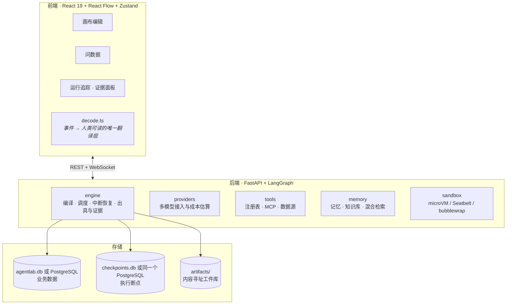
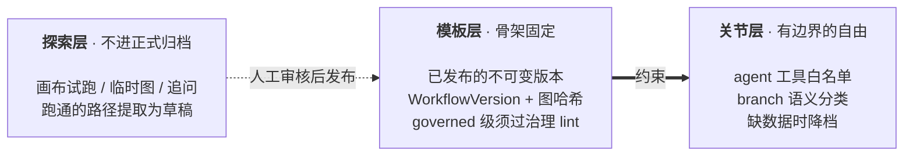

[English](../en/architecture.md) | 简体中文

# 架构与设计决策

这篇讲 AgentLab 的总体架构，以及几个关键设计决策的理由。给想改代码或想理解系统为什么这样设计的人看。目录结构和开发流程见[开发](development.md)。

## 总体架构

## 受限动态编排

大多数实际任务的步骤是已知的：写周报、核对数据、审批后发布。让模型每次现场重新规划，既是在重复发明已知答案，也让结果不可复现——不可复现就没法验收。

所以 AgentLab 的引擎是**编译式**的：运行时模型改不了图结构，它的自由被结构性地限制在 agent 节点内部和分支决策里。在此基础上分三层：

- **模板层**：正式运行只认已发布的不可变版本；受管级发布要过治理检查和证据门禁。
- **关节层**：授权范围内的自由；工具白名单衰减报表把「已授权但从未使用」的工具显出来，为收缩权限提供依据。
- **探索层**：结果标成探索性，不进正式归档；跑通的路径经「提取模板」沉淀为草稿，人工审核后发布。

怎么发布、怎么从探索走到模板，见[工作流](workflows.md#发布与版本)。

## 选用 LangGraph

可视化编排的难点不在画节点和连线，而在暂停、恢复与回放。LangGraph 的 checkpointer 和 `interrupt()` 把这几件事做在了底层：

- 人工介入是一次中断加一次 `Command(resume=...)`，进程重启后仍可从断点继续。
- `aget_state_history()` 直接给出每一步的状态快照。

由此还有一项收益：**agent 内部的工具审批不重复计费**。`interrupt()` 会让整个节点重放，朴素实现会重复执行之前的模型调用。agent 节点里的模型调用和工具执行都包在 LangGraph 的 `@task` 里，结果进断点，重放时直接读缓存。

## 事件流是唯一的可视化数据源

节点通过 `get_stream_writer()` 发出事件，runner 把它们转成 `RunEvent`，落库并广播。画布高亮、token 流、工具卡片、时间线全部由同一份事件驱动：刷新页面或中途接入，都能拿到完整过程（WebSocket 先补历史，再接实时）。

前端对应地只有一个翻译层 `run/decode.ts`，画布右栏、问数据页、运行详情页共用它。分设几套的后果是：同一次运行在三个页面讲出三个版本，使用者没法判断哪个是真的。

## 画布动效只表示真实发生的事

画布上每个会动的东西都对应一件真实事件（含义见[工作流](workflows.md#动效表示什么)）。跑一张十几个节点的图，一眼要能看出「谁在动」；纯装饰的动效做不到，只会让画布变吵。

- 协作矩阵和右栏泳道读的是**同一份** `reduceTeam`（`run/decode.ts`），两处不会给出不同的并行度。
- 系统关掉动效时，光效整体不绘制，而不是停住：停在最后一帧的光弧和堆在起点的光点，看着像渲染坏了。

## 用护栏代替固定步数

固定步数想挡的是四件事：循环不收敛、花费越滚越大、上下文会满、真正失控。每件事都有更贴切的挡法（`engine/guards.py`）：重复调用不再执行、令牌与金额预算、接近窗口先压缩再收尾，步数只留兜底。具体的值见[工作流](workflows.md#护栏)。

上限在运行发起时快照，恢复和接着跑沿用同一份：审批恢复时节点整个重放，上限一变，循环停的位置就和断点对不上。

## 沙箱分两档

轻量档用操作系统自带的访问控制（Seatbelt、bubblewrap），冷启动快，但 macOS 上限不住内存；重量档 microVM 有独立内核，内存限额真实生效，代价是第一次拉镜像要等。所以 auto 模式在镜像没缓存时先用轻量档。两档的保证、局限和实测数据见[身份、权限与安全](identity-and-security.md#代码沙箱)。

## 为什么检索是混合的

默认的 embedding 是本地特征哈希：不联网、不下载模型、零配置可用，但语义泛化能力弱。BM25 补上精确的关键词匹配。

实测（24 篇文档、16 个问题的评测集，hit@1）：

| 配置 | hit@1 | 字面类 | 语义类 |
|---|---|---|---|
| 纯关键词（alpha=0） | 88% | 100% | 75% |
| 纯向量（本地哈希，alpha=1） | 81% | 88% | 75% |
| 混合 + Qwen3-Embedding-4B | 94% | 100% | 88% |
| 上述配置叠加模型重排 | 100% | — | — |

- 纯向量（81%）低于纯关键词（88%），混合才到 94%。专有名词靠 BM25，同义改写靠向量，两者各担一半——在这份语料上，混合检索是必要的，不是装饰。
- 样本只有 16 题，一题就是 6 个百分点。结论的方向可信，精度不要过度解读。

向量模型的维度靠实际探测，不按模型名推断。本地部署的模型维度各异（bge-m3 是 1024，Qwen3-Embedding-4B 是 2560）；推断错了，后果不是偏差，而是全部存量向量被判定为和当前 embedder 不匹配，检索整体退回关键词。

## 为什么表格必须成为表

Excel / CSV 如果放进知识库，只能被切块检索，数字就成了模型从片段里「读」出来的。而本项目的基础约定是「所有算术下沉到 SQL 或口径卡」：产出复核能拦住凭空出现的数字，拦不住「从一堆片段里读错了一格」。所以表格上传后落成 SQLite 文件、注册成数据源（见[数据源](data-sources.md#上传表格)）。

## 连线走线

自动排版之后，层与层之间按「穿过这条走廊的连线，在竖直方向最多重叠几条」预留走廊宽度。前端的 `canvas/routing.ts` 据此给每条线分配独立的竖直车道，并错开端口、让跨层的长边从没有节点的空档绕过去。`check-canvas-layout` 用几何断言守这部分（见[开发](development.md#前端检查)）。
