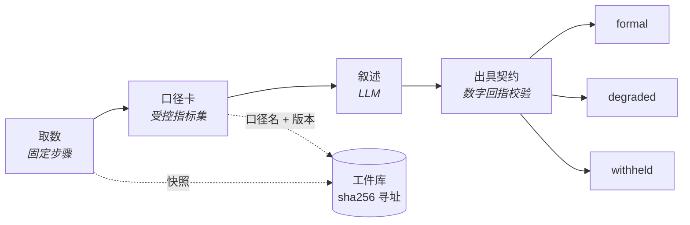

[English](../en/evidence.md) | 简体中文

# 证据与出具

这篇讲报告里的数字从哪来、怎么核对：口径卡和出具契约、三档出具、报告撰写节点的引用标记（含分析结论）、查询区间里没有数据时怎么办、点开一个数或一个分析结论能看到什么、封存与核对、两种导出，以及双盲复算、反方审稿、审批质询、数字推演、运行对比、分析说法核对这组复核工具。给搭建者、审批人和看报告的人看。分析判断本身怎么算见[分析能力](analysis.md)。

## 基本思路

所有算术都发生在口径卡节点里，叙述只能引用，不能自己算出新数字。口径卡是受控指标集：每个指标怎么取数、怎么算，写成表达式，带口径名和版本。报告里的数字由系统照快照填进去，每一个都点得开出处。

有两个内置模板示范这条链路：

- 模板 ⑧：叙述由模型调用节点写，出口把叙述里的数字按数值回指到指标集。
- 模板 ⑨：叙述换成报告撰写节点，数字按引用填值。




## 出具契约与三档

出具契约配在 `output` 节点上，决定这份成果按哪一档出具：formal（完整出具）、degraded（降档）或 withheld（不予出具）。判定结果和缺数据声明随成果一起印出。数据不全时降档，不硬出。

### 按数值回指

契约只核对数值时，校验器从叙述里抽出全部数字，逐个回指指标集：

- 支持千分位、百分数与比率互转、千 / 万 / 亿后缀，以及按书写精度的舍入容差。
- 日期、枚举序号、引用标记不参与回指。
- 中文数字同样回指，否则换一种写法就绕过去了：成、倍、百分之、分之、一半按比例回指；「两千余」按区间 [2000, 3000] 回指。「一个问题」「十分重要」「从三个方面看」「三季度」「几十家」这类虚指、序数、季度名、结构性列举不算结论数字。

实测：Opus 5 写的正文数字全部回指成功，但结尾「（约 100 字）」里的 `100` 被判为集合外数字，触发降档。处置方式是改 prompt，不是扩大白名单——这正是校验器应有的行为。

### 按引用核对

契约写了 `report_from` 时按引用核对：取回报告文档时复验哈希、独立重算一遍，全部数字都带引用才判为完整出具。

- 报告引用的口径卡指标，输入要追得到原始数据（查询快照的格、运行输入）：受管级别的正式运行里追不到的记缺口、出具降档，其余照实写进出具声明，证据面板照旧标「追不到原始数据」。
- 报告里的分析说法在这里独立再核一遍，和组装报告时用同一个核对：报告撰写节点设成严格时，仍有的违规计入出具缺口（见[分析说法核对](#分析说法核对)）。

### 指标出具

纯指标看板（契约只写 `metrics_from`，上游没有报告撰写节点，成果里也没有模型写的话）按指标出具。没有叙述可核，就核指标本身：

- 必需的指标齐不齐；
- 每个指标的输入是否追到原始数据（查询快照的格、运行输入）；
- 成果字段里的数是否都回指到指标。

受管级要求每个指标都静态地追到原始数据。

契约指标的来源查询有 SQL 检查错误时，出具降档（见[数据目录](data-catalog.md#sql-检查)）。

## 口径卡

- 表达式可以写 `cell(nodes.pull, 0, 'gmv')`，出处精确到单元格。
- 取整和缺省值交给口径卡的小数位和展示，不要写进取数 SQL（原因见[口径账本](evaluation-and-ledger.md#逐个数标口径)）。
- 受管级发布时，口径卡的输入不能来自计算角色的沙箱代码（门禁 G4）。
- 一个指标用到两份同形、只差日期的查询（本周对上周）时，系统自动做一次可比性检查（见[可比性检查](analysis.md#可比性检查)），结果挂在指标上：写作目录照实提醒；带契约的出口里，不可比的记缺口、出具降档，有条件可比的只标注。
- 分析卡的结果不作口径卡的输入：口径卡读它，按追不到原始数据处理。

### 口径升版

钉住的方法卡出现新版本时，正式运行拒绝启动，直到模板显式声明升版策略：

| 策略 | 做法 |
|---|---|
| `recompute` | 回算历史 |
| `dual` | 新旧两版双印 |
| `incomparable` | 标注前后不可比 |

这里没有默认值。口径变更最容易静默出错的形态是「数字看起来都对，只是与上周不可比」。应用固定的版本升版时也要选处置，见[应用](apps.md#生成一个应用)。

## 报告撰写节点

报告撰写节点（`report`）里，模型只写引用标记，数值由系统照快照填进去。流式输出里看到的就是最终数字。

### 引用标记

```
[[m:gmv]]  [[m:gmv|万]]                    口径卡指标；换算显示也由系统完成
[[i:week]]                                 运行输入
[[v:Q1.r0.gmv]]                            查询快照里的一格，取回时复验哈希
[[table:Q1 cols=region,amount rows=0-4]]   系统照快照生成整张表，每一格都点得开
[[t:orders]]  [[c:orders.week]]            表名、字段名；写在反引号里的名字同样核对
[[q:K1|原话]]                              知识库原话，须在那次检索命中的片段里逐字出现
[[a:A1]]  [[a:A1.top_share|pct]]          分析结论的判定语、具名的数，都由系统按结论渲染
[[v:A1.r0.share]]  [[table:A1 rows=0-4]]   分析结论结果表里的一格、整张表
[[see:m:gmv,Q1,A1]]                        结论句的依据，挂在句末，不渲染
```

分析结论按台账先后编成 A1、A2……，写作目录里另有一段「分析结论」。分析结论里的占比、变化率由系统按百分数显示（`[[a:A1.top_share]]` 写出来是 62.0%），比率的变化按百分点（1.2 个百分点），写作者照常引用、不用自己写换算。「主要来自」「异常」「持续上升」这类判断词要挂对应的分析结论、判定对得上，见[分析说法核对](analysis.md#分析说法核对)。

### 违规怎么处理

- 裸数字、解析不了的引用当场判违规，交回去重写（`max_repairs`，默认 1 次）。
- 仍不过关时，按 `on_violation` 处理：让节点失败（正式运行的默认），或把违规标在报告里（探索运行的默认）。

## 取数链路

- agent、工具节点、代码节点、知识检索取数时都记进证据台账。报告的来源清单按台账编号：查询是 Q1…，知识库片段是 K1…。
- agent 的分析工具、分析卡做的分析结论也记进证据台账，编号 A1…。分析只读这次运行里平台执行的查询快照，结论连同它的输入一起封存（见[分析能力](analysis.md)）。
- agent 打开 `cite_fields`（配合 `output_schema`）后，每个字段标出取自哪次查询的哪一格，再到快照里核对：对不上以快照为准并告警；查不到的记为空值，不兜底成 0。
- 代码节点的 `evidence_role`：`source` 是取数，`compute`（默认）是计算。沙箱算出来的数不能被报告直接引用，要进口径卡。
- 上传表格的单元格可以追到原表的格子（推断的来源）。
- 登记端点读回的表格也能作证（见[工具](tools.md#端点读取可以作证)）；子工作流的出处一路带回父图（见[工作流](workflows.md#子工作流)）。
- 数据源可以设遮罩列（`mask_columns`）。对搭建者、管理员和未开启登录时的所有人，遮罩只减少暴露，不是安全边界；对开了登录的使用者是边界（见[哪些角色看得到原值](identity-and-security.md#哪些角色看得到原值)）。

## 查询区间里没有数据

一张只存最新一天的表（每天整表重灌），按上周、上上周去查，结果整列是 0。这些 0 不是「没有发生」，是这段时间表里根本没有数据；照算下去，报告就会写出「上周为 0」「环比 0.00%」。

- 查询结果里有整列都是 0 或空的数值列时，系统把 SQL 收窄到算出这一列的那一项，取出用到的表和时间条件，当场查这一列在表里实际的最早、最晚日期，和查询的区间比。完全不重叠才算没有数据；一列用到几段区间（本周减上周）时，每一段都不重叠才算。
- 查出来的照实写进查询结果和快照，给人和模型看：查的是哪段时间、表里实际有哪段时间的数据、这些 0 不代表这段时间真的是 0。时间线上记一条提醒，证据面板的查询步骤列出这几列。
- 口径卡照算，取自这些列的指标标「区间内无数据」并写明原因（同一条查询里有数的列不受影响）。出具契约把它计入缺口、出具降档，报告直接引用这样的格也一样。没配出具契约的成果，应用的印章上照实写这些 0 不代表真的是 0。
- 报告撰写节点会收到提醒：不要写成 0、持平或 0%，照实写这段时间表里没有数据、数据只到哪天。
- 问数据里，复核把它记成值得重建一次的缺口，可以按复核重来，换一张有这段数据的表（见[产出复核](ask-data.md#产出复核)）。助手搭图自查时也查写死的 SQL，查出来就提醒它换表，没有这样的表就照实告诉用户。
- 双盲复算把落在这些列上的输入记为无法复算。
- 宁可漏报：现查限时（每条 10 秒，合计 20 秒），超时或失败时退回剖析、取值观察记下的范围，并注明按的是哪天的剖析或取值观察（见[数据剖析](data-catalog.md#数据剖析)），都没有就不判；解析不了的写法、认不出的日期写法不判；遮罩列不查。结果一行都没有的不归这里管。

## 点开一个数看到什么


<sub>记录页的「证据」页签：点开「环比 8.7%」，右栏从口径卡的原式、代入式一路指到两次查询里被引用的那一格，末尾是封存核对；左下是证据清单。Mock 写不出带引用的报告，这次运行用前端测试夹具（`frontend/src/run/__tests__/evidence-query.json`，示例数据）伪造，列表里其余几条是 Mock 真跑的。</sub>

- **数字**：指标的原式、代入式和复算结果；输入与快照是否一致；查询的 SQL；被引用的行加前后各 2 行，高亮到格；最后是封存状态。只认封存范围内的事件交回过的工件。出处链最上面还有一步「口径」（见[口径账本](evaluation-and-ledger.md#逐个数标口径)）。
- **表名、字段名**：出现在哪次查询、类型、所属的表。表结构快照、SQL、结果列里都没有的名字标成可疑实体（「可能是编造的名字」，附最接近的 3 个）。快照被截断、核对不了的，只说核对不了，不冤枉成编造。
- **知识库原话**：须在那次检索命中的片段里逐字出现。
- **分析结论**（判定语、具名的数、结果表的格）：依次是判定（判定语、判定标准、点名的段与方向、谁做的、附带说明、Agent 写的这次在验证什么）、方法（方法与版本、参数、实际用的阈值、现查的表范围）、计算（结果表，关键数的代入式，如「占比 = 华东的变化 / 总变化 = -120 / -194」，引用的那一格高亮）、输入（落到哪个 Q 的哪几列、哪几行，总数那两格的闭合核对，下钻的上一层，接着是输入查询的步骤）、复算（按封存的输入用同一个函数重算，逐字段相同才算核对通过；方法升了版本，照实写运行时用的是哪一版）、封存。证据图里，分析结论连一条「派生自」的边到它的输入和下钻的上一层。

## 结论句

报告节点的 `claims` 决定怎么管结论句：

| 取值 | 做法 |
|---|---|
| `off`（默认） | 不管 |
| `require_citation` | 结论句要挂依据，没挂的计入缺口 |
| `judge` | 再请另一个模型按证据逐句判为支持 / 部分支持 / 不支持 / 不是结论 |

- 裁判只标注，不改写正文。裁判模型和写作模型相同时给警告。
- 正式运行在节点内判，判定随报告一起封存；有不支持的结论句时，按 `on_unsupported` 让出具降档或不予出具。
- 探索运行点开哪句判哪句，判定作为封存之后追加的事件记下，封存核对照样一致。
- 有上限：每份报告 40 句、$0.05、30 秒，每次点击 $0.01，每天 $2（都是默认值）。每一项都能设成不限。

## 旧运行与一键升级

- `GET /api/runs/{id}/evidence/audit` 把条目按无证据 / 可疑实体 / 有出处 / 旧运行猜测分组，可以导出 JSON 和 CSV。
- 没有契约的旧答案，按数值和已封存的查询单元格、口径卡值比对，每个数最多 3 个候选，默认折叠，写明「猜测的来源，不能当证据」。
- 老工作流可以一键升级为可追溯结构：模型调用写的报告换成报告撰写节点；问数据的 input → agent → output 中间插一个报告撰写；配了 `output_schema` 的 agent 打开 `cite_fields`。给口径卡供数的沙箱代码只建议标成 `source`，不替人改。
- 升级只给预览，人确认后才保存（升级要过发布前检查，见[工作流](workflows.md#发布前检查与修复)）。

## 封存与核对

- 每次运行的完整证据存进内容寻址的工件库（`data/artifacts/`）：sha256 就是地址，取回时复验哈希。
- 运行终态的事件清单哈希记在运行上，封存到 `run.finished` 为止。事后修改流水就对不上了。
- 在运行详情页一键核对，接口是 `GET /api/runs/{id}/verify`。
- 封存之后追加的事件不在核对范围内，例如探索运行里点开结论句的判定、口径比对的 `ledger.matched`。它们出现在时间线和可验证报告的「封存后追加」里。

## 导出

有两种导出，用途不同：要证明没被改过，用可验证报告；要让人读报告、查数字的来历，用报告导出。

**报告导出**：问数据答案和运行详情成果上的「导出」，接口 `GET /api/runs/{id}/report.html`，导出一个自包含的 HTML 文件。

- 正文由服务端渲染，不执行脚本也读得到（邮件附件预览常常不执行脚本）。
- 执行脚本后，每个数字、无证据的数字、可疑的表名字段名都点得开。面板是网页上证据面板同一个拼法的出处链（口径、来源、计算方式、SQL、被引用的行），封存状态逐项标明。
- 遮罩列照网页上的规矩写「已遮罩」。
- 分析结论的判定语、具名的数、结果表的格同样点得开，面板依次是判定、方法、计算、输入；导出时服务端按封存的输入复算一遍，复算结果写在面板里。报告末尾的「分析范围」照文档里记下的渲染，编号点得开。
- 没封存的运行照常导出，和在网页上读报告一个道理。

**可验证报告**：记录页「凭证详情」里的「导出可验证报告」，接口 `GET /api/runs/{id}/bundle.html`，是一份封存核对件。

- 收件人不连服务、不装任何东西，在浏览器里重算哈希，核对每个数字、文档和运行记录没被改过。
- 数字的出处面板同样带口径、原式、代入式、输入和复算；口径卡输入指向的查询快照也随文件附带。
- 报告引用的分析结论（含分析范围里点名的）按原字节随文件附带，连同它的输入快照和下钻的上一层结论；导出时服务端按封存的输入复算一遍，结果记在结论的条目上。浏览器里只核哈希、展示服务端的复算结果，不在页面里重算统计。任一份输入快照证明不了没碰遮罩列的，结论也只给 id。
- 它只证明文件内部一致：数字、文档、运行记录彼此对得上，而且没被改过。真伪要拿页面上的封存哈希和系统里这次运行的封存核对（`GET /api/runs/{id}/verify`）对照，页面上醒目地写着这一点。
- 封存之后追加的事件（按需裁判、审批质询这类批注）单列，只有类型、序号和内容摘要，不进清单。
- 数据源设了遮罩时，证明不了没碰遮罩列的查询快照、有输入取自遮罩列的口径卡只给 id，不附内容。遮罩只减少暴露，不是安全边界。
- 运行结束并封存后才能导出。以失败结束的运行，之后若继续运行会重新封存，导出的文件就和系统里的封存对不上了。

两种导出各记一条审计 `report.exported`。

## 复核套件

报告出具之前，可以另请一个模型查库核对；事后也可以改输入、换基准，看数字怎么变。

- 双盲复算、反方审稿、审批质询共用一个只读的核查 agent：只给它数据源的只读查询工具，可写的源上写语句也被拒绝；取自遮罩列的格子在交给模型之前就换成「已遮罩」。它自己写的数字不采信，数都由系统按格子引用，从它自己的查询快照里取。
- 双盲复算和反方审稿的查询随运行封存，证据面板能下钻；质询的查询列在问答下面。这些查询都不进报告的写作目录，写作者不会引用它们。双盲复算的对照、反方审稿记录、质询回答在运行详情「工件」页签的「核查记录」一组。
- 这三项在「设置 → 偏好设置 → 核查」里共用核查模型和每日金额上限（缺省 $2），各自单独开关、设上限；节点上写了的以节点为准。核查模型没单独配置时用证据裁判的模型；建议另选一个和写报告、查数据都不同的模型，同一模型不易发现自身的错误。
- 双盲复算和反方审稿按发起运行时的核查设置走：停在审批上期间改了设置，恢复后仍按发起时的。裁判和核查的每日花费在多进程时全站一起算（见 [PostgreSQL 与多进程](postgresql-and-scaling.md#进程间一致的状态)）。
- 数字推演和运行对比只按运行记录重算，不调用模型、不查业务库，也不改原运行。可验证报告是一种导出，见[导出](#导出)。

### 双盲复算

口径卡的式子本身是确定的、可以复算，会错的是喂给它的数：查哪张表、按哪天归属、排没排除退款。双盲复算在出具之前，把指标里来自查询的每个输入交给一个看不到原 SQL 的核查 agent 独立算一遍，再代回原式，和原值比。

- 用法：画布上的「双盲复算」节点，接在口径卡之后、成果之前。选要复算的口径卡（上游只有一张时不用选）和复算的指标（缺省是输入来自查询的全部指标），再给每个指标写一段口径说明，例如「销售额按支付时间统计，不含退款」。盲算只能依据指标名、这段说明和数据目录写查询，说明越具体，比对越有意义。
- 盲算看不到原 SQL 和原结果，也看不到原流程取的列名：列名会泄露按哪一列归属，照着算出同一个数，下单日和支付日这类陷阱就漏过去了。
- 两边相差不超过「允许的相对误差」（缺省百万分之一；原值为 0 时按绝对误差）算一致。全部一致就放行。
- 有不一致时运行停下，审批卡上逐个输入说清两条 SQL 差在哪，审核人逐个指标选「采用原流程的结果」「采用盲算的结果」或「两边都不对」。选盲算不会替换报告里的数：后两种和没选的都计入出具缺口、出具降档；「未采用原流程时」选「判为失败」时节点失败。这一步可以接驳回出口（见[驳回](workflows.md#驳回)）。
- 两边只差一处、又正好对得上数据目录的一项事实（按不同的时间列筛、多一个排除无效记录的条件、去不去重）时，审核人的选择写进目录，成为人工确认过的业务日期、有效记录条件或去重规则；指标自己的筛选范围不算。审批卡上预告选哪边会写什么；拿不准就不写，照实说原因。
- 记为「无法复算」并计入缺口的：盲算触顶、出错或交不出数；输入取自遮罩列；输入落在查询区间里没有数据的列上（见[查询区间里没有数据](#查询区间里没有数据)）；运行时长上限将至、来不及做的。来不及时，可以少选几个指标，或者在双盲复算前加一道人工审批（时限按审批前后分段算）。
- 只复算输入来自查询结果的指标；节点不支持失败重试；盲算模型和原流程的模型相同时，运行里会提醒复算缺乏独立性。

### 反方审稿

结论句的裁判只看写作者挂的证据，可证据本身可能是挑过的：只查了含退款的销售额，只看了一个月。反方审稿换个方向，自己写查询去找反例。

- 用法：画布上的「反方审稿」节点，按「报告撰写 → 反方审稿 → 成果」接；接在侧枝上或成果之后，降档不会发生，画布会提醒。上游只有一份报告时，不用选「要审的报告」。
- 每份报告挑最多 5 句关键结论（挂了依据的、带比较或因果的在前；同一份报告每次选出同样的句子），逐句派一个只读的核查 agent，在这句引用的数据源里查（没挂依据的，在报告引用的数据源里查）。它先想清楚「如果这句不成立，数据里会看到什么」，再去找。
- 每句判为经受住、被削弱、被推翻或无法判断，理由里的数字只能引用它自己查询的格子。判「被推翻」的，理由里必须引用到自己的查询结果，否则不采信；一条查询都没成功的，记为无法判断。
- 「结论被推翻时」可选出具降档（缺省，被推翻的结论计入出具缺口）、只标注、报错并停止运行。
- 下游有人工审批时，审批卡上附审稿概况，写明出具会不会降档、几句未能反查。每句的结论、理由和查询存进审稿记录，随运行封存。
- 上限缺省每句 4 次查询、90 秒，逐句串行。运行时长上限将至时，后面的句子不再开始，记为未能反查。
- 判断由反方模型给出，不是系统核对。反方模型和写作模型相同时，画布和运行里都会提醒。

### 审批质询

审批卡上只有报告正文和核对概况。审批人对一句话有疑问时（「这个数含不含退款」「排除测试账号会怎样」），不必驳回重跑，也不必自己去查库，可以当场问。

- 用法：在待审的报告上点句末的「质询」、划选一段原文，或者「就整份报告提问」。核查 agent 只读查询这次运行用过的数据源作答，通常要几十秒。
- 回答先给结论。数字只能引用它自己查询的格子、报告里已有的指标或运行输入，都点得开出处；裸数字会被标出来。回答上注明由核查模型给出，并非系统核对。
- 报告一个字不改。问答写进运行记录，随运行一起封存。
- 同一次运行同时只答一条；回答期间不能批准或驳回。
- 封存之后，只有封存核对一致的探索运行还能问：问答追加在封存之后，是批注不是证据；查的是数据源现在的数据，回答末尾会注明。正式运行封存之后不再追加。
- 上限缺省每次 6 次查询、120 秒，触顶、查询失败都在回答末尾注明。「审批质询 · 启用」关掉后不给入口，已有的问答照列。
- 遮罩值不进回答：组装好的回答里还认得出遮罩值的，不交出去。

### 数字推演沙盘

想知道某个输入换个值、去掉几行数据，这个数会变成多少、报告里哪几处跟着变，又不想动原运行时，用推演。

- 用法：在证据面板里点开口径卡上的一个数，点「推演」，改某个输入的值，或者在它背后的查询结果里勾选要排除的行（勾选的行视为不存在；这个指标没用到的行不能勾）。
- 结果给出推演后的值、推演代入式和变化，列出报告中会变的地方（可以定位过去），以及可能受影响的下游口径卡：它们引用了这张卡的指标，推演不会重算它们。
- 算法和口径卡相同：同一条原式、同一个求值器、同样的取整。
- 推演永远不是出具：不写进运行记录，不改报告，结果只给发起推演的人。
- 还在跑、停在审批上的运行也能推演，页面写明「运行未封存，数据可能还会变」；封存核对没通过的，写明推演所依据的数据可能已被改动。
- 推演不了的照实写原因，不说「无变化」：取自遮罩列的输入不给值、也不能改（改一个输入、排除一行，新旧一比就能算出遮住的那一格），这样的指标原值也写「已遮罩」；卡上没记全输入、容器输入的完整值找不回来（老运行当时没保存）、查询快照读不出来的，也推演不了。

### 运行对比

同一个工作流的两次运行（比如本周和上周的周报），把每个指标的变化拆清楚：是数据变了、口径变了，还是模板或 SQL 变了。

- 用法：运行详情「更多」菜单里的「与上一次对比」。上一次没成功时，菜单写「与上一次成功的运行对比」；没有默认基准时是「选择基准对比…」。对比页上可以更换基准、互换两边。
- 默认基准：定时任务发起的运行，取同一定时任务上一次成功结束并封存的运行；不是定时任务发起的，或者同一任务之前没有成功的，取同一工作流、同一运行类别里的。
- 两次运行都要已结束、封存且封存核对一致；只比同一个已保存的工作流。
- 每个指标归一类：只数据变、口径与数据都变、SQL 结构变（含上游节点改了配置）、只参数变（如日期不同）、新增、移除、无法比较、未变。口径包括计算式、口径版本、小数位、单位和是不是比率；千分位显示与否不算。
- 口径与数据都变、又能严格拆分的，分别给出口径效应和数据效应，两者之和等于总变化。
- 只数据变、只参数变、口径与数据都变的指标，能归因时按维度（比如区域）列出变化最大的前 10 项。每一项都追得到两边的查询快照；核查执行的查询不参与对比。
- 遮罩列的值不出现在结果里，用到遮罩列的指标不拆分。
- 图里有分析卡的，两次运行的分析卡按节点和项对齐，列出两次的状态、判定、方向和判定语；循环里执行了几次的取最后一次。
- 定时任务的运行成功结束、封存后，自动和同一任务上一次成功的运行比一次；触发历史和通知里只给基准是哪一次、各类指标各几个，不给具体数字。

### 分析说法核对

报告里的判断词——「主要来自华东」「超出常规波动」「持续上升」「差异站得住」——要挂对应的分析结论、判定对得上；写原因要有知识库原话或运行输入作依据，否则写成待核实的推测。

- 由报告撰写节点在写作时逐句核对：确定的词表加绑定，不调用模型，不花钱。引用模式的出口独立再核一遍。
- 缺省重写一次、仍有的标在报告里（证据面板、审计、导出都看得到），不影响出具档位；设成严格时按最多重写次数重写，仍有的计入出具缺口、出具降档。受管级别要求严格（门禁 G3）。
- 只核带这一项记录的新报告文档，升级前的报告复核结果不变。
- 判断词分哪几类、各要挂哪种分析、哪些写法不核，见[分析说法核对](analysis.md#分析说法核对)。
