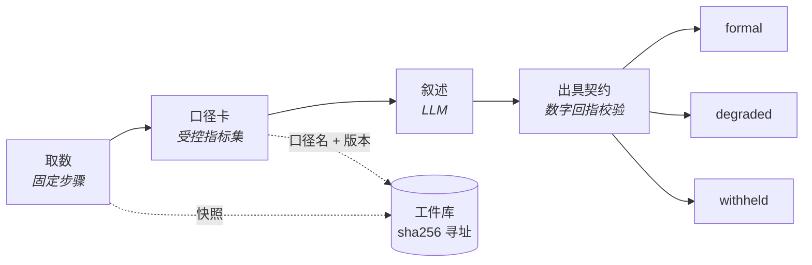

[English](../en/evidence.md) | 简体中文

# 证据与出具

这篇讲报告里的数字从哪来、怎么核对：口径卡和出具契约、三档出具、报告撰写节点的引用标记、点开一个数能看到什么、封存与核对、两种导出。给搭建者和看报告的人看。

## 基本思路

所有算术都发生在口径卡节点里，叙述只能引用，不能自己算出新数字。口径卡是受控指标集：每个指标怎么取数、怎么算，写成表达式，带口径名和版本。报告里的数字由系统照快照填进去，每一个都点得开出处。

有两个内置模板示范这条链路：

- 模板 ⑧：叙述由模型调用节点写，出口把叙述里的数字按数值回指到指标集。
- 模板 ⑨：叙述换成报告撰写节点，数字按引用填值。




## 出具契约与三档

出具契约配在 `output` 节点上，决定这份成果按哪一档出具：formal（完整出具）、degraded（降档）或 withheld（不予出具）。判定结果和缺数据声明随成果一起印出。数据不全时降档，不硬出。

### 按数值回指

契约只核对数值时，校验器从叙述里抽出全部数字，逐个回指指标集：

- 支持千分位、百分数与比率互转、千 / 万 / 亿后缀，以及按书写精度的舍入容差。
- 日期、枚举序号、引用标记不参与回指。
- 中文数字同样回指，否则换一种写法就绕过去了：成、倍、百分之、分之、一半按比例回指；「两千余」按区间 [2000, 3000] 回指。「一个问题」「十分重要」「从三个方面看」「三季度」「几十家」这类虚指、序数、季度名、结构性列举不算结论数字。

实测：Opus 5 写的正文数字全部回指成功，但结尾「（约 100 字）」里的 `100` 被判为集合外数字，触发降档。处置方式是改 prompt，不是扩大白名单——这正是校验器应有的行为。

### 按引用核对

契约写了 `report_from` 时按引用核对：取回报告文档时复验哈希、独立重算一遍，全部数字都带引用才判为完整出具。

### 指标出具

纯指标看板（契约只写 `metrics_from`，上游没有报告撰写节点，成果里也没有模型写的话）按指标出具。没有叙述可核，就核指标本身：

- 必需的指标齐不齐；
- 每个指标的输入是否追到原始数据（查询快照的格、运行输入）；
- 成果字段里的数是否都回指到指标。

受管级要求每个指标都静态地追到原始数据。

契约指标的来源查询有 SQL 检查错误时，出具降档（见[数据目录](data-catalog.md#sql-检查)）。

## 口径卡

- 表达式可以写 `cell(nodes.pull, 0, 'gmv')`，出处精确到单元格。
- 取整和缺省值交给口径卡的小数位和展示，不要写进取数 SQL（原因见[口径账本](evaluation-and-ledger.md#逐个数标口径)）。
- 受管级发布时，口径卡的输入不能来自计算角色的沙箱代码（门禁 G4）。

### 口径升版

钉住的方法卡出现新版本时，正式运行拒绝启动，直到模板显式声明升版策略：

| 策略 | 做法 |
|---|---|
| `recompute` | 回算历史 |
| `dual` | 新旧两版双印 |
| `incomparable` | 标注前后不可比 |

这里没有默认值。口径变更最容易静默出错的形态是「数字看起来都对，只是与上周不可比」。应用固定的版本升版时也要选处置，见[应用](apps.md#生成一个应用)。

## 报告撰写节点

报告撰写节点（`report`）里，模型只写引用标记，数值由系统照快照填进去。流式输出里看到的就是最终数字。

### 引用标记

```
[[m:gmv]]  [[m:gmv|万]]                    口径卡指标；换算显示也由系统完成
[[i:week]]                                 运行输入
[[v:Q1.r0.gmv]]                            查询快照里的一格，取回时复验哈希
[[table:Q1 cols=region,amount rows=0-4]]   系统照快照生成整张表，每一格都点得开
[[t:orders]]  [[c:orders.week]]            表名、字段名；写在反引号里的名字同样核对
[[q:K1|原话]]                              知识库原话，须在那次检索命中的片段里逐字出现
[[see:m:gmv,Q1]]                           结论句的依据，挂在句末，不渲染
```

### 违规怎么处理

- 裸数字、解析不了的引用当场判违规，交回去重写（`max_repairs`，默认 1 次）。
- 仍不过关时，按 `on_violation` 处理：让节点失败（正式运行的默认），或把违规标在报告里（探索运行的默认）。

## 取数链路

- agent、工具节点、代码节点、知识检索取数时都记进证据台账。报告的来源清单按台账编号：查询是 Q1…，知识库片段是 K1…。
- agent 打开 `cite_fields`（配合 `output_schema`）后，每个字段标出取自哪次查询的哪一格，再到快照里核对：对不上以快照为准并告警；查不到的记为空值，不兜底成 0。
- 代码节点的 `evidence_role`：`source` 是取数，`compute`（默认）是计算。沙箱算出来的数不能被报告直接引用，要进口径卡。
- 上传表格的单元格可以追到原表的格子（推断的来源）。
- 登记端点读回的表格也能作证（见[工具](tools.md#端点读取可以作证)）；子工作流的出处一路带回父图（见[工作流](workflows.md#子工作流)）。
- 数据源可以设遮罩列（`mask_columns`）。对搭建者、管理员和未开启登录时的所有人，遮罩只减少暴露，不是安全边界；对开了登录的使用者是边界（见[哪些角色看得到原值](identity-and-security.md#哪些角色看得到原值)）。

## 点开一个数看到什么


<sub>记录页的「证据」页签：点开「环比 8.7%」，右栏从口径卡的原式、代入式一路指到两次查询里被引用的那一格，末尾是封存核对；左下是证据清单。Mock 写不出带引用的报告，这次运行用前端测试夹具（`frontend/src/run/__tests__/evidence-query.json`，示例数据）伪造，列表里其余几条是 Mock 真跑的。</sub>

- **数字**：指标的原式、代入式和复算结果；输入与快照是否一致；查询的 SQL；被引用的行加前后各 2 行，高亮到格；最后是封存状态。只认封存范围内的事件交回过的工件。出处链最上面还有一步「口径」（见[口径账本](evaluation-and-ledger.md#逐个数标口径)）。
- **表名、字段名**：出现在哪次查询、类型、所属的表。表结构快照、SQL、结果列里都没有的名字标成可疑实体（「可能是编造的名字」，附最接近的 3 个）。快照被截断、核对不了的，只说核对不了，不冤枉成编造。
- **知识库原话**：须在那次检索命中的片段里逐字出现。

## 结论句

报告节点的 `claims` 决定怎么管结论句：

| 取值 | 做法 |
|---|---|
| `off`（默认） | 不管 |
| `require_citation` | 结论句要挂依据，没挂的计入缺口 |
| `judge` | 再请另一个模型按证据逐句判为支持 / 部分支持 / 不支持 / 不是结论 |

- 裁判只标注，不改写正文。裁判模型和写作模型相同时给警告。
- 正式运行在节点内判，判定随报告一起封存；有不支持的结论句时，按 `on_unsupported` 让出具降档或不予出具。
- 探索运行点开哪句判哪句，判定作为封存之后追加的事件记下，封存核对照样一致。
- 有上限：每份报告 40 句、$0.05、30 秒，每次点击 $0.01，每天 $2（都是默认值）。每一项都能设成不限。

## 旧运行与一键升级

- `GET /api/runs/{id}/evidence/audit` 把条目按无证据 / 可疑实体 / 有出处 / 旧运行猜测分组，可以导出 JSON 和 CSV。
- 没有契约的旧答案，按数值和已封存的查询单元格、口径卡值比对，每个数最多 3 个候选，默认折叠，写明「猜测的来源，不能当证据」。
- 老工作流可以一键升级为可追溯结构：模型调用写的报告换成报告撰写节点；问数据的 input → agent → output 中间插一个报告撰写；配了 `output_schema` 的 agent 打开 `cite_fields`。给口径卡供数的沙箱代码只建议标成 `source`，不替人改。
- 升级只给预览，人确认后才保存（升级要过发布前检查，见[工作流](workflows.md#发布前检查与修复)）。

## 封存与核对

- 每次运行的完整证据存进内容寻址的工件库（`data/artifacts/`）：sha256 就是地址，取回时复验哈希。
- 运行终态的事件清单哈希记在运行上，封存到 `run.finished` 为止。事后修改流水就对不上了。
- 在运行详情页一键核对，接口是 `GET /api/runs/{id}/verify`。
- 封存之后追加的事件不在核对范围内，例如探索运行里点开结论句的判定、口径比对的 `ledger.matched`。它们出现在时间线和可验证报告的「封存后追加」里。

## 导出

有两种导出，用途不同：要证明没被改过，用可验证报告；要让人读报告、查数字的来历，用报告导出。

**报告导出**：问数据答案和运行详情成果上的「导出」，接口 `GET /api/runs/{id}/report.html`，导出一个自包含的 HTML 文件。

- 正文由服务端渲染，不执行脚本也读得到（邮件附件预览常常不执行脚本）。
- 执行脚本后，每个数字、无证据的数字、可疑的表名字段名都点得开。面板是网页上证据面板同一个拼法的出处链（口径、来源、计算方式、SQL、被引用的行），封存状态逐项标明。
- 遮罩列照网页上的规矩写「已遮罩」。
- 没封存的运行照常导出，和在网页上读报告一个道理。

**可验证报告**：记录页「凭证详情」里的「导出可验证报告」，接口 `GET /api/runs/{id}/bundle.html`，是一份封存核对件。

- 收件人不连服务，在浏览器里重算哈希，核对每个数字、文档和运行记录没被改过。
- 数字的出处面板同样带口径、原式、代入式、输入和复算；口径卡输入指向的查询快照也随文件附带。

两种导出各记一条审计 `report.exported`。

## 复核套件

运行之外还有一组复核工具：双盲复算、反方审稿、审批质询、数字推演沙盘。双盲复算的裁决是人工步骤，可以驳回，也可以接驳回出口（见[工作流](workflows.md#驳回)）。裁判和核查的每日花费在多进程时全站一起算（见 [PostgreSQL 与多进程](postgresql-and-scaling.md#进程间一致的状态)）。
